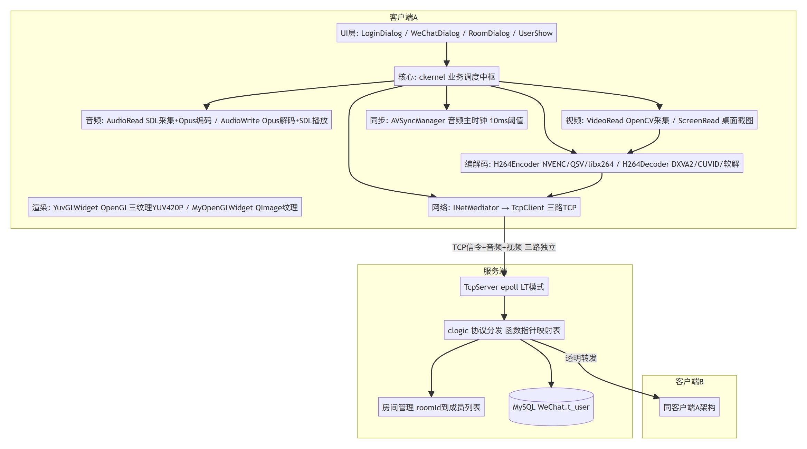
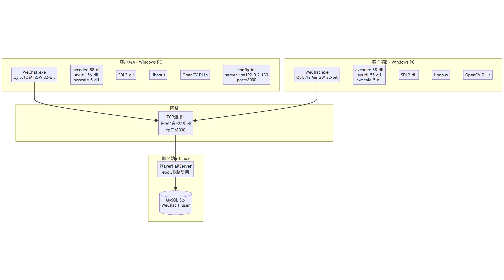

# VCC 视频会议

> **Qt + C++ 从零实现的桌面视频会议系统** —— 自定义二进制协议 · 三级音频处理 · H.264 视频链路 · Docker 一键部署

**仓库主页**：[github.com/MorningStar-hub095/vcc-video-conference](https://github.com/MorningStar-hub095/vcc-video-conference)
**客户端下载**：[Releases](https://github.com/MorningStar-hub095/vcc-video-conference/releases/latest)

---

## 它是什么 / 不是什么

| ✅ 它是 | ❌ 它不是 |
|---|---|
| 一套可运行的桌面 C/S 视频会议系统（注册登录、房间、语音、视频、桌面共享） | 网页应用 —— 没有在线 demo，客户端是 Windows 桌面程序 |
| 约 20k 行、单人从协议设计到部署运维独立完成的学习作品 | 生产级软件 —— 未做并发压测，存在已知限制，请勿商用 |
| 带完整工程化的仓库：Docker 部署、健康探针、隔离冒烟、SQL 注入回归、版本化迁移与回滚 | 微信/腾讯会议的仿制品 —— 与腾讯公司无任何关联 |

## 技术亮点

1. **自定义二进制应用层协议**：13 类包、帧格式 `[int32 小端长度][包体]`，双端补齐包长合法性校验（≤0 或 >1MB 直接丢弃），修复"异常包长可被未认证客户端耗尽内存"的缺陷。
2. **三级音频处理链路**：SDL2 采集 → WebRTC VAD 静音断流 → Opus 48kHz/VOIP 编码，另集成 Speex AEC 回声消除。
3. **视频链路**：摄像头/屏幕采集 → OpenCV 处理（含人脸检测）→ H.264 硬编码优先 + PLI 关键帧请求重传。
4. **工程化门禁**：本地 `ci-local.sh` 四步门禁与 CI 同源（编译 + 冒烟 + 注入回归）、隔离冒烟栈（生产库零污染）、bcrypt 口令散列、mTLS 双向认证 + CRL 吊销体系。

## 架构一图看懂

更多架构图（业务流程、时序、ER、状态机、数据流等 12 类 80+ 张）见仓库 [docs/架构图/](https://github.com/MorningStar-hub095/vcc-video-conference/tree/main/docs/%E6%9E%B6%E6%9E%84%E5%9B%BE)。

## 30 秒了解

- **演示视频**：待录制（将展示双端注册登录 → 建房进房 → 音频互通 → 视频互通 → 桌面共享的完整 60~90 秒流程）
- **快速体验**：下载 [Release](https://github.com/MorningStar-hub095/vcc-video-conference/releases/latest) 中的客户端 zip → 解压 → 修改 `config.ini` 里的 `ip` 为你部署的服务端地址 → 双击启动
- **服务端部署**：`cd deploy && cp .env.example .env（填写口令）&& ./deploy.sh`，详见 [README · 部署](https://github.com/MorningStar-hub095/vcc-video-conference#部署)

## 我做了什么

从协议设计、客户端音视频链路、服务端 epoll 转发、数据库安全，到容器化部署、
冒烟门禁与回滚体系，全部独立完成（约 20k 行自研代码 + 2.5 万行 BSD 第三方源码集成）。
完整技术细节见仓库 [README](https://github.com/MorningStar-hub095/vcc-video-conference#readme) 与 [NOTICE](https://github.com/MorningStar-hub095/vcc-video-conference/blob/main/NOTICE)。

---

*本页由 GitHub Pages 从仓库 `docs/` 目录自动构建。项目采用 [MIT](https://github.com/MorningStar-hub095/vcc-video-conference/blob/main/LICENSE) 许可证，详见[免责声明](https://github.com/MorningStar-hub095/vcc-video-conference/blob/main/NOTICE)。*
