# WeChat 音视频会议系统 - 项目类图（完整重构版）

> **文档版本：** v2.1
> **最后更新：** 2026-08-01
> **更新说明：** 新增 WebRTC VAD 静音检测（动态阈值/状态平滑/UI联动）相关成员与方法
> **重构说明：** 基于源码头文件全面重构，完整标注每个类的属性（名称、类型、可见性）和方法（名称、参数、返回值、可见性），使用标准 UML 符号标识所有类间关系。

---

## 一、整体架构分层

```
┌─────────────────────────────────────────────────────────────────────────────┐
│                          UI 层（Qt Widgets 用户界面）                         │
│  LoginDialog(QDialog)  WeChatDialog(QDialog)  RoomDialog(QDialog)           │
│  UserShow(QWidget)     MyOpenGLWidget(QOpenGLWidget)                        │
├─────────────────────────────────────────────────────────────────────────────┤
│                       核心调度层（业务中枢 - 单例模式）                         │
│                              ckernel(QObject)                               │
│  协议映射表 PFUN m_netPackMap[100] │ 三路TCP连接 │ 模块生命周期管理            │
├──────────┬──────────┬───────────┬──────────┬────────────────────────────────┤
│  音频层   │  视频采集层│ 视频编解码层│  渲染层   │    同步层                     │
│AudioRead │VideoRead │H264Encoder│YuvGLWidget│  AVSyncManager(单例)          │
│AudioWrite│ScreenRead│H264Decoder│MyOpenGLW │  SyncContext(结构体)           │
│(SDL+Opus)│(OpenCV)  │(FFmpeg)   │(OpenGL)   │  (音频主时钟策略)               │
├──────────┴──────────┴───────────┴──────────┴────────────────────────────────┤
│                    网络传输层（接口抽象 + 中介者模式）                          │
│  INet(抽象接口) ──实现── TcpClient / TcpServer / UdpNet                     │
│  INetMediator(抽象中介者) ──继承── TcpClientMed / TcpServerMed / UdpMed     │
├─────────────────────────────────────────────────────────────────────────────┤
│                         工具/协议层                                          │
│  ThreadWorker(QObject)  SendVideoWorker  MD5  packdef.h(协议结构体)         │
└─────────────────────────────────────────────────────────────────────────────┘
```

### UML 关系符号说明

| 符号 | 关系类型 | 说明 |
|------|---------|------|
| `<|--` | 继承（泛化） | 子类继承父类，实线空心三角 |
| `<|..` | 实现（接口） | 类实现接口，虚线空心三角 |
| `*--` | 组合（Composition） | 强拥有关系，部分随整体创建/销毁，实线实心菱形 |
| `o--` | 聚合（Aggregation） | 弱拥有关系，部分可独立于整体存在，实线空心菱形 |
| `-->` | 关联（Association） | 类之间有结构关系，实线箭头 |
| `..>` | 依赖（Dependency） | 类之间有使用关系，虚线箭头 |

### 可见性符号说明

| 符号 | 可见性 | 说明 |
|------|--------|------|
| `+` | public | 公有访问 |
| `-` | private | 私有访问 |
| `#` | protected | 受保护访问 |

---

## 二、完整类图（Mermaid 格式）

### 2.1 核心调度层

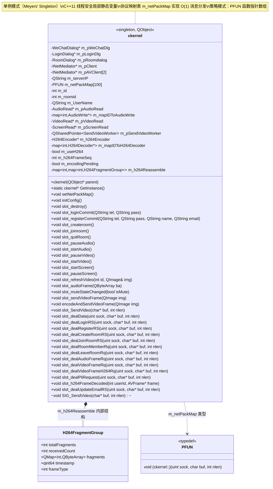

### 2.2 网络传输层（接口抽象 + 中介者模式）

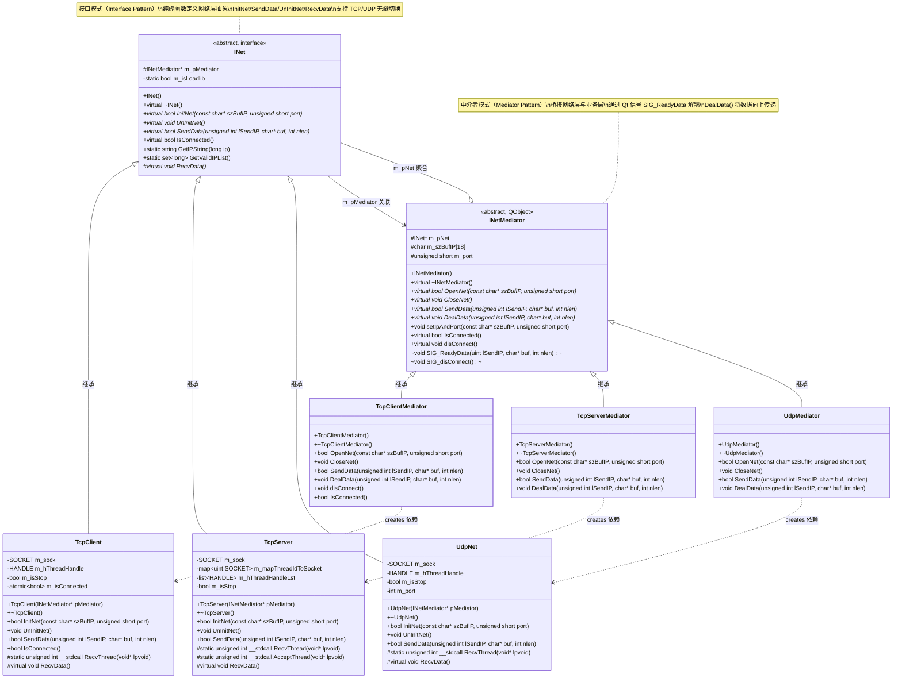

### 2.3 音频层（SDL2 + Opus）

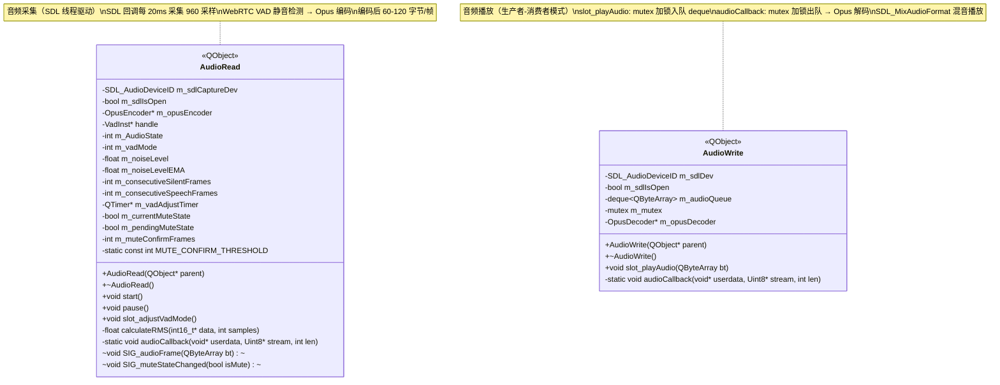

### 2.4 视频采集层（OpenCV + Qt Screen）

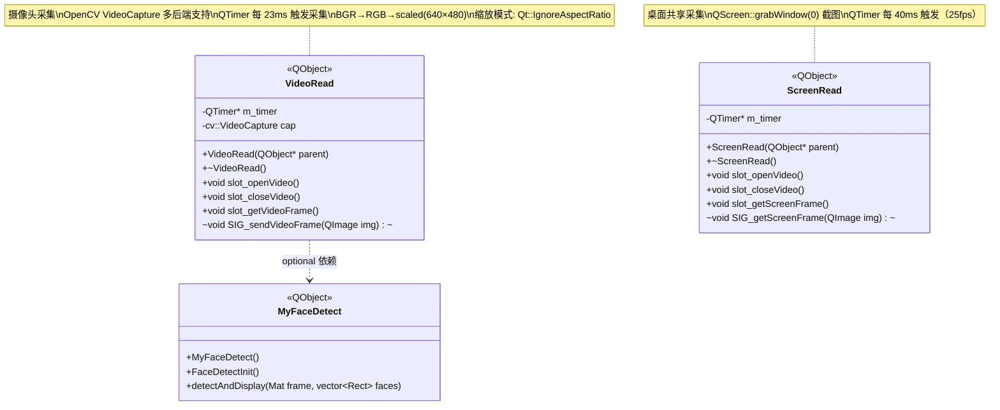

### 2.5 视频编解码层（FFmpeg H.264）

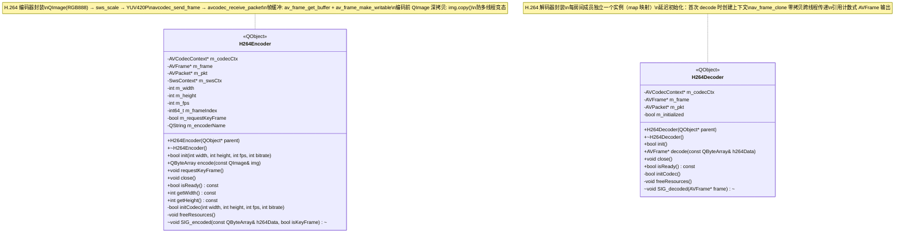

### 2.6 渲染层（OpenGL）

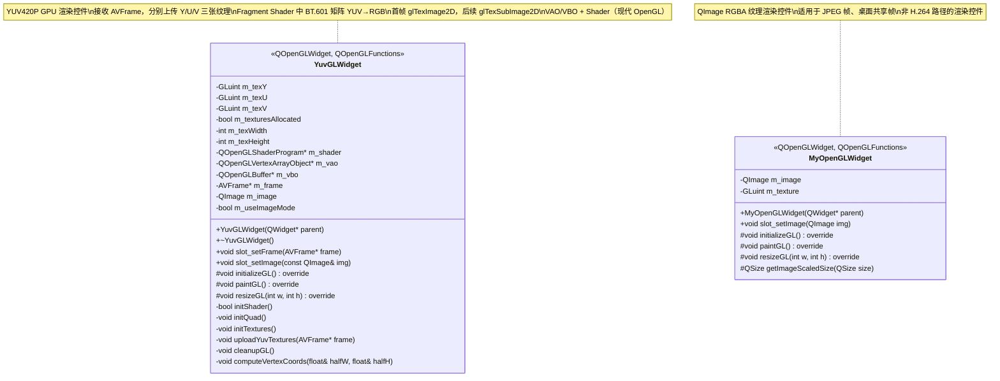

### 2.7 音视频同步层（单例模式）

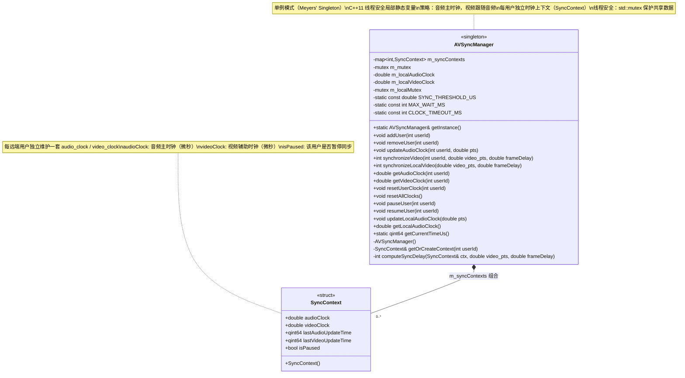

### 2.8 UI 层

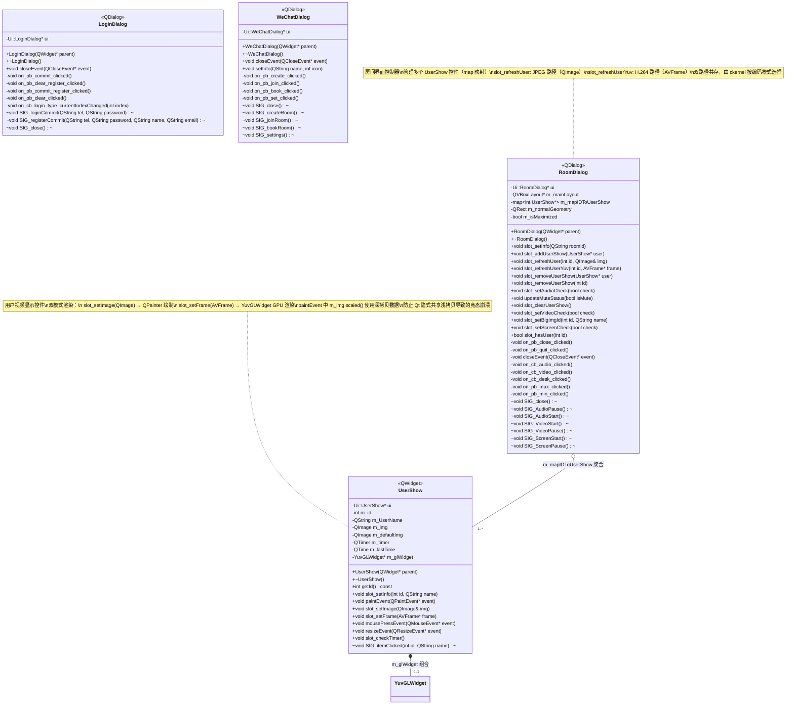

### 2.9 工具/线程层

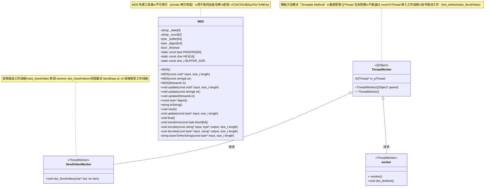

---

## 三、完整类关系总图

```mermaid
classDiagram
    direction TB

    %% ===== 核心调度层 =====
    class ckernel {
        <<singleton, QObject>>
        -INetMediator* m_pClient
        -INetMediator* m_pAVClient[2]
        -WeChatDialog* m_pWeChatDlg
        -LoginDialog* m_pLoginDlg
        -RoomDialog* m_pRoomdialog
        -AudioRead* m_pAudioRead
        -map~int,AudioWrite*~ m_mapIDToAudioWrite
        -VideoRead* m_pVideoRead
        -ScreenRead* m_pScreenRead
        -H264Encoder* m_h264Encoder
        -map~int,H264Decoder*~ m_mapIDToH264Decoder
        -QSharedPointer~SendVideoWorker~ m_pSendVideoWorker
        -bool m_useH264
        -int m_h264FrameSeq
        -bool m_encodingPending
        -PFUN m_netPackMap[100]
        -int m_id
        -int m_roomid
        -QString m_UserName
        -QString m_serverIP
        +static ckernel* GetInstance()
        +void slot_muteStateChanged(bool isMute)
        +void slot_sendVideoFrame(QImage img)
        +void encodeAndSendVideoFrame(QImage img)
        +void slot_dealData(uint sock, char* buf, int nlen)
        +void slot_dealVideoFrameH264Rq(uint sock, char* buf, int nlen)
        +void slot_dealPliRequest(uint sock, char* buf, int nlen)
        +void slot_h264FrameDecoded(int userId, AVFrame* frame)
    }

    %% ===== 网络层 =====
    class INet {
        <<abstract>>
        #INetMediator* m_pMediator
        +virtual bool InitNet(const char*, unsigned short)*
        +virtual void UnInitNet()*
        +virtual bool SendData(uint, char*, int)*
        #virtual void RecvData()*
    }
    class TcpClient {
        -SOCKET m_sock
        -atomic~bool~ m_isConnected
        +bool InitNet(const char*, unsigned short)
        +bool SendData(uint, char*, int)
    }
    class INetMediator {
        <<abstract, QObject>>
        #INet* m_pNet
        +virtual bool OpenNet(const char*, unsigned short)*
        +virtual void CloseNet()*
        +virtual bool SendData(uint, char*, int)*
        ~void SIG_ReadyData(uint, char*, int)~
    }
    class TcpClientMediator {
        +bool OpenNet(const char*, unsigned short)
        +bool SendData(uint, char*, int)
        +bool IsConnected()
    }

    %% ===== 音频层 =====
    class AudioRead {
        <<QObject>>
        -OpusEncoder* m_opusEncoder
        -VadInst* handle
        -int m_vadMode
        -QTimer* m_vadAdjustTimer
        +void start()
        +void pause()
        +void slot_adjustVadMode()
        ~void SIG_audioFrame(QByteArray)~
        ~void SIG_muteStateChanged(bool)~
    }
    class AudioWrite {
        <<QObject>>
        -OpusDecoder* m_opusDecoder
        -deque~QByteArray~ m_audioQueue
        -mutex m_mutex
        +void slot_playAudio(QByteArray)
    }

    %% ===== 视频采集层 =====
    class VideoRead {
        <<QObject>>
        -cv::VideoCapture cap
        +void slot_getVideoFrame()
        ~void SIG_sendVideoFrame(QImage)~
    }
    class ScreenRead {
        <<QObject>>
        +void slot_getScreenFrame()
        ~void SIG_getScreenFrame(QImage)~
    }

    %% ===== 视频编解码层 =====
    class H264Encoder {
        <<QObject>>
        -AVCodecContext* m_codecCtx
        -AVFrame* m_frame
        -SwsContext* m_swsCtx
        +bool init(int, int, int, int)
        +QByteArray encode(const QImage&)
        +void requestKeyFrame()
    }
    class H264Decoder {
        <<QObject>>
        -AVCodecContext* m_codecCtx
        -AVFrame* m_frame
        +AVFrame* decode(const QByteArray&)
        +bool isReady() const
    }

    %% ===== 渲染层 =====
    class YuvGLWidget {
        <<QOpenGLWidget>>
        -GLuint m_texY, m_texU, m_texV
        -QOpenGLShaderProgram* m_shader
        -AVFrame* m_frame
        +void slot_setFrame(AVFrame*)
        +void slot_setImage(const QImage&)
        #void paintGL()
    }
    class MyOpenGLWidget {
        <<QOpenGLWidget>>
        -QImage m_image
        -GLuint m_texture
        +void slot_setImage(QImage)
        #void paintGL()
    }

    %% ===== 同步层 =====
    class AVSyncManager {
        <<singleton>>
        -map~int,SyncContext~ m_syncContexts
        -mutex m_mutex
        +static AVSyncManager& getInstance()
        +int synchronizeVideo(int, double, double)
        +void updateAudioClock(int, double)
    }
    class SyncContext {
        <<struct>>
        +double audioClock
        +double videoClock
        +bool isPaused
    }

    %% ===== UI 层 =====
    class LoginDialog {
        <<QDialog>>
        ~void SIG_loginCommit(QString, QString)~
        ~void SIG_registerCommit(QString, QString, QString, QString)~
    }
    class WeChatDialog {
        <<QDialog>>
        ~void SIG_createRoom()~
        ~void SIG_joinRoom()~
    }
    class RoomDialog {
        <<QDialog>>
        -map~int,UserShow*~ m_mapIDToUserShow
        +void slot_addUserShow(UserShow*)
        +void slot_refreshUserYuv(int, AVFrame*)
        +void updateMuteStatus(bool isMute)
    }
    class UserShow {
        <<QWidget>>
        -QImage m_img
        -YuvGLWidget* m_glWidget
        +void slot_setImage(QImage&)
        +void slot_setFrame(AVFrame*)
    }

    %% ===== 工具层 =====
    class ThreadWorker {
        <<QObject>>
        #QThread* m_pThread
    }
    class SendVideoWorker {
        <<ThreadWorker>>
        +void slot_SendVideo(char*, int)
    }
    class MD5 {
        +string toString()
        +void update(const string&)
    }

    %% ===== 继承关系 =====
    INet <|-- TcpClient
    INetMediator <|-- TcpClientMediator
    ThreadWorker <|-- SendVideoWorker

    %% ===== 聚合/组合关系 =====
    INetMediator o-- INet : m_pNet
    ckernel o-- "1" INetMediator : m_pClient 信令连接
    ckernel o-- "2" INetMediator : m_pAVClient 音视频连接
    ckernel o-- "1" LoginDialog : m_pLoginDlg
    ckernel o-- "1" WeChatDialog : m_pWeChatDlg
    ckernel o-- "1" RoomDialog : m_pRoomdialog
    ckernel o-- "1" AudioRead : m_pAudioRead
    ckernel o-- "0..*" AudioWrite : m_mapIDToAudioWrite
    ckernel o-- "1" VideoRead : m_pVideoRead
    ckernel o-- "1" ScreenRead : m_pScreenRead
    ckernel o-- "1" H264Encoder : m_h264Encoder
    ckernel o-- "0..*" H264Decoder : m_mapIDToH264Decoder
    ckernel o-- "1" SendVideoWorker : m_pSendVideoWorker
    RoomDialog o-- "1..*" UserShow : m_mapIDToUserShow
    UserShow *-- "0..1" YuvGLWidget : m_glWidget
    AVSyncManager *-- "0..*" SyncContext : m_syncContexts

    %% ===== 依赖关系 =====
    ckernel ..> AVSyncManager : singleton 访问
    ckernel ..> MD5 : 密码哈希
    TcpClientMediator ..> TcpClient : creates
    ckernel ..> H264Encoder : 编码调度
    ckernel ..> H264Decoder : 解码管理

    note for ckernel "ckernel 是系统业务中枢，采用单例模式\n通过协议映射表 m_netPackMap 实现 O(1) 消息分发\n持有三路独立 TCP 连接（信令+音频+视频）\n管理所有子模块的生命周期"
```

---

## 四、协议结构体定义

```mermaid
classDiagram
    direction TB

    class STRU_REGISTER_RQ {
        <<struct>>
        +PackType m_nType
        +char m_tel[60]
        +char m_name[60]
        +char m_password[60]
        +char m_email[60]
    }

    class STRU_REGISTER_RS {
        <<struct>>
        +PackType m_nType
        +int m_lresult
    }

    class STRU_LOGIN_RQ {
        <<struct>>
        +PackType m_nType
        +char m_tel[40]
        +char m_password[40]
    }

    class STRU_LOGIN_RS {
        <<struct>>
        +PackType m_nType
        +int m_userid
        +int m_lresult
        +char m_name[60]
    }

    class STRU_CREATEROOM_RQ {
        <<struct>>
        +PackType m_nType
        +int m_UserID
    }

    class STRU_CREATEROOM_RS {
        <<struct>>
        +PackType m_nType
        +int m_RoomID
        +int m_lresult
    }

    class STRU_JOINROOM_RQ {
        <<struct>>
        +PackType m_nType
        +int m_UserID
        +int m_RoomID
    }

    class STRU_JOINROOM_RS {
        <<struct>>
        +PackType m_nType
        +int m_RoomID
        +int m_lresult
    }

    class STRU_ROOM_MEMBER_RQ {
        <<struct>>
        +PackType m_nType
        +int m_UserID
        +char m_szUser[60]
    }

    class STRU_LEAVEROOM_RQ {
        <<struct>>
        +PackType m_nType
        +int m_nUserID
        +int m_RoomID
        +char szUserName[60]
    }

    class STRU_AUDIO_REGISTER {
        <<struct>>
        +PackType m_nType
        +int m_userid
    }

    class STRU_VIDEO_REGISTER {
        <<struct>>
        +PackType m_nType
        +int m_userid
    }

    class STRU_UPDATE_EMAIL_RQ {
        <<struct>>
        +PackType m_nType
        +int m_userid
        +char m_email[60]
    }

    class STRU_UPDATE_EMAIL_RS {
        <<struct>>
        +PackType m_nType
        +int m_lresult
    }

    class STRU_VIDEO_FRAME_H264_HEADER {
        <<struct>>
        +PackType m_nType
        +int m_userid
        +int m_roomid
        +int m_min
        +int m_sec
        +int m_msec
        +int m_frameType
        +int m_frameSeq
        +int m_totalFragments
        +int m_fragmentIndex
    }

    class STRU_PLI_REQUEST {
        <<struct>>
        +PackType m_nType
        +int m_userid
        +int m_roomid
    }

    class UserInfo {
        <<struct>>
        +int m_sock
        +int m_id
        +int m_roomid
        +char m_userName[60]
    }

    note for STRU_VIDEO_FRAME_H264_HEADER "H.264 分片传输包头\nframeType: 0=I帧, 1=P帧\nframeSeq: 帧序号（同一帧多片共享）\ntotalFragments: 总分片数\nfragmentIndex: 当前分片（0-based）\n后接 char m_h264Data[] 可变长数据\n分片大小: H264_FRAGMENT_SIZE=4096字节"
```

---

## 五、关键业务流程 - 信号槽交互路径

### 5.1 用户登录流程

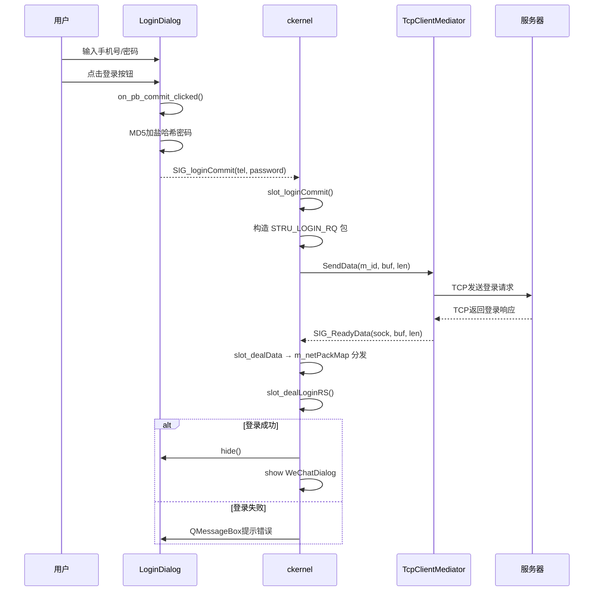

### 5.2 创建/加入房间流程

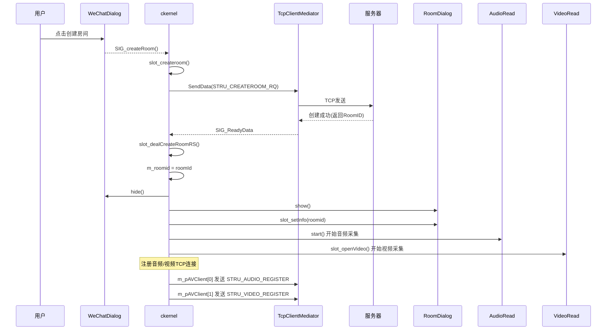

### 5.3 音频采集到播放全链路

```mermaid
sequenceDiagram
    participant SDL_IN as SDL采集线程
    participant AR as AudioRead
    participant CK as ckernel
    participant RD as RoomDialog
    participant NET as 音频TCP连接
    participant SVR as 服务器
    participant CK2 as 远端ckernel
    participant AW as AudioWrite
    participant SDL_OUT as SDL播放线程

    SDL_IN->>AR: audioCallback(stream, 1920字节)
    AR->>AR: WebRTC VAD检测(返回0=静音/1=有声/-1=错误)
    AR->>AR: calculateRMS 更新 m_noiseLevel
    AR->>AR: 状态平滑(连续3帧≈60ms确认)
    alt 静音状态切换
        AR-->>CK: SIG_muteStateChanged(isMute)
        CK->>CK: slot_muteStateChanged()
        CK->>RD: updateMuteStatus(isMute)
        RD->>RD: cb_audio 显示 音频(无声)/音频
    end
    AR->>AR: 静音帧 memset 清零(配合Opus DTX)
    AR->>AR: opus_encode(960samples → 60-120字节)
    AR-->>CK: SIG_audioFrame(QByteArray)
    CK->>CK: slot_audioFrame()
    CK->>CK: 构造 STRU_AUDIO_FRAME 包
    CK->>CK: AVSyncManager::updateLocalAudioClock(pts)
    CK->>NET: m_pAVClient[audio_client] SendData()
    NET->>SVR: TCP音频连接发送
    SVR-->>CK2: 透明转发
    CK2->>CK2: slot_dealAudioFrameRq()
    CK2->>CK2: AVSyncManager::updateAudioClock(userId, pts)
    CK2-->>AW: slot_playAudio(opusData)
    AW->>AW: mutex加锁 入队 m_audioQueue
    SDL_OUT->>AW: audioCallback()
    AW->>AW: mutex加锁 出队
    AW->>AW: opus_decode(60-120字节 → 1920字节PCM)
    AW->>AW: SDL_MixAudioFormat() 混音播放

    Note over AR: 并行支路: QTimer每5秒触发 slot_adjustVadMode
    Note over AR: 按噪声EMA自适应切换VAD模式(1=宽松/2=中等/3=严格)
```

### 5.4 视频采集到渲染全链路

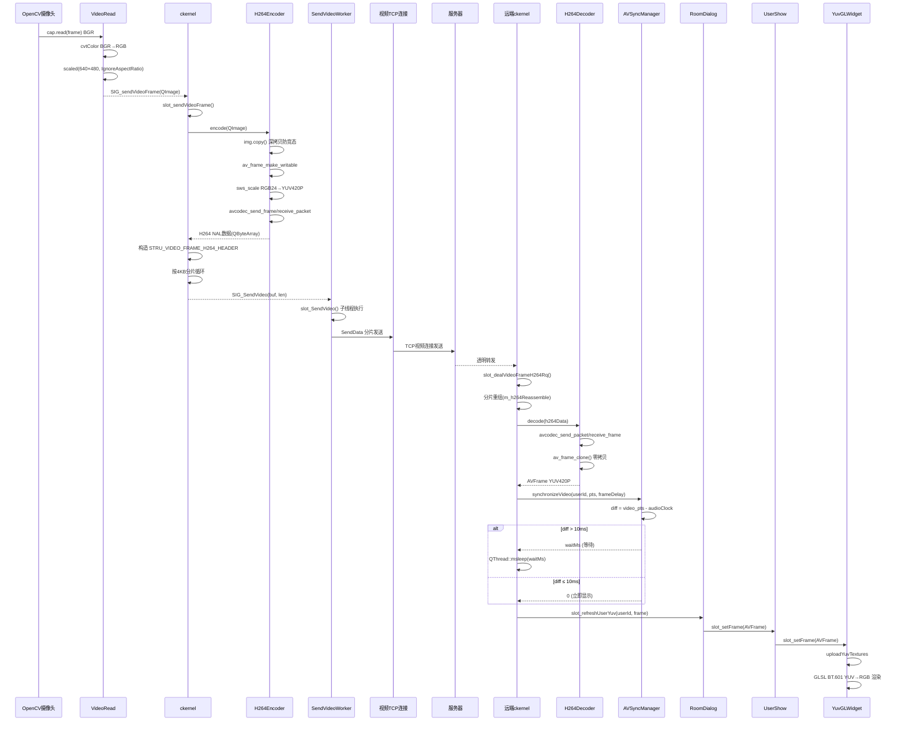

### 5.5 PLI 关键帧请求流程

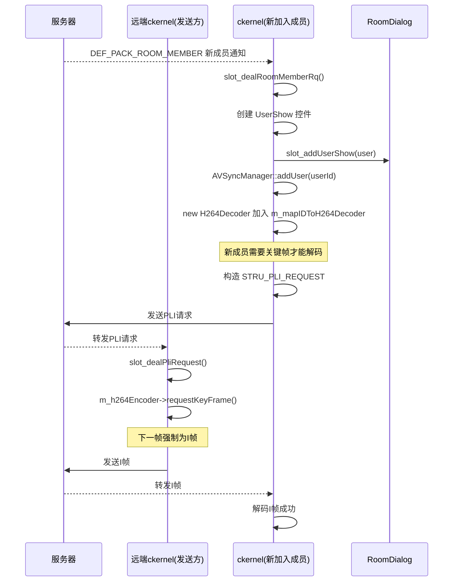

---

## 六、设计模式总结

| 设计模式 | 应用位置 | 具体实现 | UML 关系 | 说明 |
|---------|---------|---------|---------|------|
| **接口模式** | INet → TcpClient/TcpServer/UdpNet | 纯虚函数 InitNet/SendData/UnInitNet/RecvData | `INet <|-- TcpClient` | 网络层抽象，支持 TCP/UDP 无缝切换 |
| **中介者模式** | INetMediator → TcpClientMediator 等 | DealData() 桥接网络层与业务层 | `INetMediator o-- INet` | Qt 信号 SIG_ReadyData 解耦网络与业务 |
| **单例模式** | ckernel::GetInstance() | Meyers 单例（C++11 线程安全局部静态变量） | `ckernel ..> ckernel` | 全局唯一业务中枢 |
| **单例模式** | AVSyncManager::getInstance() | Meyers 单例（C++11 线程安全） | `AVSyncManager ..> AVSyncManager` | 全局唯一同步管理器 |
| **观察者模式** | Qt 信号槽机制 | connect(sender, SIGNAL, receiver, SLOT) | `-->> SIG_xxx` | 模块间松耦合通信 |
| **策略模式** | m_netPackMap[100] 协议映射表 | PFUN 函数指针数组，O(1) 消息分发 | `ckernel ..> PFUN` | m_netPackMap[type - 10000] = slot_dealXxx |
| **生产者-消费者** | AudioWrite::m_audioQueue | std::deque + std::mutex | `AudioWrite *-- m_audioQueue` | SDL 回调线程消费，Qt 主线程生产 |
| **模板方法** | ThreadWorker → SendVideoWorker | 基类管理 QThread 生命周期 | `ThreadWorker <|-- SendVideoWorker` | moveToThread + 信号驱动工作 |
| **零拷贝** | H264Decoder::decode() → AVFrame | av_frame_clone 引用计数 | `H264Decoder ..> AVFrame` | 跨线程传递不复制像素数据 |
| **组合模式** | AVSyncManager → SyncContext | 每用户独立同步上下文 | `AVSyncManager *-- SyncContext` | 部分随整体创建/销毁 |

---

## 七、协议类型常量表

| 常量名 | 值 | 方向 | 对应结构体 | 说明 |
|--------|-----|------|-----------|------|
| DEF_PACK_REGISTER_RQ | 10000 | C→S | STRU_REGISTER_RQ | 注册请求 |
| DEF_PACK_REGISTER_RS | 10001 | S→C | STRU_REGISTER_RS | 注册响应 |
| DEF_PACK_LOGIN_RQ | 10002 | C→S | STRU_LOGIN_RQ | 登录请求 |
| DEF_PACK_LOGIN_RS | 10003 | S→C | STRU_LOGIN_RS | 登录响应 |
| DEF_PACK_CREATEROOM_RQ | 10004 | C→S | STRU_CREATEROOM_RQ | 创建房间请求 |
| DEF_PACK_CREATEROOM_RS | 10005 | S→C | STRU_CREATEROOM_RS | 创建房间响应 |
| DEF_PACK_JOINROOM_RQ | 10006 | C→S | STRU_JOINROOM_RQ | 加入房间请求 |
| DEF_PACK_JOINROOM_RS | 10007 | S→C | STRU_JOINROOM_RS | 加入房间响应 |
| DEF_PACK_ROOM_MEMBER | 10008 | S→C | STRU_ROOM_MEMBER_RQ | 房间成员通知 |
| DEF_PACK_AUDIO_FRAME | 10009 | C→S→C | (内联结构) | 音频帧(转发) |
| DEF_PACK_VIDEO_FRAME | 10010 | C→S→C | (内联结构) | 视频帧-JPEG(转发) |
| DEF_PACK_LEAVEROOM_RQ | 10011 | C→S | STRU_LEAVEROOM_RQ | 离开房间请求 |
| DEF_PACK_LEAVEROOM_RS | 10012 | S→C | STRU_ROOM_MEMBER_RQ | 离开房间通知 |
| DEF_PACK_AUDIO_REGISTER | 10013 | C→S | STRU_AUDIO_REGISTER | 音频通道注册 |
| DEF_PACK_VIDEO_REGISTER | 10014 | C→S | STRU_VIDEO_REGISTER | 视频通道注册 |
| DEF_PACK_UPDATE_EMAIL_RQ | 10015 | C→S | STRU_UPDATE_EMAIL_RQ | 补全邮箱请求 |
| DEF_PACK_UPDATE_EMAIL_RS | 10016 | S→C | STRU_UPDATE_EMAIL_RS | 补全邮箱响应 |
| DEF_PACK_VIDEO_FRAME_H264 | 10017 | C→S→C | STRU_VIDEO_FRAME_H264_HEADER | 视频帧-H264(转发) |
| DEF_PACK_PLI_REQUEST | 10018 | C→S→C | STRU_PLI_REQUEST | PLI关键帧请求 |
| DEF_PACK_VIDEO_SPSPPS | 10019 | C→S→C | (可选) | H264 SPS/PPS参数集 |

---

## 八、类间关系完整说明

### 8.1 继承关系（泛化）

| 父类 | 子类 | 说明 |
|------|------|------|
| INet | TcpClient | TCP 客户端实现 |
| INet | TcpServer | TCP 服务端实现 |
| INet | UdpNet | UDP 网络实现 |
| INetMediator | TcpClientMediator | TCP 客户端中介者 |
| INetMediator | TcpServerMediator | TCP 服务端中介者 |
| INetMediator | UdpMediator | UDP 中介者 |
| ThreadWorker | SendVideoWorker | 视频发送工作线程 |
| ThreadWorker | worker | 示例工作线程 |
| QObject | ckernel, AudioRead, AudioWrite, VideoRead, ScreenRead, H264Encoder, H264Decoder, INetMediator, ThreadWorker | Qt 对象基类 |
| QDialog | LoginDialog, WeChatDialog, RoomDialog | Qt 对话框基类 |
| QWidget | UserShow | Qt 窗口部件基类 |
| QOpenGLWidget | YuvGLWidget, MyOpenGLWidget | Qt OpenGL 控件基类 |

### 8.2 聚合关系（Aggregation - 弱拥有）

| 聚合方 | 被聚合方 | 多重性 | 说明 |
|--------|---------|--------|------|
| ckernel | INetMediator (m_pClient) | 1 | 信令 TCP 连接 |
| ckernel | INetMediator (m_pAVClient) | 2 | 音频+视频 TCP 连接 |
| ckernel | LoginDialog | 1 | 登录对话框 |
| ckernel | WeChatDialog | 1 | 主界面对话框 |
| ckernel | RoomDialog | 1 | 房间对话框 |
| ckernel | AudioRead | 1 | 音频采集器 |
| ckernel | AudioWrite | 0..* | 音频播放器（每成员一个） |
| ckernel | VideoRead | 1 | 摄像头采集器 |
| ckernel | ScreenRead | 1 | 桌面共享采集器 |
| ckernel | H264Encoder | 1 | H264 编码器 |
| ckernel | H264Decoder | 0..* | H264 解码器（每成员一个） |
| ckernel | SendVideoWorker | 1 | 视频发送工作线程 |
| INetMediator | INet | 1 | 网络底层实现 |
| RoomDialog | UserShow | 1..* | 用户显示控件（每成员一个） |

### 8.3 组合关系（Composition - 强拥有）

| 组合方 | 被组合方 | 多重性 | 说明 |
|--------|---------|--------|------|
| UserShow | YuvGLWidget | 0..1 | YUV 渲染控件（延迟创建） |
| AVSyncManager | SyncContext | 0..* | 同步上下文（每用户一个） |
| ckernel | H264FragmentGroup | 0..* | 分片重组缓冲区（内部结构体） |

### 8.4 依赖关系（Dependency - 使用）

| 依赖方 | 被依赖方 | 说明 |
|--------|---------|------|
| ckernel | AVSyncManager | 单例访问同步管理器 |
| ckernel | MD5 | 密码加盐哈希 |
| TcpClientMediator | TcpClient | 创建 TcpClient 实例 |
| TcpServerMediator | TcpServer | 创建 TcpServer 实例 |
| UdpMediator | UdpNet | 创建 UdpNet 实例 |
| VideoRead | MyFaceDetect | 可选人脸检测 |
| ckernel | H264Encoder | 编码调度 |
| ckernel | H264Decoder | 解码管理 |

### 8.5 关联关系（Association - 结构关系）

| 关联方 | 被关联方 | 说明 |
|--------|---------|------|
| INet | INetMediator | m_pMediator 反向关联中介者 |

---

## 九、关键设计说明

### 9.1 三路 TCP 连接架构

```
ckernel
  ├── m_pClient (信令连接) ──→ TcpClientMediator ──→ TcpClient ──→ 服务器:8000
  │     用途: 登录/注册/房间管理/成员通知
  │     特点: 低频小包，要求即时响应
  │
  ├── m_pAVClient[0] (音频连接) ──→ TcpClientMediator ──→ TcpClient ──→ 服务器:8000
  │     用途: Opus 音频帧转发
  │     特点: 高频小包（50帧/秒），要求低延迟
  │
  └── m_pAVClient[1] (视频连接) ──→ TcpClientMediator ──→ TcpClient ──→ 服务器:8000
        用途: H264 视频帧分片转发
        特点: 中频大包（30帧/秒，4KB/分片），要求高吞吐
```

> **设计说明：** 三路 TCP 连接分离信令与媒体流，避免大视频帧阻塞信令通道。每路连接独立的 TcpClientMediator 实例，通过 SIG_ReadyData 信号统一汇入 ckernel::slot_dealData 处理。

### 9.2 双路径视频渲染架构

```
ckernel::slot_sendVideoFrame(QImage)
  │
  ├── H264 路径（m_useH264 = true）
  │     ├── H264Encoder::encode(QImage) → QByteArray
  │     ├── 按 4KB 分片 → STRU_VIDEO_FRAME_H264_HEADER + h264Data
  │     ├── SendVideoWorker 子线程发送
  │     └── 接收端: H264Decoder::decode → AVFrame → YuvGLWidget GPU 渲染
  │
  └── JPEG 路径（m_useH264 = false，兼容回退）
        ├── QImage::save("JPG") → QByteArray
        ├── STRU_VIDEO_FRAME + jpegData
        └── 接收端: slot_refreshUser(QImage) → QPainter CPU 渲染
```

> **设计说明：** H264 路径使用 GPU 加速渲染（YuvGLWidget + OpenGL Shader），JPEG 路径使用 CPU 软渲染（QPainter）。UserShow 控件通过 m_glWidget 的可见性自动切换渲染路径。

### 9.3 QImage 隐式共享线程安全

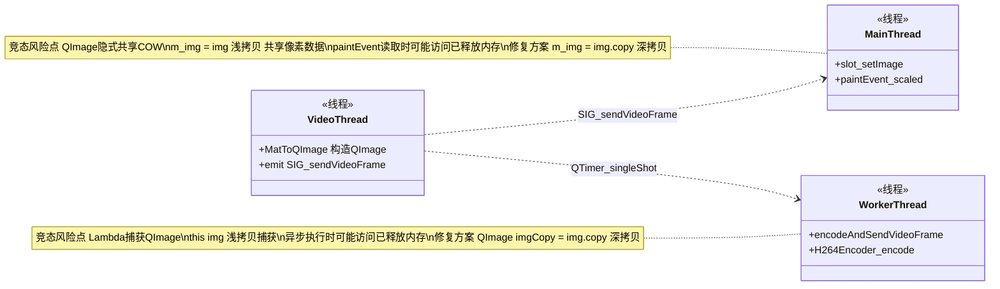

> **设计说明：** Qt 的 QImage 采用隐式共享（Copy-On-Write）机制，赋值操作是浅拷贝。在三线程架构（Video/Main/Worker）中，浅拷贝会导致竞态条件：paintEvent 读取像素数据时，原始 QImage 可能已被销毁。修复方案是在 slot_setImage 和 Lambda 捕获前使用 `img.copy()` 强制深拷贝。

### 9.4 FFmpeg 帧缓冲区管理

```
H264Encoder::encode(QImage) 流程：
  │
  ├── 1. QImage 深拷贝：img.copy() → 独立像素数据
  ├── 2. av_frame_make_writable(m_frame) → 确保 YUV 帧缓冲区可写
  ├── 3. sws_scale(m_swsCtx, RGB→YUV420P) → 色彩空间转换
  ├── 4. avcodec_send_frame(m_codecCtx, m_frame) → 发送帧到编码器
  └── 5. avcodec_receive_packet(m_codecCtx, m_pkt) → 接收编码后的包

H264Decoder::decode(QByteArray) 流程：
  │
  ├── 1. avcodec_send_packet(m_codecCtx, m_pkt) → 发送包到解码器
  ├── 2. avcodec_receive_frame(m_codecCtx, m_frame) → 接收解码后的帧
  └── 3. av_frame_clone(m_frame) → 引用计数 +1，零拷贝跨线程传递
```

> **设计说明：** 编码器使用 `av_frame_get_buffer` + `av_frame_make_writable` 标准组合管理帧缓冲区，支持引用计数。解码器使用 `av_frame_clone` 实现零拷贝跨线程传递，避免像素数据复制开销。

---

> **文档版本：** v2.1
> **最后更新：** 2026-08-01
> **更新说明：** 新增 WebRTC VAD 静音检测（动态阈值/状态平滑/UI联动）相关成员与方法
> **数据来源：** 源码头文件静态分析（ckernel.h, INet.h, TcpClient.h, INetMediator.h, audioread.h, audiowrite.h, videoread.h, screenread.h, h264encoder.h, h264decoder.h, yuvglwidget.h, myopenglwidget.h, AVSyncManager.h, threadworker.h, md5.h, roomdialog.h, usershow.h, logindialog.h, wechatdialog.h, packdef.h）
> **重构内容：** 基于源码头文件全面重构类图，完整标注每个类的属性（名称、类型、可见性）和方法（名称、参数、返回值、可见性），使用标准 UML 符号标识所有类间关系（继承、实现、关联、聚合、组合、依赖），添加设计模式注释和关键设计说明。
