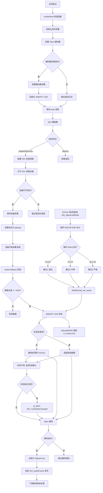
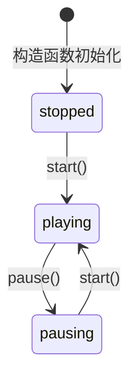
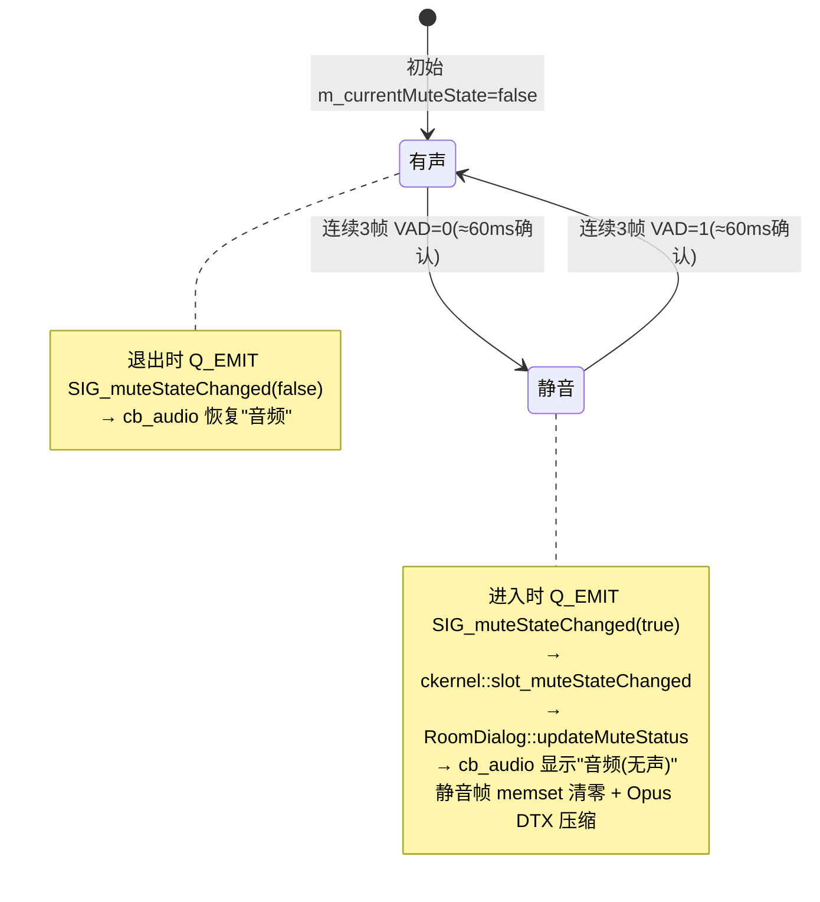
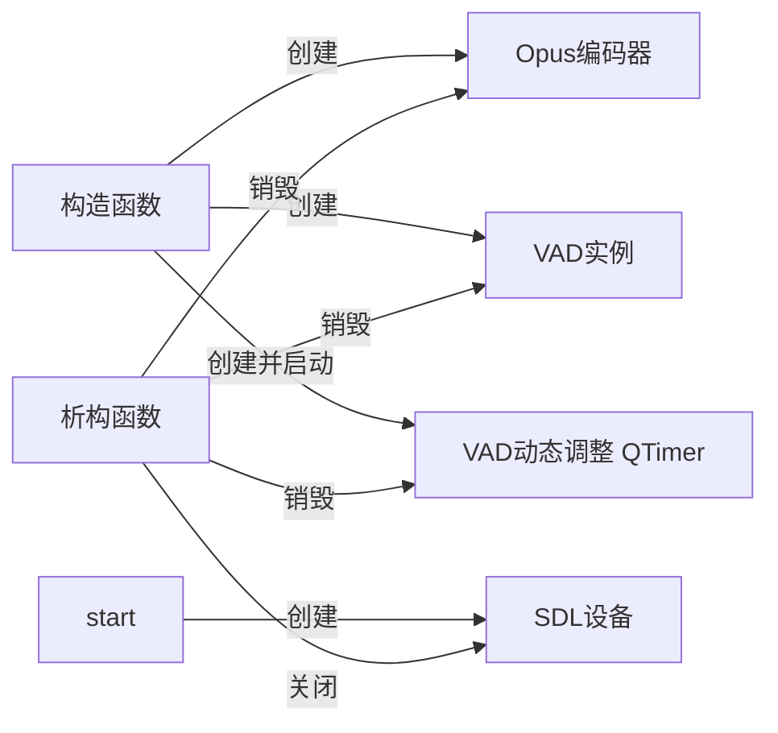
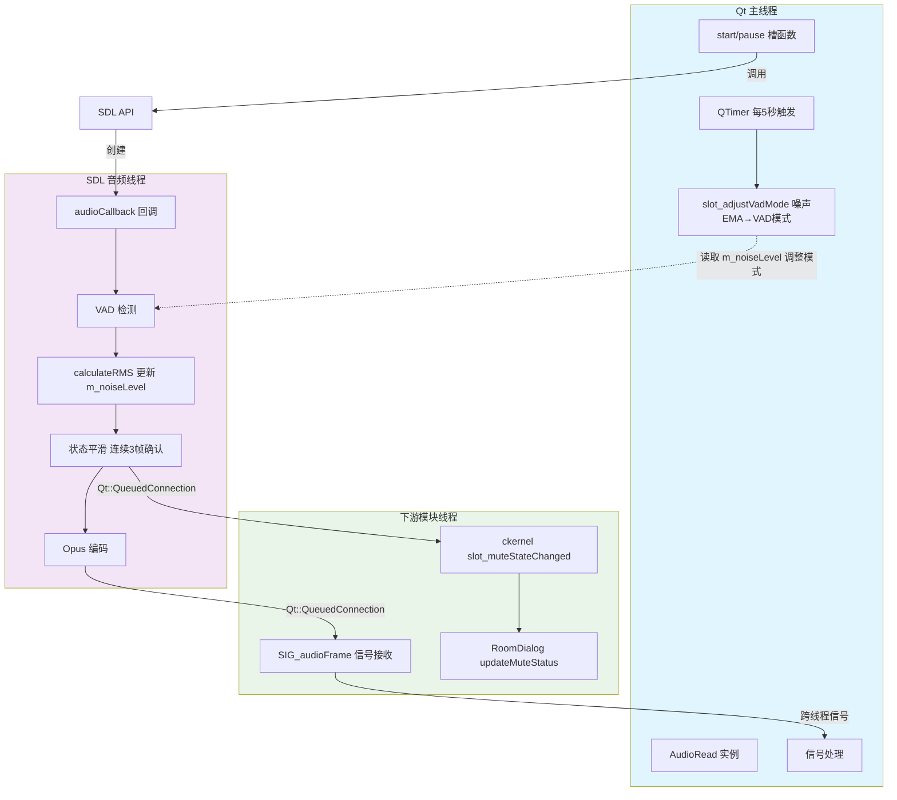

# 音频采集与编码流程技术文档

## 1. 概述

### 1.1 职责说明

音频采集模块负责从麦克风捕获音频数据，并通过以下处理流程实现实时音频通信：

1. **音频采集**：使用 SDL（Simple DirectMedia Layer）音频子系统从系统音频设备捕获原始 PCM 音频数据
2. **语音活动检测**：使用 WebRTC VAD（Voice Activity Detection）判断当前帧是否包含语音；采用**动态阈值**机制根据环境噪声自适应灵敏度（模式 1/2/3），并使用**状态平滑**（连续 3 帧≈60ms 确认）避免状态频繁抖动
3. **静音状态上报**：静音状态变化时通过 `SIG_muteStateChanged` 信号通知 `ckernel`，联动 `RoomDialog` 更新麦克风 UI 反馈
4. **音频编码**：使用 Opus 编码器将 PCM 数据压缩为高效编码格式（静音帧清零配合 Opus DTX，静音时带宽降至 ~1kbps）
5. **数据传输**：通过 Qt 信号机制将编码后的音频帧发送给下游模块

### 1.2 关键文件

| 文件名 | 职责说明 |
|--------|----------|
| `World.h` | 全局头文件，定义共享依赖、宏定义和枚举类型 |
| `audioread.h` | 音频采集类声明，定义接口和成员变量 |
| `audioread.cpp` | 音频采集与编码的核心实现 |

---

## 2. 业务流程图

### 2.1 整体音频采集编码流程



### 2.2 状态转换流程



### 2.2.1 音频静音状态机（WebRTC VAD + 状态平滑）



### 2.3 资源生命周期



---

## 3. 关键代码文件表格

| 文件 | 核心类/结构 | 主要功能 | 依赖库 |
|------|-------------|----------|--------|
| `World.h` | 枚举 `ENUM_PLAY_STATE` | 定义播放状态枚举和全局依赖 | SDL, Opus, WebRTC VAD, Qt |
| `audioread.h` | 类 `AudioRead` | 音频采集类接口声明 | QObject |
| `audioread.cpp` | 类 `AudioRead` | 音频采集、VAD检测、Opus编码实现 | SDL, Opus, WebRTC VAD |

---

## 4. 完整代码逐行解析

### 4.1 World.h —— 全局头文件

```cpp
#ifndef WORLD_H                    // 头文件保护宏开始，防止重复包含
#define WORLD_H                    // 定义 WORLD_H 宏

#include <QDebug>                  // 包含 Qt 调试输出头文件，用于 qDebug() 输出

extern "C" {                       // 以 C 语言链接方式包含 SDL 头文件
#include <SDL.h>                   // SDL 核心头文件
#include <SDL_audio.h>             // SDL 音频子系统头文件
}

#undef main                        // 取消 SDL 对 main 的宏定义，避免与 Qt 的 main 函数冲突
                                   // SDL 在 Windows 上会将 main 定义为 SDL_main

#include <mutex>                   // 包含互斥锁头文件（本文件中未直接使用，供其他模块使用）
#include <deque>                   // 包含双端队列头文件（本文件中未直接使用，供其他模块使用）

#define USE_VAD   (1)              // 定义 VAD 功能开关宏，1 表示启用语音活动检测

#include "WebRtc_Vad/webrtc_vad.h" // 包含 WebRTC VAD 头文件

// 枚举类型：定义音频播放/采集的三种状态
enum ENUM_PLAY_STATE {
    stopped,   // 停止状态，值为 0
    playing,   // 播放/采集中状态，值为 1
    pausing    // 暂停状态，值为 2
};

extern "C" {                       // 以 C 语言链接方式包含 Opus 编解码器头文件
#include <opus/opus.h>             // Opus 编解码器头文件
}

#endif // WORLD_H                  // 头文件保护宏结束
```

### 4.2 audioread.h —— 音频采集类声明

```cpp
#ifndef AUDIOREAD_H                // 头文件保护宏开始
#define AUDIOREAD_H                // 定义 AUDIOREAD_H 宏

#include <QObject>                 // 包含 QObject 头文件，Qt 对象基类
#include "World.h"                 // 包含全局头文件，获取 SDL/Opus/VAD 等依赖

// AudioRead 类：负责音频采集和编码
// 继承自 QObject，支持 Qt 信号槽机制
class AudioRead : public QObject
{
    Q_OBJECT                       // Qt 元对象宏，启用信号槽机制和元对象功能

public:
    // 构造函数
    // 参数: parent - 父对象指针，默认为 nullptr
    // 功能: 初始化成员变量、创建 Opus 编码器、初始化 VAD
    explicit AudioRead(QObject *parent = nullptr);

    // 析构函数
    // 功能: 释放 SDL 设备、销毁 Opus 编码器、释放 VAD 资源
    ~AudioRead();

public slots:
    // 开始采集槽函数
    // 功能: 打开 SDL 采集设备并启动音频采集
    void start();

    // 暂停采集槽函数
    // 功能: 暂停 SDL 采集设备
    void pause();

signals:
    // 音频帧信号
    // 参数: bt - 编码后的音频数据（Opus 编码的 QByteArray）
    // 功能: 通知下游模块处理音频帧
    void SIG_audioFrame(QByteArray bt);

    // 静音状态变化信号（WebRTC VAD 检测结果上报）
    // 参数: isMute - true=进入静音, false=退出静音（开始说话）
    // 功能: 跨线程通知 ckernel 联动 RoomDialog 更新麦克风 UI
    void SIG_muteStateChanged(bool isMute);

private slots:
    // VAD 模式动态调整槽（QTimer 每 5 秒触发）
    // 功能: 根据环境噪声 EMA 自适应切换 VAD 灵敏度模式（1/2/3）
    void slot_adjustVadMode();

private:
    // SDL 音频设备 ID
    // 数据类型: SDL_AudioDeviceID（通常为 uint32_t）
    // 初始值: 0
    // 功能: 标识已打开的 SDL 音频采集设备
    SDL_AudioDeviceID m_sdlCaptureDev;

    // SDL 设备是否已打开标志
    // 数据类型: bool
    // 初始值: false
    // 功能: 跟踪 SDL 采集设备的打开状态
    bool m_sdlIsOpen;

    // Opus 编码器指针
    // 数据类型: OpusEncoder*
    // 初始值: nullptr
    // 功能: 指向已创建的 Opus 编码器实例
    OpusEncoder *m_opusEncoder;

    // WebRTC VAD 实例句柄
    // 数据类型: VadInst*
    // 初始值: 未初始化（在构造函数中赋值）
    // 功能: 指向 WebRTC VAD 实例，用于语音活动检测
    VadInst *handle;

    // SDL 音频采集回调函数（静态成员函数）
    // 参数:
    //   userdata - 用户数据指针，指向 AudioRead 实例
    //   stream   - 音频数据缓冲区指针（PCM 格式）
    //   len      - 音频数据长度（字节）
    // 功能: SDL 调用此函数处理采集到的音频数据
    static void audioCallback(void *userdata, Uint8 *stream, int len);

    // 音频采集状态
    // 数据类型: int (存储 ENUM_PLAY_STATE 枚举值)
    // 初始值: stopped (0)
    // 功能: 记录当前音频采集状态
    int m_AudioState;

    // ===== WebRTC VAD 静音检测增强成员 =====
    // 动态阈值调整相关（slot_adjustVadMode 使用）
    int m_vadMode;                  // 当前 VAD 模式（0-3，默认 2=VoIP 推荐）
    float m_noiseLevel;             // 当前帧 RMS 能量（audioCallback 写入，主线程读取）
    float m_noiseLevelEMA;          // 噪声水平的指数移动平均（EMA）
    int m_consecutiveSilentFrames;  // 连续静音帧计数
    int m_consecutiveSpeechFrames;  // 连续有声帧计数
    QTimer *m_vadAdjustTimer;       // VAD 模式动态调整定时器（5 秒间隔）

    // 状态平滑相关（避免说话停顿瞬间频繁切换）
    bool m_currentMuteState;        // 当前已确认的静音状态
    bool m_pendingMuteState;        // 待确认的静音状态
    int m_muteConfirmFrames;        // 状态确认帧计数
    static const int MUTE_CONFIRM_THRESHOLD = 3;  // 连续 3 帧(≈60ms)确认才切换

    // 工具方法：计算 PCM 数据的 RMS 能量（归一化到 0.0-1.0）
    float calculateRMS(int16_t *data, int samples);
};

#endif                             // 头文件保护宏结束
```

### 4.3 audioread.cpp —— 音频采集与编码实现

#### 4.3.1 构造函数 AudioRead::AudioRead

```cpp
#include "audioread.h"
#include <cmath>   // [新增] calculateRMS 计算均方根时 sqrt 需要

// 构造函数实现
// 参数: parent - 父对象指针，传递给基类 QObject
// 功能: 初始化所有成员变量，创建 Opus 编码器，初始化 WebRTC VAD，
//       并启动 VAD 动态阈值调整定时器与状态平滑成员
AudioRead::AudioRead(QObject *parent) : QObject(parent)
{
    // ========== 成员变量初始化 ==========
    m_AudioState = stopped;        // 初始化音频状态为停止状态
    m_sdlIsOpen = false;           // 初始化 SDL 设备打开标志为 false
    m_sdlCaptureDev = 0;           // 初始化 SDL 设备 ID 为 0（无效设备）
    m_opusEncoder = nullptr;       // 初始化 Opus 编码器指针为空

    // ========== 创建 Opus 编码器 ==========
    int err;                       // 错误码变量，用于接收 opus_encoder_create 返回值

    // 创建 Opus 编码器
    // 参数说明:
    //   48000                - 采样率 48kHz（Opus 支持的最高质量采样率）
    //   1                    - 单声道（1 个音频通道）
    //   OPUS_APPLICATION_VOIP - 应用类型为 VoIP（优化语音编码）
    //   &err                 - 错误码输出参数
    m_opusEncoder = opus_encoder_create(48000, 1, OPUS_APPLICATION_VOIP, &err);

    // 检查编码器创建是否成功
    if (err != OPUS_OK || !m_opusEncoder) {
        // 创建失败，输出错误信息
        qDebug() << "[Opus] 编码器创建失败:" << opus_strerror(err);
    } else {
        // 创建成功，配置编码器参数

        // 设置比特率为 32 kbps
        // 32kbps 适合 VoIP 场景，在语音质量和带宽之间取得平衡
        opus_encoder_ctl(m_opusEncoder, OPUS_SET_BITRATE(32000));

        // 启用 DTX（Discontinuous Transmission，非连续传输）
        // 当检测到静音帧时，Opus 会使用极少的比特编码，节省带宽
        opus_encoder_ctl(m_opusEncoder, OPUS_SET_DTX(1));

        // 启用带内 FEC（Forward Error Correction，前向纠错）
        // 在数据包中嵌入冗余信息，用于在丢包时恢复数据
        opus_encoder_ctl(m_opusEncoder, OPUS_SET_INBAND_FEC(1));

        // 设置编码复杂度为 5（范围 0-10）
        // 5 是平衡质量和 CPU 消耗的推荐值
        opus_encoder_ctl(m_opusEncoder, OPUS_SET_COMPLEXITY(5));

        qDebug() << "[Opus] 编码器创建成功, 48kHz/VOIP/DTX/FEC/32kbps";
    }

    // ========== 初始化 WebRTC VAD ==========
#ifdef USE_VAD                     // 条件编译：仅当 USE_VAD 宏定义时编译以下代码

    // 创建 VAD 实例
    // 参数: &handle - 输出参数，接收创建的 VAD 实例指针
    // 返回值: 0 表示成功
    if (0 != WebRtcVad_Create(&handle))
    {
        qDebug() << "[VAD] vad create fail";
    }

    // 初始化 VAD 实例
    // 参数: handle - 要初始化的 VAD 实例
    // 返回值: 0 表示成功
    if (0 != WebRtcVad_Init(handle))
    {
        qDebug() << "[VAD] vad init fail";
    }

    // [新增] 设置 VAD 灵敏度模式为 2（中等偏高，VoIP 推荐档）
    // 模式 0=宽松 / 1=中等偏低 / 2=中等偏高(推荐) / 3=严格
    // 后续由 slot_adjustVadMode 根据环境噪声动态调整
    WebRtcVad_set_mode(handle, 2);
    qDebug() << "[VAD] vad mode set to 2 (VoIP recommended)";

#endif                             // USE_VAD 条件编译结束

    // ========== [新增] VAD 动态阈值调整成员初始化 ==========
    m_vadMode = 2;                  // 默认中等灵敏度（与上方 set_mode 一致）
    m_noiseLevel = 0.0f;            // 当前帧 RMS（audioCallback 每帧更新）
    m_noiseLevelEMA = 0.0f;         // 噪声 EMA 初始化为 0
    m_consecutiveSilentFrames = 0;
    m_consecutiveSpeechFrames = 0;

    // [新增] 每 5 秒评估一次环境噪声，动态调整 VAD 模式
    // 注意：QTimer 在主线程触发 slot_adjustVadMode，读取 SDL 线程写入的 m_noiseLevel
    //       （单 float 读写为良性跨线程竞争，不引入互斥锁，与第七章线程模型一致）
    m_vadAdjustTimer = new QTimer(this);
    m_vadAdjustTimer->setInterval(5000);  // 5 秒间隔
    connect(m_vadAdjustTimer, &QTimer::timeout,
            this, &AudioRead::slot_adjustVadMode);
    m_vadAdjustTimer->start();

    // ========== [新增] 静音状态平滑成员初始化 ==========
    m_currentMuteState = false;     // 初始状态：有声
    m_pendingMuteState = false;     // 待确认状态：有声
    m_muteConfirmFrames = 0;        // 确认帧计数清零
}
```

#### 4.3.2 析构函数 AudioRead::~AudioRead

```cpp
// 析构函数实现
// 功能: 释放所有已分配的资源，包括 SDL 设备、Opus 编码器、
//       VAD 动态调整定时器、VAD 实例
AudioRead::~AudioRead()
{
    // ========== 关闭 SDL 采集设备 ==========
    // 检查 SDL 设备是否已打开
    if (m_sdlIsOpen && m_sdlCaptureDev != 0) {
        // 暂停设备采集（参数 1 表示暂停）
        SDL_PauseAudioDevice(m_sdlCaptureDev, 1);

        // 关闭 SDL 音频设备，释放相关资源
        SDL_CloseAudioDevice(m_sdlCaptureDev);

        // 重置设备 ID 为 0
        m_sdlCaptureDev = 0;

        // 重置设备打开标志
        m_sdlIsOpen = false;

        qDebug() << "[SDL-Capture] 采集设备已关闭";
    }

    // ========== 销毁 Opus 编码器 ==========
    // 检查编码器是否已创建
    if (m_opusEncoder) {
        // 销毁 Opus 编码器，释放内存
        opus_encoder_destroy(m_opusEncoder);

        // 将指针置空，避免悬空指针
        m_opusEncoder = nullptr;

        qDebug() << "[Opus] 编码器已销毁";
    }

    // ========== [新增] 释放 VAD 动态调整定时器 ==========
    // 先停后删，避免悬空回调（QTimer 在主线程，析构也在主线程，安全）
    if (m_vadAdjustTimer) {
        m_vadAdjustTimer->stop();
        delete m_vadAdjustTimer;
        m_vadAdjustTimer = nullptr;
        qDebug() << "[VAD] 动态调整定时器已释放";
    }

    // ========== 释放 WebRTC VAD 资源 ==========
#ifdef USE_VAD                     // 条件编译：仅当 USE_VAD 宏定义时编译以下代码

    // 释放 VAD 实例占用的内存
    WebRtcVad_Free(handle);

#endif                             // USE_VAD 条件编译结束
}
```

#### 4.3.3 静态回调函数 AudioRead::audioCallback

```cpp
// SDL 音频采集回调函数（静态成员函数）
// 此函数由 SDL 音频子系统在新音频数据可用时自动调用
// 参数:
//   userdata - 用户数据指针，我们在打开设备时传入了 AudioRead 实例的 this 指针
//   stream   - 指向音频数据缓冲区的指针，包含采集到的 PCM 数据
//   len      - 音频数据的字节长度
// 注意: 此函数在 SDL 音频线程中调用，不是主线程
void AudioRead::audioCallback(void *userdata, Uint8 *stream, int len)
{
    // 将 userdata 转换为 AudioRead 指针，以便访问类成员
    AudioRead *audio = (AudioRead *)userdata;

    // ========== 数据长度验证 ==========
    // 检查数据长度是否达到一帧的最小要求
    // 1920 字节 = 960 采样点 × 2 字节/采样（16位音频）
    // 如果数据不足一帧，直接返回，不进行处理
    if (len < 1920) return;

    // ========== 语音活动检测 (VAD) ==========
    // [修改] 原基础版 VAD 仅做"检测+清零"，无法感知静音状态、易因停顿抖动、
    //        不能自适应环境噪声。改为增强版：RMS 能量统计 + 状态平滑 + 静音状态信号上报。
    //        原代码以注释形式保留（遵循"严禁删除原有代码，以注释代替删除"守则）。
    /* 原代码（基础VAD：仅检测+清零，无状态平滑、无UI联动）：
    #ifdef USE_VAD
        if (0 == WebRtcVad_Process(audio->handle, 48000, (int16_t*)stream, 960))
        {
            // 静音帧清零（Opus DTX 会进一步压缩静音帧）
            memset(stream, 0, len);
        }
    #endif
    */
    bool isMute = false;           // [新增] 当前帧静音标志
#ifdef USE_VAD                     // 条件编译：仅当 USE_VAD 宏定义时编译以下代码

    // WebRTC VAD 检测当前帧是否包含语音
    // 参数:
    //   audio->handle    - VAD 实例句柄
    //   48000            - 采样率（必须与 VAD 初始化时一致）
    //   (int16_t*)stream - 音频数据指针（16位有符号整数格式）
    //   960              - 采样点数（10ms 的 48kHz 音频）
    // 返回值: 0 表示静音，1 表示有声，-1 表示错误
    //        （错误时按有声处理，避免误清零导致语音丢失）
    int vadResult = WebRtcVad_Process(audio->handle, 48000,
                                       (int16_t*)stream, 960);
    isMute = (vadResult == 0);     // 返回 0 判定为静音

    // [新增] 计算当前帧 RMS 能量，供 slot_adjustVadMode 动态阈值调整使用
    //        （归一化到 0.0-1.0，由 SDL 线程每帧写入，主线程 QTimer 每 5 秒读取）
    audio->m_noiseLevel = audio->calculateRMS((int16_t*)stream, 960);

    // [新增] 状态平滑：连续 MUTE_CONFIRM_THRESHOLD(3) 帧确认才切换状态
    //        避免说话停顿瞬间频繁切换（3 帧 ≈ 60ms）
    if (isMute != audio->m_pendingMuteState) {
        // 待确认状态发生变化，重置计数器开始确认
        audio->m_pendingMuteState = isMute;
        audio->m_muteConfirmFrames = 1;
    } else {
        // 待确认状态延续，累加计数
        audio->m_muteConfirmFrames++;
        // 达到确认阈值且状态确实改变，触发静音状态变化信号
        if (audio->m_muteConfirmFrames >= AudioRead::MUTE_CONFIRM_THRESHOLD &&
            audio->m_pendingMuteState != audio->m_currentMuteState) {
            audio->m_currentMuteState = audio->m_pendingMuteState;
            // 跨线程信号（QueuedConnection 由 ckernel 端自动处理）
            // → ckernel::slot_muteStateChanged → RoomDialog::updateMuteStatus
            Q_EMIT audio->SIG_muteStateChanged(audio->m_currentMuteState);
            qDebug() << "[VAD] 静音状态切换:" << audio->m_currentMuteState;
        }
    }

    // 静音帧清零（与原逻辑保持一致，Opus DTX 会进一步压缩静音帧）
    if (isMute) {
        // 参数:
        //   stream - 目标缓冲区
        //   0      - 填充值（静音）
        //   len    - 填充长度（字节）
        memset(stream, 0, len);
    }

#endif                             // USE_VAD 条件编译结束

    // ========== Opus 编码 ==========
    // 定义编码输出缓冲区，最大 4096 字节
    // Opus 单帧编码通常远小于此值
    unsigned char opusData[4096];

    // 使用 Opus 编码器编码音频帧
    // 参数:
    //   audio->m_opusEncoder - Opus 编码器实例指针
    //   (const opus_int16*)stream - 输入 PCM 数据（16位有符号整数）
    //   960                 - 每帧采样点数（20ms @ 48kHz = 960 采样点）
    //   opusData            - 编码输出缓冲区
    //   sizeof(opusData)    - 输出缓冲区大小（字节）
    // 返回值: 编码后的字节数，负值表示错误
    int nbBytes = opus_encode(audio->m_opusEncoder,
                              (const opus_int16*)stream,
                              960,
                              opusData,
                              sizeof(opusData));

    // 检查编码是否成功
    if (nbBytes < 0) {
        // 编码失败，输出错误信息
        qDebug() << "[Opus] 编码错误:" << opus_strerror(nbBytes);
        return;                    // 返回，不发送无效数据
    }

    // ========== 封装并发送音频帧 ==========
    // 将编码后的 Opus 数据封装为 QByteArray
    // 参数:
    //   (char*)opusData - Opus 数据指针
    //   nbBytes         - 数据长度
    QByteArray sendBuffer((char*)opusData, nbBytes);

    // 发射音频帧信号，将编码后的数据传递给连接的槽函数
    // 下游模块可以通过连接此信号接收音频数据
    Q_EMIT audio->SIG_audioFrame(sendBuffer);
}
```

#### 4.3.4 开始采集函数 AudioRead::start

```cpp
// 开始采集槽函数实现
// 功能: 启动或恢复音频采集
// 调用时机: 用户点击开始按钮或需要恢复采集时
void AudioRead::start()
{
    // 检查当前状态是否允许启动采集
    // 只有在停止或暂停状态下才能启动
    if (m_AudioState == stopped || m_AudioState == pausing)
    {
        // ========== 打开 SDL 采集设备（仅首次） ==========
        // 检查 SDL 设备是否已打开
        if (!m_sdlIsOpen) {
            // 定义期望的音频规格
            SDL_AudioSpec desiredSpec;

            // 定义实际获得的音频规格（SDL 可能调整参数）
            SDL_AudioSpec obtainedSpec;

            // 将期望规格结构体清零
            SDL_zero(desiredSpec);

            // 设置期望的音频参数
            desiredSpec.freq = 48000;      // 采样率: 48000 Hz
            desiredSpec.format = AUDIO_S16LSB;  // 音频格式: 16位有符号小端序
            desiredSpec.channels = 1;      // 通道数: 1（单声道）
            desiredSpec.samples = 960;     // 缓冲区采样点数: 960（20ms @ 48kHz）
            desiredSpec.callback = audioCallback;  // 回调函数指针
            desiredSpec.userdata = this;   // 用户数据: 传递 this 指针

            // 打开 SDL 音频采集设备
            // 参数:
            //   NULL          - 设备名称，NULL 表示使用默认设备
            //   1             - iscapture 参数，1 表示打开采集设备（麦克风）
            //   &desiredSpec  - 期望的音频规格
            //   &obtainedSpec - 实际获得的音频规格输出
            //   0             - 允许的变更标志，0 表示不允许任何变更
            // 返回值: 设备 ID，0 表示失败
            m_sdlCaptureDev = SDL_OpenAudioDevice(NULL, 1,
                                &desiredSpec, &obtainedSpec, 0);

            // 检查设备是否打开成功
            if (m_sdlCaptureDev == 0) {
                qDebug() << "[SDL-Capture] 打开采集设备失败:" << SDL_GetError();
                return;            // 打开失败，直接返回
            }

            // 标记设备已打开
            m_sdlIsOpen = true;

            // 输出设备信息（使用实际获得的参数）
            qDebug() << "[SDL-Capture] 采集设备已打开, devID:" << m_sdlCaptureDev
                     << "freq:" << obtainedSpec.freq
                     << "samples:" << obtainedSpec.samples;
        }

        // ========== 启动采集 ==========
        // 取消暂停，开始音频采集
        // 参数:
        //   m_sdlCaptureDev - SDL 设备 ID
        //   0               - 0 表示取消暂停（开始采集），1 表示暂停
        SDL_PauseAudioDevice(m_sdlCaptureDev, 0);

        // 更新状态为播放/采集中
        m_AudioState = playing;

        qDebug() << "[SDL-Capture] 采集已启动";
    }
}
```

#### 4.3.5 暂停采集函数 AudioRead::pause

```cpp
// 暂停采集槽函数实现
// 功能: 暂停音频采集
// 调用时机: 用户点击暂停按钮时
void AudioRead::pause()
{
    // 检查当前状态是否为播放中
    // 只有在播放状态下才能暂停
    if (m_AudioState == playing)
    {
        // ========== 暂停 SDL 采集设备 ==========
        // 检查设备是否已打开且有效
        if (m_sdlIsOpen && m_sdlCaptureDev != 0) {
            // 暂停设备采集
            // 参数:
            //   m_sdlCaptureDev - SDL 设备 ID
            //   1               - 1 表示暂停采集
            SDL_PauseAudioDevice(m_sdlCaptureDev, 1);
        }

        // 更新状态为暂停
        m_AudioState = pausing;

        qDebug() << "[SDL-Capture] 采集已暂停";
    }
}
```

#### 4.3.6 RMS 能量计算 AudioRead::calculateRMS

```cpp
// [新增] 计算 PCM 数据的 RMS 能量值（归一化到 0.0-1.0）
// 参数:
//   data    - int16_t PCM 数据指针
//   samples - 采样数
// 返回: 归一化 RMS（0.0=完全静音，1.0=最大音量）
// 用途: 供 slot_adjustVadMode 估计环境噪声水平，动态调整 VAD 灵敏度
// 线程: 由 SDL 音频线程在 audioCallback 中调用（每 20ms 一次）
float AudioRead::calculateRMS(int16_t *data, int samples)
{
    // 空指针或非正采样数保护，返回 0（视为静音）
    if (!data || samples <= 0) return 0.0f;

    double sum = 0.0;
    // 累加各采样点的平方值
    for (int i = 0; i < samples; i++) {
        sum += (double)data[i] * data[i];
    }
    // 计算均方根（Root Mean Square）
    double rms = sqrt(sum / samples);
    // 归一化到 0.0-1.0（int16_t 最大值 32767）
    return (float)(rms / 32767.0);
}
```

#### 4.3.7 VAD 模式动态调整 AudioRead::slot_adjustVadMode

```cpp
// [新增] 动态调整 VAD 模式（QTimer 每 5 秒触发一次）
// 策略: 用噪声 EMA 估计环境噪声水平，按三档选择 VAD 灵敏度
//   噪声 EMA < 0.02  → 模式 1（宽松，安静环境，避免漏检轻声说话）
//   噪声 EMA < 0.10  → 模式 2（中等，办公室/居家，平衡）
//   噪声 EMA >= 0.10 → 模式 3（严格，嘈杂环境，避免误判噪声为语音）
// 仅当模式变化时才调用 WebRtcVad_set_mode，避免频繁切换
// 线程: 主线程（QTimer 触发），读取 SDL 线程写入的 m_noiseLevel
void AudioRead::slot_adjustVadMode()
{
    // EMA 平滑系数：0.95 偏向历史值，避免短期波动影响估计
    const float EMA_ALPHA = 0.95f;

    // 更新噪声水平 EMA 估计（当前帧 m_noiseLevel 视为噪声水平采样）
    // 公式: EMA_new = α * EMA_old + (1-α) * sample
    m_noiseLevelEMA = EMA_ALPHA * m_noiseLevelEMA +
                      (1.0f - EMA_ALPHA) * m_noiseLevel;

    // 根据噪声水平动态选择 VAD 模式
    int newMode = m_vadMode;
    if (m_noiseLevelEMA < 0.02f) {
        // 噪声水平极低（安静环境），使用宽松模式，避免漏检轻声说话
        newMode = 1;
    } else if (m_noiseLevelEMA < 0.10f) {
        // 噪声水平中等（办公室/居家环境），使用推荐模式
        newMode = 2;
    } else {
        // 噪声水平较高（嘈杂环境），使用严格模式，避免误判环境噪声为语音
        newMode = 3;
    }

    // 模式变化时才更新，避免频繁切换
    if (newMode != m_vadMode) {
        m_vadMode = newMode;
#ifdef USE_VAD                     // 条件编译：仅当 USE_VAD 宏定义时编译以下代码
        WebRtcVad_set_mode(handle, m_vadMode);
#endif                             // USE_VAD 条件编译结束
        qDebug() << "[VAD] 模式调整为" << m_vadMode
                 << "噪声EMA:" << m_noiseLevelEMA;
    }
}
```

---

## 5. 参数说明表格

### 5.1 成员变量参数说明

| 参数名称 | 数据类型 | 初始值 | 取值范围 | 功能作用 |
|----------|----------|--------|----------|----------|
| `m_sdlCaptureDev` | `SDL_AudioDeviceID` | `0` | `0` 或有效设备 ID | 标识已打开的 SDL 音频采集设备，0 表示无效 |
| `m_sdlIsOpen` | `bool` | `false` | `true` / `false` | 跟踪 SDL 采集设备是否已打开 |
| `m_opusEncoder` | `OpusEncoder*` | `nullptr` | 有效指针或 `nullptr` | 指向已创建的 Opus 编码器实例 |
| `handle` | `VadInst*` | 未初始化 | 有效指针 | 指向 WebRTC VAD 实例 |
| `m_AudioState` | `int` | `stopped (0)` | `0`/`1`/`2` | 记录当前音频采集状态 |
| `m_vadMode` | `int` | `2` | `1`/`2`/`3` | 当前 VAD 灵敏度模式（2=VoIP 推荐，由 slot_adjustVadMode 动态调整） |
| `m_noiseLevel` | `float` | `0.0f` | `0.0`-`1.0` | 当前帧 RMS 能量（SDL 线程写入，主线程读取） |
| `m_noiseLevelEMA` | `float` | `0.0f` | `0.0`-`1.0` | 噪声水平的指数移动平均（EMA），5 秒更新一次 |
| `m_consecutiveSilentFrames` | `int` | `0` | ≥0 | 连续静音帧计数（预留） |
| `m_consecutiveSpeechFrames` | `int` | `0` | ≥0 | 连续有声帧计数（预留） |
| `m_vadAdjustTimer` | `QTimer*` | `new QTimer` | 有效指针 | VAD 模式动态调整定时器（5 秒间隔） |
| `m_currentMuteState` | `bool` | `false` | `true`/`false` | 当前已确认的静音状态（false=有声） |
| `m_pendingMuteState` | `bool` | `false` | `true`/`false` | 待确认的静音状态（需连续 3 帧确认） |
| `m_muteConfirmFrames` | `int` | `0` | ≥0 | 状态确认帧计数（达到 3 帧才切换） |
| `MUTE_CONFIRM_THRESHOLD` | `static const int` | `3` | 常量 | 静音状态切换确认阈值（3 帧≈60ms） |

### 5.2 Opus 编码器参数说明

| 参数名称 | 设置值 | 取值范围 | 功能作用 |
|----------|--------|----------|----------|
| 采样率 | `48000` | 8000/12000/16000/24000/48000 | 采样频率，48kHz 为最高质量 |
| 通道数 | `1` | 1 或 2 | 音频通道数，1 为单声道 |
| 应用类型 | `OPUS_APPLICATION_VOIP` | VOIP/AUDIO/RESTRICTED_LOWDELAY | 优化目标，VOIP 优化语音 |
| 比特率 | `32000` bps | 6000-510000 | 编码比特率，32kbps 适合语音 |
| DTX | `1` (启用) | 0 或 1 | 静音时减少比特率节省带宽 |
| FEC | `1` (启用) | 0 或 1 | 前向纠错，抗丢包能力 |
| 复杂度 | `5` | 0-10 | 编码复杂度，平衡质量和性能 |
| 每帧采样数 | `960` | 120/240/480/960/1920/2880 | 20ms @ 48kHz = 960 采样点 |

### 5.3 SDL 音频参数说明

| 参数名称 | 设置值 | 取值范围 | 功能作用 |
|----------|--------|----------|----------|
| `freq` | `48000` | 常见: 22050/44100/48000 | 采样频率（Hz） |
| `format` | `AUDIO_S16LSB` | 多种 PCM 格式 | 音频数据格式，16位有符号小端序 |
| `channels` | `1` | 1 或 2 | 通道数，1 为单声道 |
| `samples` | `960` | 通常 256-8192 | 缓冲区采样点数，决定回调频率 |
| `callback` | `audioCallback` | 函数指针 | 音频数据就绪时的回调函数 |
| `userdata` | `this` | 任意指针 | 传递给回调函数的用户数据 |
| `iscapture` | `1` | 0 或 1 | 1 表示采集设备（麦克风） |

### 5.4 VAD 参数说明

| 参数名称 | 设置值 | 取值范围 | 功能作用 |
|----------|--------|----------|----------|
| 采样率 | `48000` | 8000/16000/32000/48000 | 必须与输入音频采样率一致 |
| 每帧采样数 | `960` | 取决于采样率和帧时长 | 10ms 帧长度用于 VAD 处理 |
| VAD 模式（初始） | `2`（VoIP 推荐） | 0-3（0 最宽松，3 最严格） | 构造函数显式 `WebRtcVad_set_mode(handle, 2)` |
| VAD 返回值 | `0`=静音 / `1`=有声 / `-1`=错误 | — | 注意：0 表示静音（非语音），错误时按有声处理 |
| 动态调整间隔 | `5000` ms | — | QTimer 触发 `slot_adjustVadMode` 的周期 |
| EMA 平滑系数 α | `0.95` | 0.0-1.0 | 偏向历史值，避免短期波动影响噪声估计 |
| 噪声 EMA 阈值（低） | `0.02` | — | EMA<0.02 → 模式 1（宽松，安静环境） |
| 噪声 EMA 阈值（高） | `0.10` | — | EMA≥0.10 → 模式 3（严格，嘈杂环境）；区间内为模式 2 |
| 状态确认阈值 | `3` 帧（≈60ms） | — | `MUTE_CONFIRM_THRESHOLD`，连续 3 帧确认才切换静音状态 |
| 静音信号 | `SIG_muteStateChanged(bool)` | true/false | 跨线程通知 ckernel 联动 RoomDialog 更新 UI |

---

## 6. 技术选型说明

### 6.1 为什么选择 SDL（Simple DirectMedia Layer）

| 优势 | 说明 |
|------|------|
| **跨平台支持** | 支持 Windows、Linux、macOS、Android、iOS 等主流平台 |
| **低延迟** | 直接访问底层音频 API，延迟可控制在 20-50ms |
| **回调机制** | 基于回调的音频处理模型，适合实时音频处理 |
| **简单易用** | API 简洁，学习曲线平缓 |
| **成熟稳定** | 经过 20+ 年发展，广泛用于游戏和多媒体应用 |

**在本项目中的应用场景**：
- 使用 `SDL_OpenAudioDevice` 打开系统麦克风
- 通过回调函数 `audioCallback` 异步获取音频数据
- 利用 `SDL_PauseAudioDevice` 实现采集的启停控制

### 6.2 为什么选择 Opus 编码器

| 优势 | 说明 |
|------|------|
| **专为实时通信设计** | 由 IETF 标准化（RFC 6716），广泛用于 WebRTC |
| **超高压缩率** | 32kbps 即可提供优秀语音质量 |
| **超低延迟** | 最小帧时长 2.5ms，算法延迟 5-66.5ms |
| **自适应特性** | DTX 静音检测 + FEC 前向纠错，完美适配网络环境 |
| **全频带支持** | 支持窄带到全频带（8kHz-48kHz） |
| **开源免费** | BSD 许可证，无专利费用 |

**在本项目中的应用场景**：
- `OPUS_APPLICATION_VOIP` 模式优化语音编码
- DTX 在静音时节省 90%+ 带宽
- FEC 提供抗丢包能力，适合不稳定网络

### 6.3 为什么选择 WebRTC VAD

| 优势 | 说明 |
|------|------|
| **算法高效** | 基于 GMM（高斯混合模型），CPU 占用极低 |
| **专为语音优化** | 经过大量语音数据训练，准确率高 |
| **实时处理** | 处理延迟 < 1ms，不影响实时性 |
| **开源实现** | 来自 Google WebRTC 项目，质量有保障 |
| **与 Opus 配合** | VAD 结果可辅助 Opus DTX 决策 |

**在本项目中的应用场景**：
- 检测音频帧是否包含语音（返回 0=静音 / 1=有声 / -1=错误）
- 静音帧清零，避免编码无意义噪声
- 配合 Opus DTX 进一步优化带宽使用（双重静音压缩）
- **动态阈值**：QTimer 每 5 秒根据噪声 RMS 的 EMA 自适应切换 VAD 灵敏度模式（1/2/3），适配安静到嘈杂等不同环境
- **状态平滑**：连续 3 帧（≈60ms）确认才切换静音状态，避免说话停顿瞬间频繁抖动
- **UI 联动**：静音状态变化时通过 `SIG_muteStateChanged` 信号通知 `ckernel` → `RoomDialog::updateMuteStatus`，在 `cb_audio` 复选框文本上反馈"音频(无声)"

---

## 7. 线程模型说明

### 7.1 线程架构



### 7.2 线程交互说明

| 线程 | 职责 | 关键操作 |
|------|------|----------|
| **Qt 主线程** | UI 交互、生命周期管理、VAD 动态调整 | 创建/销毁 AudioRead，调用 start/pause；QTimer 每 5 秒触发 `slot_adjustVadMode` 评估噪声 EMA 并调整 VAD 模式 |
| **SDL 音频线程** | 音频数据采集、VAD 检测、状态平滑、编码 | `audioCallback` 回调：VAD 检测、`calculateRMS` 更新 `m_noiseLevel`、连续 3 帧状态平滑、发射 `SIG_muteStateChanged`、Opus 编码、发射 `SIG_audioFrame` |
| **信号接收线程** | 处理编码后的音频数据、UI 联动 | 接收 `SIG_audioFrame`；`ckernel::slot_muteStateChanged` → `RoomDialog::updateMuteStatus` 更新 `cb_audio` 文本 |

### 7.3 线程安全注意事项

1. **SDL 回调线程**：`audioCallback` 在 SDL 内部线程中调用，不是 Qt 主线程
2. **信号跨线程**：`SIG_audioFrame` 与 `SIG_muteStateChanged` 信号默认使用 `Qt::AutoConnection`，跨线程时自动使用队列连接（QueuedConnection），槽函数在接收线程（ckernel 所在线程）执行
3. **成员变量访问**：
   - `m_opusEncoder` 在构造函数中创建，在回调中使用，生命周期管理需注意
   - `handle` (VAD) 同理，在析构前不应释放
4. **状态变量**：`m_AudioState` 在主线程读写，回调线程不访问，无需加锁
5. **[新增] `m_noiseLevel` 跨线程读写**：SDL 线程每帧写入，主线程 QTimer 每 5 秒读取。单 `float` 的读写在主流架构上为原子可观察的良性竞争，且仅为阈值估计用途（偶发读到旧值不影响正确性），故不引入互斥锁以避免回调线程阻塞
6. **[新增] VAD 模式切换**：`WebRtcVad_set_mode` 仅在主线程 `slot_adjustVadMode` 中调用，SDL 线程仅调用 `WebRtcVad_Process`，二者无并发写冲突
7. **[新增] QTimer 生命周期**：`m_vadAdjustTimer` 创建、触发、销毁均在主线程，析构时先 `stop()` 再 `delete`，避免悬空回调

### 7.4 时序分析

| 操作 | 时间间隔 | 说明 |
|------|----------|------|
| 音频帧周期 | 20ms | 48kHz 采样率，960 采样点/帧 |
| VAD 处理延迟 | < 1ms | WebRTC VAD 计算开销极小 |
| RMS 计算延迟 | < 0.1ms | 960 采样点平方和+sqrt，开销可忽略 |
| 状态平滑确认 | ≈60ms | 连续 3 帧（3×20ms）确认才切换静音状态 |
| Opus 编码延迟 | 2-5ms | 取决于复杂度设置 |
| 信号传递延迟 | 1-5ms | 取决于 Qt 事件循环负载 |
| VAD 模式调整周期 | 5000ms | QTimer 触发 slot_adjustVadMode 的间隔 |
| **总处理延迟** | **~25ms** | 从采集到信号发射（不含状态平滑确认） |

---

## 8. 总结

本文档详细介绍了音频采集与编码流程的实现，包括：

1. **SDL 音频采集**：使用回调机制异步获取麦克风数据
2. **WebRTC VAD 语音检测**：识别静音帧（返回 0=静音/1=有声/-1=错误），静音帧清零优化带宽
3. **动态阈值调整**：QTimer 每 5 秒根据噪声 RMS 的 EMA 自适应切换 VAD 灵敏度模式（1=宽松/2=中等/3=严格），适配不同环境
4. **状态平滑**：连续 3 帧（≈60ms）确认才切换静音状态，避免说话停顿瞬间频繁抖动
5. **静音状态 UI 联动**：静音状态变化时通过 `SIG_muteStateChanged` 信号跨线程通知 `ckernel` → `RoomDialog::updateMuteStatus`，在 `cb_audio` 复选框文本上反馈"音频(无声)"
6. **Opus 编码**：高效压缩音频数据，支持 DTX 和 FEC，与 VAD 协同实现双重静音压缩
7. **Qt 信号机制**：将编码后的数据传递给下游模块

该设计具有以下特点：
- **低延迟**：端到端延迟约 25ms
- **低带宽**：32kbps 编码 + VAD 清零 + DTX 可大幅节省带宽
- **高可靠**：FEC 提供抗丢包能力
- **自适应**：动态阈值适配安静到嘈杂等不同环境
- **抗抖动**：状态平滑避免静音状态频繁切换
- **跨平台**：SDL + Opus + WebRTC 均支持主流平台

---

*文档版本: v2.0*
*最后更新: 2026-08-01*
*更新说明: 新增 WebRTC VAD 静音检测增强功能（动态阈值调整、状态平滑、静音状态 UI 联动），修正 VAD 返回值说明（0=静音/1=有声/-1=错误）*
