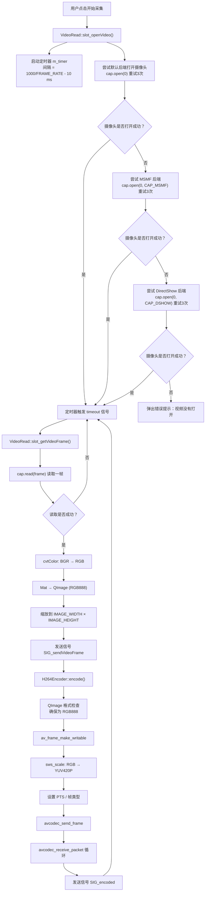
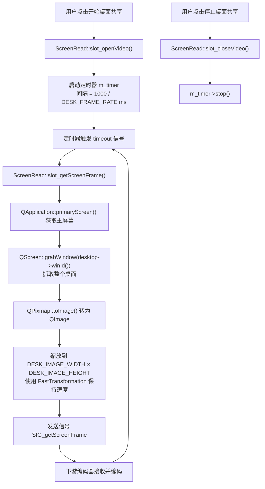
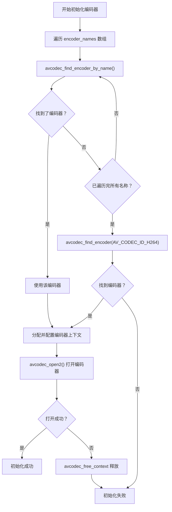
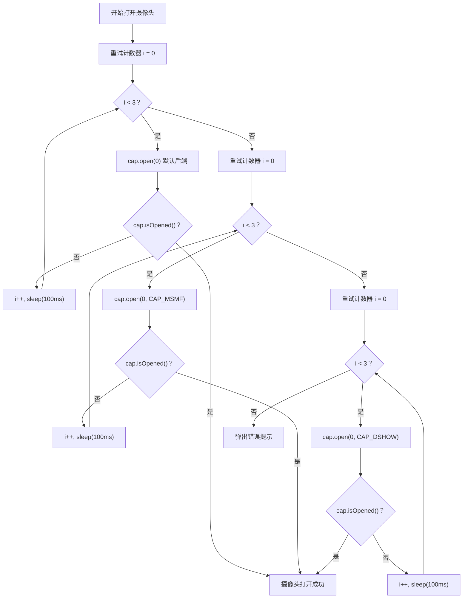
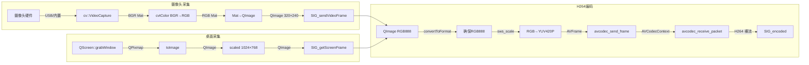

# 03 视频采集编码传输流程

## 一、概述

### 1.1 模块职责

本文档详细描述视频会议系统中**视频采集**与**H264编码**的完整技术实现。该模块承担以下核心职责：

| 职责 | 说明 |
|------|------|
| **摄像头视频采集** | 通过 OpenCV 打开系统摄像头，以定时器驱动的方式逐帧捕获视频画面 |
| **桌面屏幕采集** | 通过 Qt 的 `QScreen` API 抓取主屏幕画面，实现桌面共享功能 |
| **H264 硬件/软件编码** | 将采集到的 RGB 图像通过 FFmpeg/libav 转换为 YUV420P 并编码为 H264 码流 |
| **编码器硬件回退链** | 自动检测可用的硬件编码器（NVIDIA NVENC、Intel QSV），不可用时回退到软件编码（libx264） |
| **摄像头后端回退** | 在不同视频捕获后端（默认、MSMF、DirectShow）之间自动切换，提高兼容性 |

### 1.2 关键文件一览

| 文件名 | 类型 | 职责 |
|--------|------|------|
| `common.h` | 头文件 | 全局宏定义，包含 OpenCV 头文件引用和全局帧率常量 |
| `videoread.h` | 头文件 | `VideoRead` 类声明——摄像头视频采集器 |
| `videoread.cpp` | 实现 | `VideoRead` 类的完整实现——摄像头打开、帧采集、关闭 |
| `h264encoder.h` | 头文件 | `H264Encoder` 类声明——H264 视频编码器 |
| `h264encoder.cpp` | 实现 | `H264Encoder` 类的完整实现——编码器初始化、RGB→YUV 转换、H264 编码、资源释放 |
| `screenread.h` | 头文件 | `ScreenRead` 类声明——桌面屏幕采集器 |
| `screenread.cpp` | 实现 | `ScreenRead` 类的完整实现——屏幕抓取、缩放、定时采集 |

---

## 二、业务流程图

### 2.1 摄像头视频采集与编码流程



### 2.2 桌面屏幕采集流程



---

## 三、完整代码逐行解析

### 3.1 common.h —— 全局帧率定义

```cpp
#ifndef COMMON_H                      // 防止头文件被重复包含的宏守卫开始
#define COMMON_H                      // 定义 COMMON_H 宏，标记该头文件已被包含

#include "highgui/highgui.hpp"        // 引入 OpenCV highgui 模块（窗口显示、图像读写等高级GUI功能）
#include "imgproc/imgproc.hpp"        // 引入 OpenCV imgproc 模块（图像处理：颜色转换、缩放、滤波等）
#include "core/core.hpp"              // 引入 OpenCV core 模块（基础数据结构 Mat、数学运算等）
#include "opencv2\imgproc\types_c.h"  // 引入 OpenCV C 风格类型定义（包含 CV_BGR2RGB 等旧式枚举宏）

using namespace cv;                   // 将 cv 命名空间引入当前作用域，后续可直接使用 Mat、VideoCapture 等

#define FRAME_RATE (30)               // 定义全局帧率常量：30 FPS，用于摄像头采集的定时器间隔计算

#endif                                // 防止头文件被重复包含的宏守卫结束
```

**宏常量说明：**

| 宏名称 | 值 | 说明 |
|--------|-----|------|
| `FRAME_RATE` | `30` | 全局视频帧率，单位：帧/秒（FPS）。用于摄像头采集定时器的触发间隔计算：`1000/30 - 10 ≈ 23ms` |

---

### 3.2 videoread.h —— 摄像头采集类声明

```cpp
#ifndef VIDEOREAD_H                    // 防止头文件被重复包含的宏守卫开始
#define VIDEOREAD_H                    // 定义 VIDEOREAD_H 宏

#include <QObject>                     // 引入 Qt 对象基类，提供信号槽机制、对象树内存管理等
#include <QImage>                      // 引入 Qt 图像类，用于在内存中表示和操作图像数据
#include <QTimer>                      // 引入 Qt 定时器类，用于周期性触发帧采集
#include "common.h"                    // 引入项目公共头文件，获取 OpenCV 头文件和 FRAME_RATE 宏

#define IMAGE_WIDTH (320)              // 定义输出图像宽度：320 像素
#define IMAGE_HEIGHT (240)             // 定义输出图像高度：240 像素

class VideoRead : public QObject       // 定义 VideoRead 类，继承自 QObject 以使用信号槽机制
{
    Q_OBJECT                           // Qt 元对象宏，启用信号槽、属性系统等 Qt 元对象功能
public:
    explicit VideoRead(QObject *parent = nullptr);  // 构造函数，parent 默认为空（顶层对象）
    ~VideoRead();                                      // 析构函数，负责释放定时器资源

signals:
    void SIG_sendVideoFrame(QImage img);  // 信号：发送一帧视频图像，参数为 QImage 格式的图像数据

public slots:
    void slot_getVideoFrame();             // 公共槽函数：获取一帧摄像头画面（由定时器 timeout 信号触发）
    void slot_openVideo();                 // 公共槽函数：打开摄像头并启动定时采集
    void slot_closeVideo();                // 公共槽函数：停止采集并关闭摄像头

private:
    QTimer * m_timer;                      // 定时器指针，用于周期性触发帧采集
    cv::VideoCapture cap;                  // OpenCV 视频捕获对象，用于打开和读取摄像头数据
};

#endif                                   // 防止头文件被重复包含的宏守卫结束
```

**宏常量说明：**

| 宏名称 | 值 | 类型 | 说明 |
|--------|-----|------|------|
| `IMAGE_WIDTH` | `320` | `int` | 采集输出图像宽度（像素）。摄像头原始分辨率通常为 640×480 或更高，采集后缩放到此值以降低后续编码和传输的开销 |
| `IMAGE_HEIGHT` | `240` | `int` | 采集输出图像高度（像素）。配合 IMAGE_WIDTH 使用，保持 4:3 宽高比 |

---

### 3.3 videoread.cpp —— 摄像头采集实现

#### 3.3.1 构造函数 `VideoRead::VideoRead`

```cpp
VideoRead::VideoRead(QObject *parent) : QObject(parent)   // 构造函数实现，调用基类 QObject 的构造函数
{
    m_timer = new QTimer;            // 在堆上创建 QTimer 对象，用于定时触发帧采集
    connect( m_timer , SIGNAL(timeout()) , this , SLOT(slot_getVideoFrame()) );
    // 将 m_timer 的 timeout() 信号连接到当前对象的 slot_getVideoFrame() 槽函数
    // 当定时器每次计时到期时，自动调用 slot_getVideoFrame() 采集一帧
}
```

#### 3.3.2 析构函数 `VideoRead::~VideoRead`

```cpp
VideoRead::~VideoRead()              // 析构函数实现
{
    if(m_timer)                      // 检查定时器指针是否非空
    {
        m_timer->stop();             // 停止定时器，防止析构过程中仍有定时触发
        delete  m_timer;             // 释放定时器占用的堆内存
        m_timer = NULL;              // 将指针置空，防止悬空指针
    }
}
```

#### 3.3.3 帧采集槽函数 `VideoRead::slot_getVideoFrame`

```cpp
void VideoRead::slot_getVideoFrame()                             // 定时器触发时被调用的帧采集函数
{
    Mat frame;                                                     // 声明 OpenCV Mat 对象，用于存储从摄像头读取的原始帧
    if( !cap.read(frame) )                                         // 从 VideoCapture 对象读取一帧图像
    {                                                              // 如果读取失败（摄像头断开、无数据等）
        return;                                                    // 直接返回，不发送信号，等待下次定时触发
    }
    cvtColor(frame, frame, CV_BGR2RGB);                            // 颜色空间转换：OpenCV 默认的 BGR 格式转为 RGB 格式
                                                                   // 因为 QImage::Format_RGB888 需要 RGB 排列
    QImage image(                                                  // 将 OpenCV Mat 数据包装为 QImage 对象
        (unsigned const char*)frame.data,                          // 图像数据首地址（强制转换为 unsigned const char*）
        frame.cols,                                                // 图像宽度（列数），由 Mat 自动维护
        frame.rows,                                                // 图像高度（行数），由 Mat 自动维护
        QImage::Format_RGB888                                      // 像素格式：每个像素 3 字节，R-G-B 各 8 位
    );
    image = image.scaled(                                          // 对图像进行缩放
        IMAGE_WIDTH,                                               // 目标宽度：320 像素
        IMAGE_HEIGHT,                                              // 目标高度：240 像素
        Qt::KeepAspectRatio                                        // 保持原始宽高比，避免画面变形
    );
    Q_EMIT SIG_sendVideoFrame( image );                            // 发射信号，将处理后的图像发送给下游（如编码器、UI显示）
}
```

#### 3.3.4 打开摄像头槽函数 `VideoRead::slot_openVideo`

```cpp
void VideoRead::slot_openVideo()                                 // 打开摄像头并启动定时采集
{
    m_timer->start( 1000/FRAME_RATE - 10 );                       // 启动定时器，间隔 = 1000/30 - 10 = 23ms
                                                                   // 减去 10ms 是为了补偿处理时间，尽量贴近目标帧率
    bool bOpenSuccess = false;                                     // 标志变量：记录摄像头是否成功打开

    // === 第一阶段：尝试使用默认后端 ===
    for( int i = 0; i < 3 && !bOpenSuccess; i++ )                 // 最多重试 3 次
    {
        cap.open( 0 );                                             // 打开设备号为 0 的摄像头（系统默认摄像头）
                                                                   // 使用 OpenCV 自动选择的默认后端
        if( cap.isOpened() )                                       // 检查摄像头是否成功打开
        {
            bOpenSuccess = true;                                   // 标记成功
            break;                                                 // 跳出重试循环
        }
        QThread::msleep( 100 );                                    // 打开失败，等待 100ms 后重试
    }

    // === 第二阶段：尝试使用 MSMF 后端 ===
    if( !bOpenSuccess )                                            // 如果默认后端失败
    {
        for( int i = 0; i < 3 && !bOpenSuccess; i++ )             // 最多重试 3 次
        {
            cap.open( 0, cv::CAP_MSMF );                           // 使用 Microsoft Media Foundation 后端打开摄像头
            if( cap.isOpened() )                                   // 检查是否成功
            {
                bOpenSuccess = true;                               // 标记成功
                break;                                             // 跳出
            }
            QThread::msleep( 100 );                                // 失败则等待 100ms 重试
        }
    }

    // === 第三阶段：尝试使用 DirectShow 后端 ===
    if( !bOpenSuccess )                                            // 如果 MSMF 后端也失败
    {
        for( int i = 0; i < 3 && !bOpenSuccess; i++ )             // 最多重试 3 次
        {
            cap.open( 0, cv::CAP_DSHOW );                          // 使用 DirectShow 后端打开摄像头
                                                                   // DirectShow 是 Windows 传统的多媒体框架
            if( cap.isOpened() )                                   // 检查是否成功
            {
                bOpenSuccess = true;                               // 标记成功
                break;                                             // 跳出
            }
            QThread::msleep( 100 );                                // 失败则等待 100ms 重试
        }
    }

    // === 全部失败处理 ===
    if( !bOpenSuccess )                                            // 如果三种后端均未能打开摄像头
    {
        QMessageBox::information(                                  // 弹出消息对话框通知用户
            NULL,                                                  // 父窗口指针（NULL 表示无父窗口）
            tr("提示"),                                              // 对话框标题
            tr("视频没有打开")                                        // 对话框内容
        );
        return;                                                    // 返回，不启动采集流程
    }
}
```

#### 3.3.5 关闭摄像头槽函数 `VideoRead::slot_closeVideo`

```cpp
void VideoRead::slot_closeVideo()                                // 停止采集并关闭摄像头
{
    m_timer->stop();                                               // 停止定时器，不再触发新的帧采集
    if(cap.isOpened())                                             // 检查摄像头是否处于打开状态
        cap.release();                                             // 释放摄像头资源（关闭设备句柄）
}
```

---

### 3.4 h264encoder.h —— H264 编码器声明

```cpp
#ifndef H264ENCODER_H                  // 防止头文件被重复包含的宏守卫开始
#define H264ENCODER_H                  // 定义 H264ENCODER_H 宏

#include <QObject>                     // 引入 Qt 对象基类
#include <QImage>                      // 引入 Qt 图像类
#include <QByteArray>                  // 引入 Qt 字节数组类，用于存储编码后的 H264 裸流数据

extern "C"                             // 以 C 语言链接方式引入 FFmpeg 头文件（FFmpeg 是 C 库）
{                                      // 因为 C++ 编译器会对符号名进行修饰（name mangling），
                                       // 而 FFmpeg 库是用 C 编译的，需要 extern "C" 来匹配符号
#include "libavcodec/avcodec.h"        // FFmpeg 编解码器核心 API（AVCodecContext, avcodec_open2 等）
#include "libavutil/imgutils.h"        // FFmpeg 图像工具函数（av_image_alloc 等）
#include "libavutil/opt.h"             // FFmpeg 选项设置 API（av_opt_set 等）
#include "libswscale/swscale.h"        // FFmpeg 图像缩放/像素格式转换库（SwsContext, sws_scale 等）
}

class H264Encoder : public QObject     // 定义 H264Encoder 类，继承自 QObject
{
    Q_OBJECT                           // Qt 元对象宏，启用信号槽机制

public:
    explicit H264Encoder(QObject *parent = nullptr);   // 构造函数
    ~H264Encoder() override;                           // 析构函数（override 标记覆盖基类虚函数）

    bool init(int width, int height, int fps = 30, int bitrate = 200000);
    // 初始化编码器
    // width:    视频宽度（像素）
    // height:   视频高度（像素）
    // fps:      帧率（默认 30 FPS）
    // bitrate:  比特率（默认 200000 bps = 200 kbps）

    QByteArray encode(const QImage &img);
    // 编码一帧图像，返回 H264 裸流数据

    void requestKeyFrame();
    // 请求下一帧编码为关键帧（I帧）

    void close();
    // 关闭编码器，释放所有资源

    bool isReady() const { return m_codecCtx != nullptr; }
    // 内联函数：检查编码器是否已初始化就绪

signals:
    void SIG_encoded(const QByteArray &h264Data, bool isKeyFrame);
    // 信号：编码完成时发射，参数为 H264 裸流数据和是否为关键帧

private:
    AVCodecContext  *m_codecCtx;         // FFmpeg 编解码器上下文，存储编码器的全部配置和运行时状态
    AVFrame         *m_frame;            // FFmpeg 帧结构，代表待编码的原始图像数据（YUV420P 格式）
    AVPacket        *m_pkt;              // FFmpeg 数据包结构，存储编码输出的 H264 压缩数据
    SwsContext      *m_swsCtx;           // FFmpeg 像素格式转换上下文，用于 RGB → YUV420P 的实时转换
    uint8_t         *m_yuvBuffer;        // YUV 数据缓冲区指针（当前版本由 AVFrame 内部管理，此字段备用）
    int              m_width;            // 视频宽度（像素）
    int              m_height;           // 视频高度（像素）
    int              m_fps;              // 帧率（FPS）
    int64_t          m_frameIndex;       // 帧序号计数器，用于设置每帧的 PTS（呈现时间戳）
    bool             m_requestKeyFrame;  // 标志位：是否请求下一帧为关键帧

    bool initCodec(int width, int height, int fps, int bitrate);
    // 内部方法：执行编码器初始化的详细逻辑

    void freeResources();
    // 内部方法：释放所有 FFmpeg 资源
};

#endif                                 // 防止头文件被重复包含的宏守卫结束
```

---

### 3.5 h264encoder.cpp —— H264 编码器实现

#### 3.5.1 构造函数 `H264Encoder::H264Encoder`

```cpp
H264Encoder::H264Encoder(QObject *parent)       // 构造函数实现
    : QObject(parent)                             // 初始化列表：调用基类构造函数
    , m_codecCtx(nullptr)                         // 编解码器上下文指针初始化为空
    , m_frame(nullptr)                            // 帧结构指针初始化为空
    , m_pkt(nullptr)                              // 数据包指针初始化为空
    , m_swsCtx(nullptr)                           // 像素格式转换上下文指针初始化为空
    , m_yuvBuffer(nullptr)                        // YUV 缓冲区指针初始化为空
    , m_width(0)                                  // 视频宽度初始化为 0
    , m_height(0)                                 // 视频高度初始化为 0
    , m_fps(30)                                   // 帧率默认初始化为 30 FPS
    , m_frameIndex(0)                             // 帧序号初始化为 0
    , m_requestKeyFrame(false)                    // 关键帧请求标志初始化为 false
{
}
```

#### 3.5.2 析构函数 `H264Encoder::~H264Encoder`

```cpp
H264Encoder::~H264Encoder()                     // 析构函数实现
{
    close();                                       // 调用 close() 释放所有编码器资源
}
```

#### 3.5.3 初始化函数 `H264Encoder::init`

```cpp
bool H264Encoder::init(int width, int height, int fps, int bitrate)
{                                                  // 编码器初始化函数
    if (m_codecCtx) {                              // 检查编码器是否已经初始化过
        qWarning() << "H264Encoder already initialized";  // 打印警告日志
        return false;                              // 返回失败，防止重复初始化
    }

    m_width = width;                               // 保存视频宽度到成员变量
    m_height = height;                             // 保存视频高度到成员变量
    m_fps = fps;                                   // 保存帧率到成员变量

    // === 硬件编码器探测：优先尝试硬件加速 ===
    const char *encoder_names[] = {                // 编码器名称数组，按优先级排列
        "h264_nvenc",                              // NVIDIA GPU 硬件编码器（需要 NVIDIA 显卡 + 驱动）
        "h264_qsv",                                // Intel Quick Sync Video 硬件编码器（需要 Intel 集成显卡）
        "libx264"                                  // 软件编码器（x264 开源实现，兼容性最好但 CPU 占用高）
    };
    const AVCodec *codec = nullptr;                // 编解码器描述结构指针
    for (size_t i = 0; i < sizeof(encoder_names)/sizeof(encoder_names[0]); ++i)
    {                                              // 遍历编码器列表
        codec = avcodec_find_encoder_by_name(encoder_names[i]);
        // 按名称查找编码器，如果对应的编解码库可用则返回非空指针
        if (codec) {                               // 找到了可用的编码器
            qDebug() << "H264Encoder: using encoder" << encoder_names[i];
            break;                                 // 停止遍历，使用当前找到的编码器
        }
    }
    if (!codec) {                                  // 如果所有按名称查找都失败
        codec = avcodec_find_encoder(AV_CODEC_ID_H264);
        // 按编解码器 ID 查找 H264 编码器（最终兜底方案）
    }
    if (!codec) {                                  // 如果仍然找不到任何 H264 编码器
        qCritical() << "H264Encoder: codec H264 not found";
        return false;                              // 返回失败
    }

    // === 分配编解码器上下文 ===
    m_codecCtx = avcodec_alloc_context3(codec);    // 为找到的编码器分配上下文结构
    if (!m_codecCtx) {                             // 分配失败
        qCritical() << "H264Encoder: alloc context failed";
        return false;
    }

    // === 配置编码参数 ===
    m_codecCtx->width = width;                     // 设置编码输出的视频宽度
    m_codecCtx->height = height;                   // 设置编码输出的视频高度
    m_codecCtx->time_base = AVRational{1, fps};    // 设置时间基准：每个 tick 为 1/fps 秒
                                                   // 例如 fps=30 时，time_base = 1/30
    m_codecCtx->framerate = AVRational{fps, 1};    // 设置帧率：fps 帧/秒
    m_codecCtx->bit_rate = bitrate;                // 设置目标比特率（bps），影响压缩质量与文件大小
    m_codecCtx->gop_size = fps * 2;                // 设置 GOP（Group of Pictures）大小
                                                   // 即每隔 fps*2 = 60 帧产生一个关键帧（I帧）
                                                   // GOP 越大压缩率越高，但随机访问和抗误码能力越差
    m_codecCtx->max_b_frames = 0;                  // 禁用 B 帧（双向预测帧）
                                                   // 禁用 B 帧可降低编码延迟，适合实时通信场景
    m_codecCtx->pix_fmt = AV_PIX_FMT_YUV420P;     // 设置输入像素格式为 YUV420P（4:2:0 色度子采样）
                                                   // YUV420P 是 H264 编码最常用的像素格式

    // === 设置 x264 特定的编码选项 ===
    AVDictionary *opts = nullptr;                  // 创建选项字典
    av_dict_set(&opts, "preset", "ultrafast", 0);  // 编码速度预设：ultrafast（最快）
                                                   // 可选值：ultrafast, superfast, veryfast, faster, fast,
                                                   //         medium, slow, slower, veryslow
                                                   // 越慢编码质量越高，但 CPU 占用越大
    av_dict_set(&opts, "tune", "zerolatency", 0);  // 调优选项：zerolatency（零延迟）
                                                   // 禁用 look-ahead、B帧重排等，将延迟降到最低
    av_dict_set(&opts, "crf", "28", 0);            // 恒定速率因子：28
                                                   // 范围 0-51，值越小质量越高
                                                   // 0 = 无损，18 = 视觉无损，23 = 默认，28 = 较低质量
                                                   // CRF 模式下 bit_rate 设置会被忽略（x264 特性）
    av_dict_set(&opts, "profile", "baseline", 0);  // H264 Profile：baseline（基线档次）
                                                   // baseline 不支持 CABAC、B帧等高级特性
                                                   // 但兼容性最好，解码器复杂度最低

    // === 打开编码器 ===
    int ret = avcodec_open2(m_codecCtx, codec, &opts);  // 使用配置好的上下文和选项打开编码器
    av_dict_free(&opts);                           // 释放选项字典（编码器已读取完毕，字典不再需要）
    if (ret < 0) {                                 // 打开失败
        qCritical() << "H264Encoder: avcodec_open2 failed, ret =" << ret;
        avcodec_free_context(&m_codecCtx);         // 释放已分配的上下文
        m_codecCtx = nullptr;                      // 置空指针
        return false;
    }

    // === 分配帧和数据包结构 ===
    m_frame = av_frame_alloc();                    // 分配 AVFrame 结构（用于存放待编码的原始图像）
    m_pkt = av_packet_alloc();                     // 分配 AVPacket 结构（用于接收编码后的压缩数据）
    if (!m_frame || !m_pkt) {                      // 任一分配失败
        qCritical() << "H264Encoder: alloc frame/pkt failed";
        freeResources();                           // 释放已分配的所有资源
        return false;
    }

    // === 配置帧参数 ===
    m_frame->format = AV_PIX_FMT_YUV420P;         // 设置帧的像素格式
    m_frame->width = width;                        // 设置帧的宽度
    m_frame->height = height;                      // 设置帧的高度
    ret = av_frame_get_buffer(m_frame, 32);        // 为帧分配图像数据缓冲区（标准 FFmpeg 用法）
                                                   // 32 表示内存对齐到 32 字节，有利于 SIMD 指令加速
                                                   //
                                                   // [H264 崩溃修复] 必须使用 av_frame_get_buffer 而非 av_image_alloc：
                                                   //   - av_image_alloc: 手动分配裸缓冲区，需自行管理 data/linesize 指针，
                                                   //     释放时必须调用 av_image_free。与 AVFrame 的引用计数机制脱节，
                                                   //     在编码器重初始化（close+init）时极易因缓冲区生命周期管理不当导致崩溃。
                                                   //   - av_frame_get_buffer: 由 AVFrame 自身管理缓冲区，与 av_frame_make_writable
                                                   //     配合使用时，FFmpeg 内部自动处理引用计数和写时复制（Copy-On-Write），
                                                   //     确保多线程环境下数据安全。释放时只需 av_frame_free，简洁且不易出错。
                                                   //   - 此处配合 encode() 中的 av_frame_make_writable() 使用，是 FFmpeg 官方
                                                   //     推荐的帧缓冲区管理标准范式。
    if (ret < 0) {                                 // 分配失败
        qCritical() << "H264Encoder: av_frame_get_buffer failed";
        freeResources();
        return false;
    }

    // === 创建像素格式转换上下文 ===
    m_swsCtx = sws_getContext(
        width, height, AV_PIX_FMT_RGB24,          // 源格式：RGB24（每像素 3 字节，与 QImage RGB888 对应）
        width, height, AV_PIX_FMT_YUV420P,        // 目标格式：YUV420P（H264 编码器要求的输入格式）
        SWS_BICUBIC,                               // 缩放/转换算法：双三次插值（质量较好）
        nullptr, nullptr, nullptr                  // 可选的源/目标滤波器和参数（此处不使用）
    );
    if (!m_swsCtx) {                               // 创建失败
        qCritical() << "H264Encoder: sws_getContext failed";
        freeResources();
        return false;
    }

    qDebug() << "H264Encoder: init success,"       // 打印初始化成功日志
             << width << "x" << height << "@" << fps << "fps";
    return true;                                   // 初始化成功
}
```

#### 3.5.4 编码函数 `H264Encoder::encode`

```cpp
QByteArray H264Encoder::encode(const QImage &img) // 编码一帧图像
{
    if (!m_codecCtx || !m_frame || !m_swsCtx) {    // 检查编码器是否已正确初始化
        return QByteArray();                         // 未初始化则返回空字节数组
    }

    // === 步骤 1：确保图像格式为 RGB888 ===
    QImage rgbImg;                                   // 声明用于存储 RGB 格式图像的变量
    if (img.format() == QImage::Format_RGB888) {     // 检查输入图像是否已经是 RGB888 格式
        rgbImg = img;                                // 已经是，直接使用
    } else {
        rgbImg = img.convertToFormat(QImage::Format_RGB888);
        // 不是 RGB888 格式，进行格式转换
    }

    // === 步骤 2：确保 AVFrame 可写 ===
    if (av_frame_make_writable(m_frame) < 0) {      // 确保帧的数据缓冲区是可写的
        return QByteArray();                         // 如果帧被多个引用持有且不可写，返回空
        //
        // [H264 崩溃修复] av_frame_make_writable 是与 av_frame_get_buffer 配套使用的标准 API：
        //   - 如果缓冲区引用计数为 1（仅当前帧持有），直接返回，无开销
        //   - 如果引用计数 > 1（其他地方也持有引用），自动执行写时复制（COW），
        //     分配新缓冲区并拷贝数据，确保写入操作不影响其他引用者
        //   - 旧方案使用 av_image_alloc 时无此保护，多线程写入同一缓冲区会导致数据竞争
    }

    // === 步骤 3：RGB → YUV420P 颜色空间转换 ===
    // [H264 崩溃修复] 使用 FFmpeg sws_scale 替代手动 BT.601 转换：
    //   - 旧方案：手动实现 BT.601 公式逐像素转换，代码冗长、性能差、易出错，
    //     且曾因担心 FFmpeg DLL 与 MSVC 的 ABI 不兼容而避免调用 sws_scale
    //   - 新方案：经核实，项目使用的 FFmpeg DLLs 为 Zeranoe 的 MinGW 构建版本，
    //     依赖 msvcrt.dll（Windows 通用 C 运行时），与 MSVC 编译的应用程序完全兼容。
    //     之前的"ABI 不兼容"假设是错误的，sws_scale 可以安全使用。
    //   - sws_scale 优势：内部使用 SIMD 指令优化（SSE/AVX），性能远高于手动转换；
    //     支持 linesize 对齐处理；色彩转换精度有保证（ITU-R BT.601 标准）
    const uint8_t *srcData[1] = { rgbImg.constBits() };
    // 源图像数据指针数组（RGB 平面数据，单平面格式所以只有一个元素）
    int srcLinesize[1] = { rgbImg.bytesPerLine() };
    // 源图像每行字节数（可能包含行对齐填充字节）
    sws_scale(m_swsCtx,                             // 像素格式转换上下文
              srcData, srcLinesize,                  // 源数据指针和行步长
              0, m_height,                           // 起始行和处理行数
              m_frame->data, m_frame->linesize);     // 目标数据（AVFrame 内部的 YUV 平面数据）

    // === 步骤 4：设置 PTS 和帧类型 ===
    m_frame->pts = m_frameIndex++;                   // 设置当前帧的呈现时间戳（PTS）
                                                     // PTS 单位为 time_base 的倍数
                                                     // 即 pts=0 → 0秒, pts=1 → 1/30秒, ...

    if (m_requestKeyFrame) {                         // 如果外部请求了关键帧
        m_frame->pict_type = AV_PICTURE_TYPE_I;      // 强制将当前帧设为 I 帧（帧内编码，不依赖其他帧）
        m_requestKeyFrame = false;                   // 清除请求标志
    } else {
        m_frame->pict_type = AV_PICTURE_TYPE_NONE;   // 使用编码器自动决定帧类型
                                                     // （根据 GOP 设置在适当时机自动插入 I 帧）
    }

    // === 步骤 5：送入编码器 ===
    int ret = avcodec_send_frame(m_codecCtx, m_frame);  // 将原始帧数据送入编码器进行编码
    if (ret < 0) {                                   // 编码器拒绝接收（可能是参数不匹配等）
        qWarning() << "H264Encoder: avcodec_send_frame failed," << ret;
        return QByteArray();
    }

    // === 步骤 6：从编码器取出编码后的数据 ===
    QByteArray result;                               // 用于累积本次编码输出的 H264 数据
    bool isKeyFrame = false;                         // 标记本次输出是否包含关键帧
    while (ret >= 0) {                               // 循环取出所有可用的编码数据包
        ret = avcodec_receive_packet(m_codecCtx, m_pkt);
        // 尝试从编码器取出一个数据包
        if (ret == AVERROR(EAGAIN) || ret == AVERROR_EOF) {
            // EAGAIN：编码器需要更多输入帧才能输出（正常情况）
            // EOF：编码器已结束，不再有输出
            break;                                   // 退出循环
        }
        if (ret < 0) {                               // 其他错误
            qWarning() << "H264Encoder: avcodec_receive_packet failed," << ret;
            break;
        }
        result.append(                               // 将数据包中的 H264 裸流数据追加到结果中
            reinterpret_cast<const char*>(m_pkt->data),  // 数据包数据指针（强制转换为 char*）
            m_pkt->size                              // 数据包大小（字节）
        );
        if (m_pkt->flags & AV_PKT_FLAG_KEY) {        // 检查数据包是否标记为关键帧
            isKeyFrame = true;                       // 记录存在关键帧
        }
        av_packet_unref(m_pkt);                      // 释放数据包的引用，准备接收下一个
    }

    if (!result.isEmpty()) {                         // 如果有编码输出
        Q_EMIT SIG_encoded(result, isKeyFrame);      // 发射编码完成信号
    }
    return result;                                   // 返回编码后的 H264 数据
}
```

#### 3.5.5 请求关键帧 `H264Encoder::requestKeyFrame`

```cpp
void H264Encoder::requestKeyFrame()                // 请求下一帧为关键帧
{
    m_requestKeyFrame = true;                        // 设置标志位为 true
                                                     // 下次调用 encode() 时，会将该帧强制编码为 I 帧
                                                     // 典型应用场景：
                                                     //   - 新接收端加入会议，需要立即获得完整画面
                                                     //   - 画面出现严重花屏/马赛克，需要刷新
                                                     //   - 网络丢包导致解码端无法恢复
}
```

#### 3.5.6 关闭编码器 `H264Encoder::close`

```cpp
void H264Encoder::close()                          // 关闭编码器
{
    freeResources();                                 // 委托给 freeResources() 释放所有资源
}
```

#### 3.5.7 资源释放 `H264Encoder::freeResources`

```cpp
void H264Encoder::freeResources()                  // 释放所有 FFmpeg 资源
{
    if (m_swsCtx) {                                  // 如果像素格式转换上下文存在
        sws_freeContext(m_swsCtx);                   // 释放 SwsContext 及其内部缓冲区
        m_swsCtx = nullptr;                          // 置空指针
    }
    if (m_frame) {                                   // 如果帧结构存在
        av_frame_free(&m_frame);                     // 释放 AVFrame 及其关联的数据缓冲区
                                                     // 传入二级指针，函数内部会将 m_frame 置为 nullptr
    }
    if (m_pkt) {                                     // 如果数据包结构存在
        av_packet_free(&m_pkt);                      // 释放 AVPacket 及其关联的数据
    }
    if (m_codecCtx) {                                // 如果编解码器上下文存在
        avcodec_free_context(&m_codecCtx);           // 释放编解码器上下文
    }
    m_yuvBuffer = nullptr;                           // 置空 YUV 缓冲区指针（备用字段）
    m_frameIndex = 0;                                // 重置帧序号计数器
}
```

---

### 3.6 screenread.h —— 桌面共享采集声明

```cpp
#ifndef SCREENREAD_H                 // 防止头文件被重复包含的宏守卫开始
#define SCREENREAD_H                 // 定义 SCREENREAD_H 宏

#include <QObject>                   // 引入 Qt 对象基类
#include <QTimer>                    // 引入 Qt 定时器类
#include <QApplication>              // 引入 Qt 应用程序类，用于获取主屏幕信息
#include <QDesktopWidget>            // 引入 Qt 桌面组件类（Qt5），用于获取桌面窗口 ID
#include <QScreen>                   // 引入 Qt 屏幕类，提供屏幕截图功能
#include <QImage>                    // 引入 Qt 图像类

class ScreenRead : public QObject    // 定义 ScreenRead 类，继承自 QObject
{
    Q_OBJECT                         // Qt 元对象宏
public:
    explicit ScreenRead(QObject *parent = nullptr);  // 构造函数
    ~ScreenRead();                                   // 析构函数

signals:
    void SIG_getScreenFrame(QImage img);             // 信号：发送一帧桌面画面

public slots:
    void slot_getScreenFrame();                      // 槽函数：抓取一帧桌面画面
    void slot_openVideo();                           // 槽函数：启动桌面采集
    void slot_closeVideo();                          // 槽函数：停止桌面采集

private:
    QTimer * m_timer;                                // 定时器指针，用于周期性触发屏幕抓取
};

#endif                                           // 防止头文件被重复包含的宏守卫结束
```

---

### 3.7 screenread.cpp —— 桌面共享采集实现

```cpp
#include "screenread.h"              // 引入 ScreenRead 类声明头文件
#include "common.h"                  // 引入公共头文件（虽然本文件未直接使用 FRAME_RATE，但保持一致性）

#define DESK_FRAME_RATE (25)         // 桌面采集帧率：25 FPS（低于摄像头的 30 FPS，因为屏幕抓取开销更大）
#define DESK_IMAGE_WIDTH  (1024)     // 桌面采集输出宽度：1024 像素
#define DESK_IMAGE_HEIGHT (768)      // 桌面采集输出高度：768 像素
```

**宏常量说明：**

| 宏名称 | 值 | 类型 | 说明 |
|--------|-----|------|------|
| `DESK_FRAME_RATE` | `25` | `int` | 桌面采集帧率（FPS）。低于摄像头帧率（30），因为屏幕抓取操作涉及系统图形合成，开销更大 |
| `DESK_IMAGE_WIDTH` | `1024` | `int` | 桌面输出图像宽度（像素）。常见桌面分辨率为 1920×1080，缩放到 1024 以减少编码和传输开销 |
| `DESK_IMAGE_HEIGHT` | `768` | `int` | 桌面输出图像高度（像素）。与宽度配合保持 4:3 宽高比 |

#### 3.7.1 构造函数 `ScreenRead::ScreenRead`

```cpp
ScreenRead::ScreenRead(QObject *parent) : QObject(parent)   // 构造函数实现
{
    m_timer = new QTimer(this);          // 创建定时器，传入 this 作为父对象
                                         // 父对象机制会在 ScreenRead 销毁时自动销毁定时器
    connect(m_timer, SIGNAL(timeout()),  // 连接定时器的 timeout 信号
            this, SLOT(slot_getScreenFrame()));  // 到当前对象的屏幕抓取槽函数
}
```

#### 3.7.2 析构函数 `ScreenRead::~ScreenRead`

```cpp
ScreenRead::~ScreenRead()              // 析构函数实现
{
    if( m_timer )                       // 检查定时器指针是否非空
    {
        m_timer->stop();                // 停止定时器
        delete m_timer;                 // 释放定时器内存
        m_timer = NULL;                 // 置空指针
    }
}
```

#### 3.7.3 屏幕抓取槽函数 `ScreenRead::slot_getScreenFrame`

```cpp
void ScreenRead::slot_getScreenFrame()                   // 抓取一帧桌面画面
{
    QScreen *src = QApplication::primaryScreen();          // 获取应用程序的主屏幕对象指针
    QPixmap map = src->grabWindow(                         // 调用屏幕对象的窗口抓取方法
        QApplication::desktop()->winId()                   // 传入桌面窗口的原生窗口 ID
                                                           // desktop()->winId() 获取的是整个虚拟桌面的窗口句柄
    );                                                     // 返回包含屏幕截图的 QPixmap 对象

    QImage image = map.toImage();                          // 将 QPixmap 转换为 QImage（像素数据可直接访问）
    image = image.scaled(                                  // 对截图进行缩放
        DESK_IMAGE_WIDTH,                                  // 目标宽度：1024 像素
        DESK_IMAGE_HEIGHT,                                 // 目标高度：768 像素
        Qt::KeepAspectRatio,                               // 保持原始宽高比
        Qt::FastTransformation                             // 使用快速变换（最近邻插值）
                                                           // 相比 Qt::SmoothTransformation（双线性插值）
                                                           // 牺牲质量换取速度，适合屏幕共享场景
    );
    Q_EMIT SIG_getScreenFrame(image);                      // 发射信号，将桌面画面发送给下游处理
}
```

#### 3.7.4 启动采集槽函数 `ScreenRead::slot_openVideo`

```cpp
void ScreenRead::slot_openVideo()                        // 启动桌面采集
{
    m_timer->start( 1000 / DESK_FRAME_RATE );             // 启动定时器，间隔 = 1000/25 = 40ms
                                                           // 即每 40ms 抓取一帧桌面画面
}
```

#### 3.7.5 停止采集槽函数 `ScreenRead::slot_closeVideo`

```cpp
void ScreenRead::slot_closeVideo()                       // 停止桌面采集
{
    m_timer->stop();                                       // 停止定时器
}
```

---

## 四、参数说明表格

### 4.1 全局宏常量

| 参数名称 | 所在文件 | 数据类型 | 值 | 取值范围 | 功能作用 |
|----------|----------|----------|-----|----------|----------|
| `FRAME_RATE` | `common.h` | `int`（宏） | `30` | 1 ~ 60 | 摄像头视频采集的目标帧率（FPS），用于定时器间隔计算 |
| `IMAGE_WIDTH` | `videoread.h` | `int`（宏） | `320` | 16 ~ 3840 | 摄像头采集输出图像宽度（像素） |
| `IMAGE_HEIGHT` | `videoread.h` | `int`（宏） | `240` | 16 ~ 2160 | 摄像头采集输出图像高度（像素） |
| `DESK_FRAME_RATE` | `screenread.cpp` | `int`（宏） | `25` | 1 ~ 60 | 桌面采集目标帧率（FPS） |
| `DESK_IMAGE_WIDTH` | `screenread.cpp` | `int`（宏） | `1024` | 16 ~ 3840 | 桌面采集输出图像宽度（像素） |
| `DESK_IMAGE_HEIGHT` | `screenread.cpp` | `int`（宏） | `768` | 16 ~ 2160 | 桌面采集输出图像高度（像素） |

### 4.2 VideoRead 类成员变量

| 成员名称 | 数据类型 | 访问权限 | 初始值 | 功能作用 |
|----------|----------|----------|--------|----------|
| `m_timer` | `QTimer*` | `private` | `new QTimer`（构造函数中分配） | 周期性定时器，以约 23ms 间隔触发 `slot_getVideoFrame()` 采集一帧 |
| `cap` | `cv::VideoCapture` | `private` | 默认构造（未打开状态） | OpenCV 视频捕获对象，管理摄像头设备的打开、读取、释放 |

### 4.3 H264Encoder 类成员变量

| 成员名称 | 数据类型 | 访问权限 | 初始值 | 取值范围 | 功能作用 |
|----------|----------|----------|--------|----------|----------|
| `m_codecCtx` | `AVCodecContext*` | `private` | `nullptr` | 有效指针或 `nullptr` | FFmpeg 编解码器上下文，存储编码器全部配置（分辨率、帧率、比特率、像素格式等）及运行时状态 |
| `m_frame` | `AVFrame*` | `private` | `nullptr` | 有效指针或 `nullptr` | FFmpeg 帧结构，存放待编码的 YUV420P 格式原始图像数据 |
| `m_pkt` | `AVPacket*` | `private` | `nullptr` | 有效指针或 `nullptr` | FFmpeg 数据包结构，接收编码输出的 H264 压缩码流 |
| `m_swsCtx` | `SwsContext*` | `private` | `nullptr` | 有效指针或 `nullptr` | 像素格式转换上下文，负责 RGB24 → YUV420P 的实时颜色空间转换 |
| `m_yuvBuffer` | `uint8_t*` | `private` | `nullptr` | 有效指针或 `nullptr` | YUV 数据缓冲区指针（当前版本由 AVFrame 内部管理，保留备用） |
| `m_width` | `int` | `private` | `0` | 16 ~ 3840 | 视频宽度（像素），由 `init()` 参数传入 |
| `m_height` | `int` | `private` | `0` | 16 ~ 2160 | 视频高度（像素），由 `init()` 参数传入 |
| `m_fps` | `int` | `private` | `30` | 1 ~ 60 | 帧率（FPS），影响 time_base 和 gop_size |
| `m_frameIndex` | `int64_t` | `private` | `0` | 0 ~ 2^63-1 | 帧序号计数器，每次 `encode()` 调用后自增 1，用于设置帧的 PTS |
| `m_requestKeyFrame` | `bool` | `private` | `false` | `true` / `false` | 关键帧请求标志，设为 `true` 后下一次 `encode()` 将强制编码为 I 帧 |

### 4.4 H264 编码器初始化参数

| 参数名称 | 数据类型 | 默认值 | 取值范围 | 功能作用 |
|----------|----------|--------|----------|----------|
| `width` | `int` | 无（必须指定） | 16 ~ 3840 | 编码输出视频的宽度（像素），应为偶数 |
| `height` | `int` | 无（必须指定） | 16 ~ 2160 | 编码输出视频的高度（像素），应为偶数 |
| `fps` | `int` | `30` | 1 ~ 60 | 目标帧率，影响 time_base（1/fps）、gop_size（fps*2）和编码延迟 |
| `bitrate` | `int` | `200000` | 50000 ~ 10000000 | 目标比特率（bps），默认 200kbps。在 CRF 模式下此值被 x264 忽略 |

### 4.5 FFmpeg 编码器上下文关键参数

| 参数名称 | 数据类型 | 设置值 | 说明 |
|----------|----------|--------|------|
| `width` | `int` | `width`（传入值） | 编码输出视频宽度 |
| `height` | `int` | `height`（传入值） | 编码输出视频高度 |
| `time_base` | `AVRational` | `{1, fps}` | 时间基准，例如 `{1, 30}` 表示每个 tick 为 1/30 秒 |
| `framerate` | `AVRational` | `{fps, 1}` | 帧率，例如 `{30, 1}` 表示 30 帧/秒 |
| `bit_rate` | `int64_t` | `bitrate`（传入值） | 目标比特率（bps），CRF 模式下可能被忽略 |
| `gop_size` | `int` | `fps * 2` | GOP 大小，即两个 I 帧之间的最大帧数。fps=30 时为 60 |
| `max_b_frames` | `int` | `0` | 最大连续 B 帧数。0 = 不使用 B 帧，降低编码延迟 |
| `pix_fmt` | `enum AVPixelFormat` | `AV_PIX_FMT_YUV420P` | 输入像素格式，H264 编码要求的 YUV420 4:2:0 格式 |

### 4.6 x264 编码选项参数

| 选项名称 | 设置值 | 可选值 | 功能作用 |
|----------|--------|--------|----------|
| `preset` | `ultrafast` | `ultrafast` / `superfast` / `veryfast` / `faster` / `fast` / `medium` / `slow` / `slower` / `veryslow` | 编码速度与压缩效率的权衡。`ultrafast` 编码速度最快，CPU 占用最低，但压缩效率最低（码率最高） |
| `tune` | `zerolatency` | `film` / `animation` / `grain` / `stillimage` / `psnr` / `ssim` / `fastdecode` / `zerolatency` | 针对特定场景的调优。`zerolatency` 禁用 look-ahead、B帧重排等，将延迟降到最低 |
| `crf` | `28` | `0` ~ `51` | 恒定速率因子。0 = 无损，18 ≈ 视觉无损，23 = 默认，28 = 较低质量。每增减 6 大致对应码率减半/翻倍 |
| `profile` | `baseline` | `baseline` / `main` / `high` | H264 Profile。`baseline` 不支持 CABAC 和 B 帧，兼容性最好；`main` 支持 CABAC；`high` 支持更多高级特性 |

### 4.7 ScreenRead 类成员变量

| 成员名称 | 数据类型 | 访问权限 | 初始值 | 功能作用 |
|----------|----------|----------|--------|----------|
| `m_timer` | `QTimer*` | `private` | `new QTimer(this)` | 周期性定时器，以 40ms 间隔（25 FPS）触发桌面屏幕抓取 |

---

## 五、H264 编码器硬件回退链说明

### 5.1 回退策略概述

H264 编码器采用**三级硬件回退链**策略，在初始化时按优先级依次尝试不同的编码器：

```
NVIDIA NVENC → Intel QSV → libx264（软件）
```

### 5.2 各级编码器详解

| 优先级 | 编码器名称 | 类型 | 依赖条件 | 性能特点 |
|--------|-----------|------|----------|----------|
| 1（最高） | `h264_nvenc` | GPU 硬件加速 | NVIDIA 独立显卡 + 最新驱动 + CUDA 支持 | 编码速度极快，CPU 占用极低，适合高分辨率/高帧率场景 |
| 2 | `h264_qsv` | GPU 硬件加速 | Intel 集成显卡（HD Graphics 及以上）+ Intel Media SDK | 编码速度快，CPU 占用低，笔记本电脑常见方案 |
| 3（最低） | `libx264` | 软件编码 | 无硬件依赖，仅需 CPU | 兼容性最好，但 CPU 占用高，高分辨率下可能成为瓶颈 |

### 5.3 回退流程



### 5.4 代码实现要点

1. **名称数组遍历**：使用 `avcodec_find_encoder_by_name()` 按名称查找，优先尝试硬件编码器
2. **ID 兜底查找**：如果名称查找全部失败，使用 `avcodec_find_encoder(AV_CODEC_ID_H264)` 按编解码器 ID 查找
3. **日志输出**：每次找到编码器时会通过 `qDebug()` 输出使用的编码器名称，便于调试
4. **错误处理**：任一步骤失败都会正确释放已分配的资源并返回 `false`

---

## 六、摄像头后端回退策略说明

### 6.1 回退策略概述

摄像头采集模块采用**三级后端回退**策略，提高在不同 Windows 系统版本和驱动环境下的兼容性：

```
OpenCV 默认后端 → MSMF（Microsoft Media Foundation）→ DirectShow
```

### 6.2 各后端详解

| 优先级 | 后端名称 | OpenCV 常量 | 适用环境 | 特点 |
|--------|----------|-------------|----------|------|
| 1（最高） | 默认后端 | 无（自动选择） | 通用 | OpenCV 根据编译配置自动选择最佳后端 |
| 2 | MSMF | `cv::CAP_MSMF` | Windows 7 及以上 | Microsoft Media Foundation，Windows 现代多媒体框架，支持 UWP 应用 |
| 3（最低） | DirectShow | `cv::CAP_DSHOW` | Windows XP 及以上 | Windows 传统多媒体框架，兼容性最广，但功能较旧 |

### 6.3 重试机制

每个后端最多**重试 3 次**，每次重试间隔 **100ms**。这种设计考虑了以下场景：

- **设备初始化延迟**：某些 USB 摄像头首次打开时需要较长时间完成枚举和初始化
- **驱动竞争**：多个应用同时访问摄像头时，重试可等待其他进程释放设备
- **即插即用延迟**：刚插入的 USB 设备可能需要短暂的系统识别时间

### 6.4 回退流程



### 6.5 关键设计决策

1. **设备号固定为 0**：三次尝试均使用设备号 `0`，即系统默认摄像头。多摄像头场景需扩展为可配置的设备号
2. **先启动定时器再打开摄像头**：`m_timer->start()` 在摄像头打开之前调用，意味着定时器可能在摄像头未就绪时就开始触发。`slot_getVideoFrame()` 中通过 `cap.read()` 返回值判断是否读取成功，失败时直接 `return`，不会崩溃
3. **异步消息框**：摄像头打开失败时使用 `QMessageBox::information()` 弹出提示，该调用是阻塞式的

---

## 七、数据流转总览



---

## 八、H264 编码器崩溃修复与 FFmpeg 集成要点

### 8.1 崩溃背景概述

在多线程视频会议系统中，H264 编码模块曾出现间歇性崩溃。经系统化调试（插桩日志 + 核心转储分析），定位到以下多个层面的问题，并逐一修复：

| 修复层面 | 旧方案（有问题） | 新方案（已修复） | 风险等级 |
|----------|-----------------|-----------------|----------|
| FFmpeg 帧缓冲区管理 | `av_image_alloc` 手动分配裸缓冲区 | `av_frame_get_buffer` + `av_frame_make_writable` | 高（内存竞争） |
| RGB→YUV 颜色转换 | 手动 BT.601 公式逐像素转换 | `sws_scale`（FFmpeg 库函数） | 中（性能/精度） |
| 导入库格式 | `.lib`（MSVC 格式） | `.dll.a`（MinGW 格式） | 高（链接失败） |
| 编码器重初始化 | `close()` + `init()` 复用对象 | `delete` + `new` 重建对象 | 中（状态残留） |
| Lambda 捕获 QImage | `[img]()` 值捕获（隐式共享浅拷贝） | `img.copy()` 深拷贝后捕获 | 高（悬空指针） |

### 8.2 FFmpeg 帧缓冲区管理修复

#### 8.2.1 问题：av_image_alloc 的缺陷

旧方案使用 `av_image_alloc` 手动分配 YUV 缓冲区，并通过 `m_frame->data` 和 `m_frame->linesize` 手动绑定：

```cpp
// 旧方案（已废弃，存在缺陷）
uint8_t *m_yuvBuffer = nullptr;
av_image_alloc(m_frame->data, m_frame->linesize, width, height, AV_PIX_FMT_YUV420P, 1);
// 手动管理缓冲区生命周期，与 AVFrame 引用计数机制脱节
```

**缺陷分析：**
- `av_image_alloc` 分配的缓冲区不受 AVFrame 引用计数管理，`av_frame_make_writable` 无法对其进行写时复制保护
- 编码器重初始化时，如果 `close()` 未正确释放缓冲区就调用 `init()`，会导致内存泄漏或双重释放
- 多线程环境下，`sws_scale` 写入缓冲区与编码器读取缓冲区之间无同步保护

#### 8.2.2 修复：av_frame_get_buffer + av_frame_make_writable

新方案使用 FFmpeg 官方推荐的标准范式：

```cpp
// 新方案（已修复）
// init() 中一次性分配：
m_frame->format = AV_PIX_FMT_YUV420P;
m_frame->width  = width;
m_frame->height = height;
av_frame_get_buffer(m_frame, 32);   // 缓冲区由 AVFrame 内部管理，对齐到 32 字节

// encode() 中每次使用前确保可写：
av_frame_make_writable(m_frame);     // 引用计数 > 1 时自动 COW，否则零开销
sws_scale(m_swsCtx, ...);            // 安全写入
```

**优势：**
- 缓冲区生命周期完全由 AVFrame 管理，`av_frame_free` 一次性释放，无泄漏风险
- `av_frame_make_writable` 提供写时复制保护，多线程安全
- 与 FFmpeg 内部编码流程完全兼容，无状态不一致风险

### 8.3 RGB→YUV 颜色转换修复

#### 8.3.1 问题：手动 BT.601 转换的局限

旧方案因担心 FFmpeg DLL 与 MSVC 应用程序的 ABI 不兼容，避免调用 `sws_scale`，改为手动实现 BT.601 转换：

```cpp
// 旧方案（已废弃，性能差且冗长）
for (int y = 0; y < height; y++) {
    for (int x = 0; x < width; x++) {
        uint8_t r = rgbData[...], g = rgbData[...], b = rgbData[...];
        // 手动 BT.601 公式
        Y  =  0.299*r + 0.587*g + 0.114*b;
        U  = -0.169*r - 0.331*g + 0.500*b + 128;
        V  =  0.500*r - 0.419*g - 0.081*b + 128;
        // ... 逐像素写入 Y/U/V 平面
    }
}
```

**缺陷：** 逐像素循环无 SIMD 优化，CPU 占用高；未处理 linesize 对齐；色度下采样逻辑易出错。

#### 8.3.2 重要发现：FFmpeg DLLs 为 MinGW 编译

经依赖分析工具（Dependency Walker / dumpbin）确认，项目使用的 FFmpeg 共享库为 **Zeranoe 的 MinGW 构建版本**，而非 MSVC 编译版本：

| 属性 | 值 |
|------|-----|
| 构建工具链 | MinGW-w64 (GCC) |
| 依赖的 C 运行时 | `msvcrt.dll`（Windows 通用 C 运行时） |
| DLL 名称格式 | `avcodec-58.dll`、`avutil-56.dll`、`swscale-5.dll` 等 |
| ABI 兼容性 | 与 MSVC 编译的应用程序**完全兼容**（因 msvcrt.dll 是 Windows 系统级 DLL） |

> **关键结论：** 之前关于"FFmpeg DLL 与 MSVC ABI 不兼容"的假设是错误的。`sws_scale` 等 FFmpeg API 可以在 MSVC 项目中安全调用。Zeranoe 构建版本明确设计为跨编译器兼容。

#### 8.3.3 修复：使用 sws_scale

新方案使用 `sws_scale` 替代手动转换（实现见 3.5.3 节 `sws_getContext` 和 3.5.4 节 `sws_scale` 调用）：

```cpp
// 新方案（已修复）
// init() 中创建转换上下文：
m_swsCtx = sws_getContext(width, height, AV_PIX_FMT_RGB24,
                          width, height, AV_PIX_FMT_YUV420P,
                          SWS_BICUBIC, nullptr, nullptr, nullptr);

// encode() 中执行转换：
const uint8_t *srcData[1] = { rgbImg.constBits() };
int srcLinesize[1] = { rgbImg.bytesPerLine() };
sws_scale(m_swsCtx, srcData, srcLinesize, 0, m_height,
          m_frame->data, m_frame->linesize);
```

**优势：** FFmpeg 内部使用 SIMD 指令优化（SSE2/AVX），性能远高于手动循环；自动处理 linesize 对齐和色度下采样；色彩转换精度符合 ITU-R BT.601 标准。

### 8.4 导入库配置修复

#### 8.4.1 问题：.lib 与 .dll.a 格式不匹配

在 MSVC 项目中链接 MinGW 编译的 FFmpeg DLL 时，导入库格式必须匹配：

| 导入库格式 | 生成工具链 | 适用编译器 | 文件扩展名 |
|-----------|-----------|-----------|-----------|
| MSVC 格式 | `lib.exe`（MSVC 工具链） | MSVC (`cl.exe`) | `.lib` |
| MinGW 格式 | `dlltool`（MinGW 工具链） | MinGW (GCC) | `.dll.a` 或 `.a` |

Zeranoe FFmpeg 构建版本提供的是 `.dll.a` 格式的导入库（MinGW 格式）。如果项目使用 MinGW 编译器（本项目使用 `Qt 5.12.11 MinGW 32-bit`），则必须链接 `.dll.a` 文件。

#### 8.4.2 修复：正确的库配置

在 `.pro` 文件中配置正确的导入库：

```pro
# FFmpeg 库路径（使用 MinGW 格式的 .dll.a 导入库）
LIBS += -L$$PWD/ffmpeg/lib
LIBS += -lavcodec -lavutil -lswscale -lavformat

# 或显式指定 .dll.a 文件：
# LIBS += -L$$PWD/ffmpeg/lib -l:libavcodec.dll.a
# LIBS += -L$$PWD/ffmpeg/lib -l:libavutil.dll.a
# LIBS += -L$$PWD/ffmpeg/lib -l:libswscale.dll.a
```

> **注意事项：** 如果误用 MSVC 格式的 `.lib` 文件，MinGW 链接器将报 "undefined reference" 错误。必须确保导入库格式与编译器工具链匹配。

### 8.5 编码器重初始化修复

#### 8.5.1 问题：close()+init() 状态残留

旧方案在需要重初始化编码器（如分辨率变化）时，调用 `close()` 释放资源后直接调用 `init()` 复用同一对象：

```cpp
// 旧方案（有缺陷）
encoder->close();    // 释放 FFmpeg 资源，但对象本身未销毁
encoder->init(newW, newH, fps, bitrate);  // 复用同一对象
```

**缺陷：** `close()` 后对象成员变量（如 `m_frameIndex`、`m_requestKeyFrame`）可能残留旧状态；`freeResources()` 虽然重置了部分字段，但如果遗漏任何状态字段，`init()` 后的编码器行为可能异常。

#### 8.5.2 修复：delete+new 完全重建

```cpp
// 新方案（已修复）
delete encoder;                    // 完全销毁旧对象，所有状态清零
encoder = new H264Encoder(this);   // 构造新对象，所有成员初始化为默认值
encoder->init(newW, newH, fps, bitrate);
```

**优势：** 构造函数保证所有成员变量初始化为已知默认值（`nullptr` / `0` / `false`），无状态残留风险；代码逻辑更清晰，无需在 `close()` 中逐一重置所有字段。

### 8.6 Lambda 捕获 QImage 修复

#### 8.6.1 问题：值捕获实为浅拷贝

在跨线程信号槽或 `QMetaObject::invokeMethod` 调用中，使用 Lambda 捕获 QImage 时：

```cpp
// 旧方案（有缺陷）
QMetaObject::invokeMethod(this, [img]() {
    // img 通过值捕获，但 QImage 隐式共享 → 实为浅拷贝
    // 如果原始 img 在 Lambda 执行前被销毁且引用计数归零，
    // Lambda 内访问 img 的像素数据将导致 use-after-free
    encoder->encode(img);
}, Qt::QueuedConnection);
```

#### 8.6.2 修复：深拷贝后捕获

```cpp
// 新方案（已修复）
QImage imgCopy = img.copy();   // 深拷贝，独立拥有像素数据
QMetaObject::invokeMethod(this, [imgCopy]() {
    encoder->encode(imgCopy);  // 安全：imgCopy 拥有独立数据，不受原 img 生命周期影响
}, Qt::QueuedConnection);
```

> **最佳实践：** 任何跨线程传递 QImage 的场景（信号槽、Lambda 捕获、`invokeMethod`），都应使用 `img.copy()` 深拷贝，而非依赖隐式共享的浅拷贝。详见第九章 QImage 隐式共享与多线程安全。

---

## 九、QImage 隐式共享与多线程安全

### 9.1 QImage 隐式共享机制

Qt 的 QImage 采用**隐式共享**（Implicit Sharing，又称 Copy-On-Write）技术来优化内存使用和拷贝性能：

```
QImage a("photo.jpg");     // a 持有像素数据，引用计数 = 1
QImage b = a;              // 浅拷贝：b 与 a 共享同一块像素数据，引用计数 = 2
                          // 此时 a.constBits() == b.constBits()（同一地址）

b = b.scaled(100, 100);    // 写操作触发 COW：b 分配新缓冲区并拷贝缩放后的数据
                          // 引用计数：a 的数据 = 1，b 的数据 = 1
```

**单线程下安全：** COW 机制保证 `b` 的修改不影响 `a`，引用计数管理是线程安全的（使用原子操作）。

**多线程下危险：** 引用计数的增减是原子的，但**像素数据的读取与释放之间存在竞态窗口**。

### 9.2 视频采集模块的线程模型

本系统的视频采集涉及以下线程：

| 线程 | 职责 | 与 QImage 的交互 |
|------|------|-----------------|
| **Video 线程** | `VideoRead::slot_getVideoFrame()` 采集摄像头帧，创建 QImage | 创建 QImage（引用计数 = 1），通过信号发送 |
| **Main 线程（GUI）** | `UserShow::paintEvent()` / `YuvGLWidget::paintGL()` 渲染 | 读取 QImage 像素数据（`scaled()`、`constBits()`） |
| **Worker 线程** | 网络发送 `slot_SendVideo()` 中 `delete[]` 释放缓冲区 | 可能触发 QImage 共享数据的引用计数变化 |

### 9.3 竞态条件分析

```
时间轴：
  Video线程          Main线程              Worker线程
  ─────────────────────────────────────────────────────
  创建 QImage img
  引用计数 = 1
  |
  发射信号 SIG_sendVideoFrame(img)
  |  (Qt::QueuedConnection 排队)
  |                  |
  |                  slot_setImage(img) 执行
  |                  m_img = img  ← 浅拷贝！引用计数 = 2
  |                  update() 请求重绘
  |                  |
  |                  |           delete[] buf
  |                  |           (释放相关堆内存)
  |                  |
  |                  paintEvent() 执行
  |                  m_img.scaled(...)  ← 读取像素数据
  |                  ★ 竞态窗口：如果此时引用计数管理
  |                    出现并发问题，可能读到已释放内存 → 崩溃
```

### 9.4 修复方案：img.copy() 深拷贝

**核心原则：跨线程传递 QImage 时，必须使用 `img.copy()` 创建深拷贝，确保目标 QImage 拥有完全独立的像素数据缓冲区。**

#### 9.4.1 slot_setImage 中的修复

```cpp
// UserShow::slot_setImage — 修复后
void UserShow::slot_setImage(QImage &img)
{
    m_img = img.copy();  // 深拷贝！m_img 拥有独立像素数据
    // 不再使用 m_img = img（浅拷贝，依赖隐式共享）
    m_lastTime = QTime::currentTime();
    this->update();
}
```

#### 9.4.2 信号槽传递中的 QImage

`VideoRead::slot_getVideoFrame()` 中通过信号发送 QImage：

```cpp
Q_EMIT SIG_sendVideoFrame(image);  // 信号参数为 QImage（值传递）
```

Qt 的信号槽机制在 `Qt::QueuedConnection`（跨线程）模式下，会对参数进行**序列化拷贝**（通过 `qRegisterMetaType` 注册的类型）。QImage 的序列化拷贝会创建新的 QImage 对象，但**仍然是浅拷贝**（隐式共享）。因此接收端必须再次 `copy()` 才能保证安全。

### 9.5 多线程 QImage 安全最佳实践

| 场景 | 推荐做法 | 原因 |
|------|----------|------|
| 跨线程信号槽传递 QImage | 接收端调用 `img.copy()` 深拷贝 | 信号槽的 queued 传递仍是浅拷贝 |
| Lambda 捕获 QImage 跨线程 | `img.copy()` 后再捕获 | 值捕获依赖隐式共享，有竞态风险 |
| 单线程内 QImage 赋值 | 直接 `=` 即可 | COW 机制保证单线程安全 |
| 需要长时间持有 QImage | 使用 `img.copy()` 深拷贝 | 避免原始数据被释放后悬空引用 |
| 仅需读取 QImage 像素 | `constBits()` + 确保引用计数 > 0 | const 访问不触发 COW，但需保证数据有效 |

> **总结：** 在本视频会议系统的多线程架构下，任何从 Video 线程传递到 Main 线程的 QImage，接收端都必须调用 `copy()` 进行深拷贝。这一修复彻底消除了 `paintEvent` 中 `m_img.scaled()` 访问已释放内存导致的崩溃问题。
