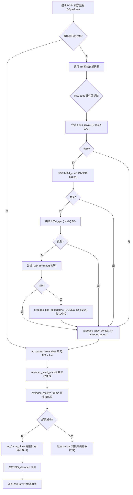
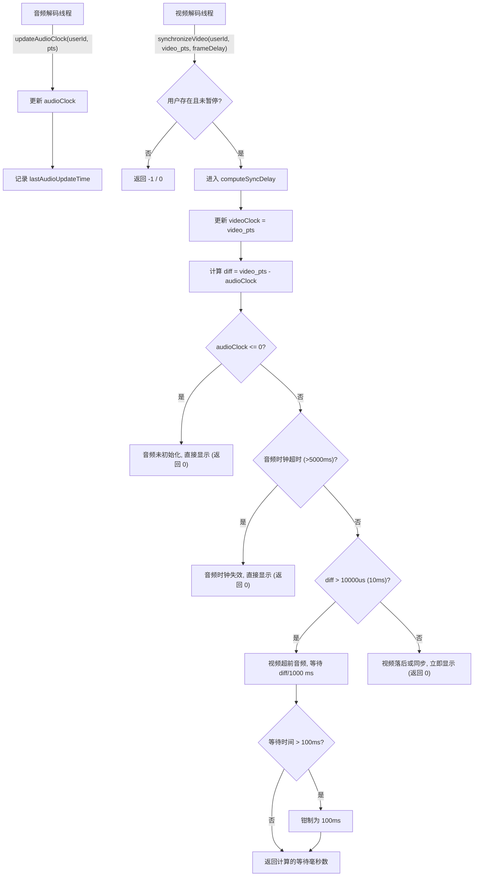
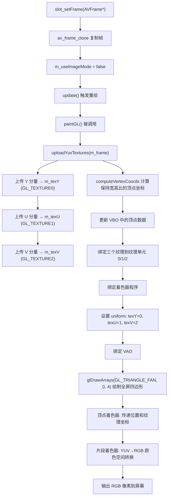

# 视频接收、解码、同步与渲染流程

## 1. 概述

### 1.1 职责

本文档详细描述视频会议系统中**远端视频流**从网络接收到最终呈现的完整处理流程，涵盖以下四个核心阶段：

| 阶段 | 职责 | 核心类 |
|------|------|--------|
| **H264 解码** | 将接收到的 H264 裸流（Annex-B / AVCC 格式）解码为 YUV420P 像素数据 | `H264Decoder` |
| **音视频同步** | 以音频时钟为主时钟，计算视频帧的等待延迟，保证唇音同步 | `AVSyncManager` |
| **OpenGL 渲染** | 将 YUV420P 数据上传至 GPU 纹理，通过 GLSL 着色器实时转换为 RGB 并显示 | `YuvGLWidget` |

### 1.2 关键文件

| 文件名 | 说明 |
|--------|------|
| `h264decoder.h` | H264 解码器头文件，声明解码器类接口 |
| `h264decoder.cpp` | H264 解码器实现，含硬件回退解码链逻辑 |
| `AVSyncManager.h` | 音视频同步管理器头文件，定义同步上下文结构体 |
| `AVSyncManager.cpp` | 音视频同步管理器实现，含音频主时钟同步算法 |
| `yuvglwidget.h` | OpenGL YUV 渲染控件头文件 |
| `yuvglwidget.cpp` | OpenGL YUV 渲染实现，含 GLSL 着色器和纹理管理 |

---

## 2. 流程总览

### 2.1 H264 解码流程



### 2.2 音视频同步流程



### 2.3 OpenGL YUV 渲染流程



---

## 3. 关键代码文件一览

| 文件 | 行数（约） | 核心功能 | 依赖库 |
|------|-----------|----------|--------|
| `h264decoder.h` | ~35 | H264 解码器类声明 | Qt Core, FFmpeg (libavcodec, libavutil, libswscale) |
| `h264decoder.cpp` | ~110 | H264 解码器实现 | 同上 |
| `AVSyncManager.h` | ~55 | 同步上下文结构体 + 同步管理器声明 | Qt Core, STL (map, mutex) |
| `AVSyncManager.cpp` | ~185 | 音视频同步算法实现 | Qt Core |
| `yuvglwidget.h` | ~50 | OpenGL 渲染控件声明 | Qt OpenGL |
| `yuvglwidget.cpp` | ~230 | OpenGL YUV 渲染实现 | Qt OpenGL, FFmpeg (libavutil) |

---

## 4. 完整代码逐行解析

### 4.1 h264decoder.h — H264 解码器声明

```cpp
#ifndef H264DECODER_H                    // 头文件保护宏，防止重复包含
#define H264DECODER_H

#include <QObject>                       // Qt 对象基类，提供信号槽机制和对象树管理
#include <QImage>                        // Qt 图像类（头文件中未直接使用，为未来扩展预留）
#include <QByteArray>                    // Qt 字节数组类，用于承载 H264 裸流数据

extern "C"                               // FFmpeg 为 C 库，需要 extern "C" 防止 C++ 名称修饰
{
#include "libavcodec/avcodec.h"          // FFmpeg 编解码核心 API（AVCodec, AVCodecContext 等）
#include "libavutil/imgutils.h"          // FFmpeg 图像工具函数（av_image_get_buffer_size 等）
#include "libavutil/opt.h"               // FFmpeg 选项设置 API（av_opt_set 等）
#include "libswscale/swscale.h"          // FFmpeg 像素格式转换库（头文件中引用，实现中未直接使用）
}

class H264Decoder : public QObject        // 继承 QObject，支持信号槽机制
{
    Q_OBJECT                              // Qt 元对象宏，启用信号槽、反射等功能
public:
    explicit H264Decoder(QObject *parent = nullptr);
    // 构造函数，parent 用于 Qt 对象树的父子关系管理，nullptr 表示无父对象

    ~H264Decoder() override;
    // 析构函数，override 确认重写 QObject 的虚析构函数

    bool init();                          // 初始化解码器，成功返回 true
    AVFrame* decode(const QByteArray &h264Data);
    // 解码一帧 H264 数据，返回解码后的 AVFrame*（调用者负责管理生命周期）
    void close();                         // 关闭解码器，释放所有资源
    bool isReady() const { return m_codecCtx != nullptr; }
    // 内联函数，检查解码器是否已初始化（编解码上下文非空即为就绪）

signals:
    void SIG_decoded(AVFrame *frame);     // 信号：每当成功解码一帧时发射，携带 AVFrame 指针

private:
    AVCodecContext  *m_codecCtx;           // FFmpeg 编解码上下文，存储解码器状态和参数
    AVFrame         *m_frame;              // FFmpeg 帧结构体，用于接收解码输出（工作缓冲区）
    AVPacket        *m_pkt;               // FFmpeg 数据包结构体，用于向解码器发送压缩数据
    bool             m_initialized;        // 初始化标志位，防止重复初始化

    bool initCodec();                     // 私有方法：执行实际的编解码器初始化逻辑
    void freeResources();                 // 私有方法：释放所有 FFmpeg 资源
};
#endif                                    // H264DECODER_H 结束
```

---

### 4.2 h264decoder.cpp — H264 解码器实现

```cpp
#include "h264decoder.h"                  // 包含对应的头文件
#include <QDebug>                         // Qt 调试输出

// ==================== 构造函数 ====================
H264Decoder::H264Decoder(QObject *parent) // 参数: parent - 父对象指针，用于对象树管理
    : QObject(parent)                     // 初始化基类 QObject
    , m_codecCtx(nullptr)                 // 初始化编解码上下文为空
    , m_frame(nullptr)                    // 初始化帧结构体为空
    , m_pkt(nullptr)                      // 初始化数据包为空
    , m_initialized(false)                // 初始化标志位为 false
{
    // 函数体为空，所有初始化在成员初始化列表中完成
}

// ==================== 析构函数 ====================
H264Decoder::~H264Decoder()
{
    close();                              // 确保释放所有 FFmpeg 资源
}

// ==================== 公开初始化接口 ====================
bool H264Decoder::init()
{
    if (m_initialized) {                  // 如果已经初始化过
        return true;                      // 直接返回成功，避免重复初始化
    }
    return initCodec();                   // 委托给私有方法执行实际初始化
}

// ==================== 核心初始化逻辑 ====================
bool H264Decoder::initCodec()
{
    // ---------- 第一阶段：硬件解码器回退链 ----------
    // 按优先级排列：DXVA2 (Windows) > CUVID (NVIDIA) > QSV (Intel) > 软解
    const char *decoder_names[] = {
        "h264_dxva2",                     // Direct3D 9 硬件加速解码（Windows 平台优先）
        "h264_cuvid",                     // NVIDIA CUDA 视频解码（需要 NVIDIA GPU + 驱动）
        "h264_qsv",                       // Intel Quick Sync Video（需要 Intel 集成显卡）
        "h264"                            // FFmpeg 内置软件解码器（通用兜底方案）
    };

    const AVCodec *codec = nullptr;       // 找到的解码器指针
    QString usedDecoder;                  // 记录实际使用的解码器名称，用于日志

    // 遍历回退链，找到第一个可用的解码器
    for (size_t i = 0; i < sizeof(decoder_names)/sizeof(decoder_names[0]); ++i) {
        // sizeof(decoder_names)/sizeof(decoder_names[0]) 计算数组元素个数
        codec = avcodec_find_decoder_by_name(decoder_names[i]);
        // 按名称查找 FFmpeg 已注册的解码器
        if (codec) {                      // 如果找到了
            usedDecoder = decoder_names[i]; // 记录名称
            qDebug() << "H264Decoder: using decoder" << usedDecoder;
            break;                        // 跳出循环，使用该解码器
        }
    }

    // 如果按名称查找全部失败，使用 FFmpeg 标准 API 按 Codec ID 查找
    if (!codec) {
        codec = avcodec_find_decoder(AV_CODEC_ID_H264);
        // AV_CODEC_ID_H264 是 FFmpeg 内置的 H264 解码器标识符
        usedDecoder = "h264(default)";    // 标记为默认解码器
    }

    if (!codec) {                         // 如果连默认解码器都找不到
        qCritical() << "H264Decoder: codec H264 not found";
        return false;                     // 初始化失败
    }

    // ---------- 第二阶段：分配编解码上下文 ----------
    m_codecCtx = avcodec_alloc_context3(codec);
    // 为找到的解码器分配上下文结构体，上下文存储解码器的所有运行时状态
    if (!m_codecCtx) {                    // 分配失败
        qCritical() << "H264Decoder: alloc context failed";
        return false;
    }

    m_codecCtx->refcounted_frames = 1;
    // 启用引用计数帧模式
    // 值为 1 时，解码输出的 AVFrame 使用引用计数管理底层数据缓冲区
    // 当最后一个引用被 av_frame_unref() 时，缓冲区才会被真正释放
    // 这允许多处共享同一个帧数据而无需拷贝（零拷贝传递）

    // ---------- 第三阶段：打开解码器 ----------
    int ret = avcodec_open2(m_codecCtx, codec, nullptr);
    // avcodec_open2: 使用指定的 codec 打开编解码上下文
    // 参数1: m_codecCtx - 要打开的上下文
    // 参数2: codec - 解码器实例
    // 参数3: nullptr - 附加选项字典（此处无需额外选项）
    // 返回值: 0 成功，负数为 AVERROR 错误码
    if (ret < 0) {
        qCritical() << "H264Decoder: avcodec_open2 failed," << ret;
        avcodec_free_context(&m_codecCtx); // 释放已分配的上下文
        m_codecCtx = nullptr;              // 置空防止悬空指针
        return false;
    }

    // ---------- 第四阶段：分配帧和数据包缓冲区 ----------
    m_frame = av_frame_alloc();           // 分配 AVFrame，用于存储解码输出的 YUV 帧
    m_pkt = av_packet_alloc();            // 分配 AVPacket，用于存储待解码的压缩数据

    if (!m_frame || !m_pkt) {             // 任一分配失败
        qCritical() << "H264Decoder: alloc frame/pkt failed";
        freeResources();                  // 释放已分配的所有资源
        return false;
    }

    m_initialized = true;                 // 标记初始化成功
    qDebug() << "H264Decoder: init success with" << usedDecoder;
    return true;
}

// ==================== 解码一帧 ====================
AVFrame* H264Decoder::decode(const QByteArray &h264Data)
// 参数: h264Data - 包含一个或多个 NAL 单元的 H264 裸流数据
// 返回值: 解码成功返回 AVFrame*（调用者负责 av_frame_free），失败返回 nullptr
{
    // 延迟初始化：如果尚未初始化则自动尝试初始化
    if (!m_initialized && !init()) {
        return nullptr;                   // 初始化失败则无法解码
    }

    if (h264Data.isEmpty()) {             // 空数据包直接返回
        return nullptr;
    }

    // ---------- 第一步：将 QByteArray 数据包装进 AVPacket ----------
    int ret = av_packet_from_data(m_pkt,
                                  reinterpret_cast<uint8_t*>(const_cast<char*>(h264Data.constData())),
                                  // constData() 返回 const char*
                                  // const_cast 去除 const（FFmpeg C API 要求非 const）
                                  // reinterpret_cast 将 char* 转换为 uint8_t*
                                  h264Data.size());
    // av_packet_from_data: 将外部内存直接绑定到 AVPacket
    // 注意：AVPacket 不会拷贝数据，仅持有指针，数据生命周期由 QByteArray 保证
    if (ret < 0) {
        qWarning() << "H264Decoder: av_packet_from_data failed," << ret;
        return nullptr;
    }

    // ---------- 第二步：将压缩数据送入解码器 ----------
    ret = avcodec_send_packet(m_codecCtx, m_pkt);
    // avcodec_send_packet: 向解码器提交一个压缩数据包
    // 解码器内部可能需要多个 packet 才能输出一帧（B帧、参考帧等）
    // 返回值: 0 成功，AVERROR(EAGAIN) 表示需要先接收输出，负数为错误

    av_packet_unref(m_pkt);
    // 立即解除 AVPacket 对数据的引用
    // 因为数据由 QByteArray 管理，AVPacket 不应持有引用

    if (ret < 0) {
        qWarning() << "H264Decoder: avcodec_send_packet failed," << ret;
        return nullptr;
    }

    // ---------- 第三步：从解码器接收解码后的帧 ----------
    ret = avcodec_receive_frame(m_codecCtx, m_frame);
    // avcodec_receive_frame: 尝试从解码器获取一帧解码输出
    // 返回值: 0 成功，AVERROR(EAGAIN) 表示需要更多输入数据，AVERROR_EOF 表示结束
    if (ret < 0) {
        return nullptr;                   // 可能需要更多数据包才能解码出完整帧
    }

    // ---------- 第四步：克隆帧并发射信号 ----------
    AVFrame *sharedFrame = av_frame_clone(m_frame);
    // av_frame_clone: 深拷贝帧的元数据，并将底层数据缓冲区的引用计数 +1
    // 这样 sharedFrame 和 m_frame 共享同一份像素数据（零拷贝）
    // 调用者可以通过 av_frame_free(&sharedFrame) 安全释放自己的引用

    av_frame_unref(m_frame);
    // 解除 m_frame 对底层数据的引用，为下一帧解码做准备
    // 底层数据不会被释放，因为 sharedFrame 仍持有引用

    if (sharedFrame) {
        Q_EMIT SIG_decoded(sharedFrame);
        // 发射信号，通知所有连接的槽函数（如 YuvGLWidget::slot_setFrame）
    }

    return sharedFrame;                   // 返回解码帧，调用者负责最终释放
}

// ==================== 关闭解码器 ====================
void H264Decoder::close()
{
    freeResources();                      // 委托给资源释放方法
}

// ==================== 释放所有资源 ====================
void H264Decoder::freeResources()
{
    if (m_frame) {
        av_frame_free(&m_frame);          // 释放 AVFrame（同时置空指针）
    }
    if (m_pkt) {
        av_packet_free(&m_pkt);           // 释放 AVPacket（同时置空指针）
    }
    if (m_codecCtx) {
        avcodec_free_context(&m_codecCtx);// 释放编解码上下文（同时关闭解码器）
    }
    m_initialized = false;                // 重置初始化标志
}
```

---

### 4.3 AVSyncManager.h — 音视频同步管理器声明

```cpp
#ifndef AVSYNCMANAGER_H                   // 头文件保护宏
#define AVSYNCMANAGER_H

#include <QObject>                        // Qt 对象基类
#include <map>                            // STL 有序映射容器，存储 userId → SyncContext
#include <mutex>                          // C++11 互斥锁，保证线程安全
#include <QTime>                          // Qt 时间类，用于获取当前时间微秒级精度
#include <QThread>                        // Qt 线程类（头文件中引用，实际未直接使用）
#include <QDebug>                         // Qt 调试输出

// ==================== 同步上下文结构体 ====================
struct SyncContext                        // 每个远端用户对应一个独立的同步上下文
{
    double audioClock;                    // 音频播放时钟（单位：微秒 us），最新解码音频帧的 PTS
    double videoClock;                    // 视频播放时钟（单位：微秒 us），最新解码视频帧的 PTS + frameDelay
    qint64 lastAudioUpdateTime;           // 音频时钟最后更新的系统时间戳（单位：毫秒 ms）
    qint64 lastVideoUpdateTime;           // 视频时钟最后更新的系统时间戳（单位：毫秒 ms）
    bool isPaused;                        // 暂停标志位，为 true 时跳过同步计算

    SyncContext()                          // 默认构造函数
        : audioClock(0.0)                 // 音频时钟初始为 0（表示未初始化）
        , videoClock(0.0)                 // 视频时钟初始为 0
        , lastAudioUpdateTime(0)          // 上次音频更新时间初始为 0
        , lastVideoUpdateTime(0)          // 上次视频更新时间初始为 0
        , isPaused(false)                 // 默认非暂停状态
    {
    }
};

// ==================== 音视频同步管理器类 ====================
class AVSyncManager                       // 非 QObject，采用单例模式管理全局同步状态
{
public:
    static AVSyncManager& getInstance();  // 获取单例实例（Meyer's Singleton，线程安全）

    // --- 远端用户管理 ---
    void addUser(int userId);             // 添加用户的同步上下文
    void removeUser(int userId);          // 移除用户的同步上下文

    // --- 远端同步接口 ---
    void updateAudioClock(int userId, double pts);
    // 更新指定用户的音频时钟，pts 单位为微秒
    int synchronizeVideo(int userId, double video_pts, double frameDelay);
    // 计算视频帧的同步等待时间，返回等待毫秒数
    double getAudioClock(int userId);     // 获取指定用户的音频时钟值
    double getVideoClock(int userId);     // 获取指定用户的视频时钟值
    void resetUserClock(int userId);      // 重置指定用户的时钟
    void resetAllClocks();                // 重置所有用户的时钟

    // --- 用户暂停/恢复 ---
    void pauseUser(int userId);           // 暂停指定用户的同步计算
    void resumeUser(int userId);          // 恢复同步并重置时钟

    // --- 本地音视频同步接口 ---
    void updateLocalAudioClock(double pts);  // 更新本地音频时钟
    double getLocalAudioClock();              // 获取本地音频时钟

    static qint64 getCurrentTimeUs();     // 获取当前时间（微秒级精度）

private:
    AVSyncManager();                      // 私有构造函数（单例模式）
    AVSyncManager(const AVSyncManager&) = delete;
    // 禁止拷贝构造
    AVSyncManager& operator=(const AVSyncManager&) = delete;
    // 禁止赋值操作

    SyncContext& getOrCreateContext(int userId);
    // 获取或自动创建用户的同步上下文
    int computeSyncDelay(SyncContext& ctx, double video_pts, double frameDelay);
    // 核心同步算法：计算视频帧需要等待的毫秒数

    std::map<int, SyncContext> m_syncContexts;
    // 远端用户同步上下文映射表: userId → SyncContext
    std::mutex m_mutex;                   // 保护 m_syncContexts 的互斥锁

    double m_localAudioClock;             // 本地音频时钟（微秒）
    double m_localVideoClock;             // 本地视频时钟（微秒）
    std::mutex m_localMutex;              // 保护本地时钟的互斥锁

    static const double SYNC_THRESHOLD_US;
    // 同步阈值（微秒），视频超前音频超过此值则等待
    static const int MAX_WAIT_MS;
    // 最大等待时间（毫秒），防止视频卡顿过久
    static const int CLOCK_TIMEOUT_MS;
    // 时钟超时时间（毫秒），音频时钟超过此时间未更新则认为失效
};
#endif                                    // AVSYNCMANAGER_H 结束
```

---

### 4.4 AVSyncManager.cpp — 音视频同步管理器实现

```cpp
#include "AVSyncManager.h"
#include <QDateTime>                      // Qt 日期时间类，用于获取系统时间戳

// ==================== 静态常量定义 ====================
const double AVSyncManager::SYNC_THRESHOLD_US = 10000.0;
// 同步阈值: 10000 微秒 = 10 毫秒
// 视频 PTS 超前音频 PTS 超过 10ms 时，视频需要等待
const int AVSyncManager::MAX_WAIT_MS = 100;
// 最大等待时间: 100 毫秒
// 即使计算出的等待时间更长，也只等待 100ms，防止视频完全停滞
const int AVSyncManager::CLOCK_TIMEOUT_MS = 5000;
// 时钟超时: 5000 毫秒 = 5 秒
// 如果音频时钟超过 5 秒未更新，认为音频流已断开，视频直接显示

// ==================== 构造函数 ====================
AVSyncManager::AVSyncManager()
    : m_localAudioClock(0.0)              // 本地音频时钟初始为 0
    , m_localVideoClock(0.0)              // 本地视频时钟初始为 0
{
    qDebug() << "[AVSync] AVSyncManager 已初始化";
}

// ==================== 单例获取 ====================
AVSyncManager& AVSyncManager::getInstance()
{
    static AVSyncManager instance;
    // Meyer's Singleton: C++11 保证局部静态变量的线程安全初始化
    return instance;
}

// ==================== 添加用户 ====================
void AVSyncManager::addUser(int userId)
// 参数: userId - 远端用户唯一标识符
{
    std::lock_guard<std::mutex> lock(m_mutex);
    // RAII 锁：作用域结束自动解锁，防止死锁

    if (m_syncContexts.find(userId) != m_syncContexts.end())
    // 检查用户是否已存在
    {
        qDebug() << "[AVSync] 用户" << userId << "已存在，跳过添加";
        return;                           // 已存在则不重复添加
    }
    m_syncContexts[userId] = SyncContext();
    // 使用默认构造函数创建新的同步上下文并插入映射表
    qDebug() << "[AVSync] 添加用户同步上下文, userId:" << userId
             << ", 当前用户数:" << m_syncContexts.size();
}

// ==================== 移除用户 ====================
void AVSyncManager::removeUser(int userId)
// 参数: userId - 要移除的远端用户 ID
{
    std::lock_guard<std::mutex> lock(m_mutex);

    auto it = m_syncContexts.find(userId);
    if (it != m_syncContexts.end())
    {
        m_syncContexts.erase(it);         // 从映射表中删除
        qDebug() << "[AVSync] 移除用户同步上下文, userId:" << userId
                 << ", 剩余用户数:" << m_syncContexts.size();
    }
    else
    {
        qDebug() << "[AVSync] 移除用户时未找到, userId:" << userId;
    }
}

// ==================== 更新音频时钟 ====================
void AVSyncManager::updateAudioClock(int userId, double pts)
// 参数: userId - 用户 ID
// 参数: pts - 最新解码音频帧的呈现时间戳（单位：微秒）
{
    std::lock_guard<std::mutex> lock(m_mutex);

    auto it = m_syncContexts.find(userId);
    if (it == m_syncContexts.end())
    {
        // 用户不存在时自动创建上下文（防御性编程）
        m_syncContexts[userId] = SyncContext();
        qDebug() << "[AVSync] updateAudioClock: 自动创建用户上下文, userId:" << userId;
        it = m_syncContexts.find(userId);  // 重新获取迭代器
    }

    SyncContext& ctx = it->second;

    if (ctx.isPaused)                     // 如果用户处于暂停状态
    {
        return;                           // 不更新时钟
    }

    ctx.audioClock = pts;                 // 更新音频时钟为最新 PTS
    ctx.lastAudioUpdateTime = QDateTime::currentMSecsSinceEpoch();
    // 记录当前系统时间（毫秒级），用于后续超时检测

    qDebug() << "[AVSync] 更新音频时钟, userId:" << userId
             << ", audioClock(us):" << ctx.audioClock;
}

// ==================== 远端视频同步 ====================
int AVSyncManager::synchronizeVideo(int userId, double video_pts, double frameDelay)
// 参数: userId - 用户 ID
// 参数: video_pts - 当前视频帧的呈现时间戳（微秒）
// 参数: frameDelay - 帧间隔时间（微秒），通常为 1/fps * 1000000
// 返回值: 需要等待的毫秒数，0 表示立即显示，-1 表示用户不存在
{
    std::lock_guard<std::mutex> lock(m_mutex);

    auto it = m_syncContexts.find(userId);
    if (it == m_syncContexts.end())
    {
        qDebug() << "[AVSync] synchronizeVideo: 用户不存在, userId:" << userId;
        return -1;                        // 用户不存在
    }

    SyncContext& ctx = it->second;

    if (ctx.isPaused)                     // 用户暂停时直接显示
    {
        return 0;
    }

    return computeSyncDelay(ctx, video_pts, frameDelay);
    // 委托给核心同步算法
}

// ==================== 本地视频同步 ====================
int AVSyncManager::synchronizeLocalVideo(double video_pts, double frameDelay)
// 参数: video_pts - 本地视频帧 PTS（微秒）
// 参数: frameDelay - 帧间隔（微秒）
// 返回值: 需要等待的毫秒数
{
    std::lock_guard<std::mutex> lock(m_localMutex);
    // 使用独立的本地互斥锁

    SyncContext ctx;                      // 创建临时上下文
    ctx.audioClock = m_localAudioClock;   // 从本地音频时钟获取
    ctx.videoClock = m_localVideoClock;   // 从本地视频时钟获取
    ctx.isPaused = false;                 // 本地不暂停

    int waitMs = computeSyncDelay(ctx, video_pts, frameDelay);

    m_localVideoClock = ctx.videoClock;   // 将更新后的视频时钟写回
    return waitMs;
}

// ==================== 核心同步算法 ====================
int AVSyncManager::computeSyncDelay(SyncContext& ctx, double video_pts, double frameDelay)
// 参数: ctx - 同步上下文（引用，会修改其中的 videoClock）
// 参数: video_pts - 当前视频帧 PTS（微秒）
// 参数: frameDelay - 帧间隔（微秒）
// 返回值: 视频帧需要等待的毫秒数，0 表示立即显示
{
    // --- 更新视频时钟 ---
    if (video_pts > 0.0)                  // 如果 PTS 有效
    {
        ctx.videoClock = video_pts;       // 更新视频时钟
    }

    double currentVideoPts = ctx.videoClock;
    // 保存当前视频 PTS 用于同步计算

    ctx.videoClock += frameDelay;
    // 预测下一帧的视频时钟 = 当前 PTS + 帧间隔
    // 这是为了在没有新帧到达时，时钟也能推进

    // --- 超时检测 ---
    qint64 now = QDateTime::currentMSecsSinceEpoch();
    // 获取当前系统时间（毫秒）

    if (ctx.audioClock <= 0.0)
    // 如果音频时钟为 0，说明音频尚未开始播放
    {
        qDebug() << "[AVSync] 音频时钟未初始化，视频直接显示";
        return 0;                         // 音频未就绪，视频直接显示避免黑屏
    }

    if (ctx.lastAudioUpdateTime > 0 &&
        (now - ctx.lastAudioUpdateTime) > CLOCK_TIMEOUT_MS)
    // 如果上次音频更新距今超过 5 秒
    {
        qDebug() << "[AVSync] 音频时钟超时, 距上次更新:" << (now - ctx.lastAudioUpdateTime) << "ms";
        return 0;                         // 音频流可能已断开，视频直接显示
    }

    // --- 音频主时钟同步计算 ---
    double diff = currentVideoPts - ctx.audioClock;
    // diff > 0: 视频超前音频（视频需要等待）
    // diff < 0: 视频落后音频（视频需要加速/跳过）
    // diff ≈ 0: 音视频同步

    qDebug() << "[AVSync] 同步比对 video_pts:" << currentVideoPts
             << ", audioClock:" << ctx.audioClock
             << ", diff(us):" << diff;

    if (diff > SYNC_THRESHOLD_US)
    // 视频超前音频超过同步阈值（10ms）
    {
        int waitMs = (int)(diff / 1000.0);
        // 将微秒差值转换为毫秒

        if (waitMs > MAX_WAIT_MS)
        {
            waitMs = MAX_WAIT_MS;         // 钳制最大等待时间为 100ms
        }

        qDebug() << "[AVSync] 视频超前, 等待:" << waitMs << "ms";
        return waitMs;                    // 返回等待时间
    }

    return 0;                             // 视频未超前或超前量在阈值内，立即显示
}

// ==================== 获取音频时钟 ====================
double AVSyncManager::getAudioClock(int userId)
// 参数: userId - 用户 ID
// 返回值: 音频时钟值（微秒），用户不存在返回 0.0
{
    std::lock_guard<std::mutex> lock(m_mutex);
    auto it = m_syncContexts.find(userId);
    if (it != m_syncContexts.end())
    {
        return it->second.audioClock;
    }
    return 0.0;
}

// ==================== 获取视频时钟 ====================
double AVSyncManager::getVideoClock(int userId)
// 参数: userId - 用户 ID
// 返回值: 视频时钟值（微秒），用户不存在返回 0.0
{
    std::lock_guard<std::mutex> lock(m_mutex);
    auto it = m_syncContexts.find(userId);
    if (it != m_syncContexts.end())
    {
        return it->second.videoClock;
    }
    return 0.0;
}

// ==================== 重置单个用户时钟 ====================
void AVSyncManager::resetUserClock(int userId)
// 参数: userId - 用户 ID
{
    std::lock_guard<std::mutex> lock(m_mutex);
    auto it = m_syncContexts.find(userId);
    if (it != m_syncContexts.end())
    {
        it->second.audioClock = 0.0;      // 重置音频时钟
        it->second.videoClock = 0.0;      // 重置视频时钟
        it->second.lastAudioUpdateTime = 0;// 重置音频更新时间
        it->second.lastVideoUpdateTime = 0;// 重置视频更新时间
        // 注意: 不重置 isPaused 状态
        qDebug() << "[AVSync] 重置用户时钟, userId:" << userId;
    }
}

// ==================== 重置所有时钟 ====================
void AVSyncManager::resetAllClocks()
// 重置所有远端用户和本地的时钟（通常在会议重连时调用）
{
    std::lock_guard<std::mutex> lock(m_mutex);
    for (auto& pair : m_syncContexts)     // 遍历所有用户上下文
    {
        pair.second.audioClock = 0.0;
        pair.second.videoClock = 0.0;
        pair.second.lastAudioUpdateTime = 0;
        pair.second.lastVideoUpdateTime = 0;
        pair.second.isPaused = false;     // 同时解除暂停状态
    }
    qDebug() << "[AVSync] 重置所有用户时钟, 用户数:" << m_syncContexts.size();
    {
        std::lock_guard<std::mutex> localLock(m_localMutex);
        // 在持有 m_mutex 的同时获取 m_localMutex（嵌套锁，此处安全因为顺序一致）
        m_localAudioClock = 0.0;
        m_localVideoClock = 0.0;
    }
}

// ==================== 暂停用户同步 ====================
void AVSyncManager::pauseUser(int userId)
// 参数: userId - 用户 ID
{
    std::lock_guard<std::mutex> lock(m_mutex);
    auto it = m_syncContexts.find(userId);
    if (it != m_syncContexts.end())
    {
        it->second.isPaused = true;       // 设置暂停标志
        qDebug() << "[AVSync] 暂停用户同步, userId:" << userId;
    }
}

// ==================== 恢复用户同步 ====================
void AVSyncManager::resumeUser(int userId)
// 参数: userId - 用户 ID
{
    std::lock_guard<std::mutex> lock(m_mutex);
    auto it = m_syncContexts.find(userId);
    if (it != m_syncContexts.end())
    {
        it->second.isPaused = false;      // 清除暂停标志
        it->second.audioClock = 0.0;      // 重置时钟（避免恢复后旧数据导致瞬间大偏移）
        it->second.videoClock = 0.0;
        qDebug() << "[AVSync] 恢复用户同步, userId:" << userId;
    }
}

// ==================== 更新本地音频时钟 ====================
void AVSyncManager::updateLocalAudioClock(double pts)
// 参数: pts - 本地音频帧 PTS（微秒）
{
    std::lock_guard<std::mutex> lock(m_localMutex);
    m_localAudioClock = pts;              // 直接更新
}

// ==================== 获取本地音频时钟 ====================
double AVSyncManager::getLocalAudioClock()
// 返回值: 本地音频时钟（微秒）
{
    std::lock_guard<std::mutex> lock(m_localMutex);
    return m_localAudioClock;
}

// ==================== 获取当前时间（微秒） ====================
qint64 AVSyncManager::getCurrentTimeUs()
// 返回值: 当天 00:00:00 至今的微秒数
{
    QTime now = QTime::currentTime();     // 获取当前时间
    return (qint64)(
        now.hour() * 3600000000LL +       // 小时 → 微秒 (3600 * 1000000)
        now.minute() * 60000000LL +       // 分钟 → 微秒 (60 * 1000000)
        now.second() * 1000000LL +        // 秒 → 微秒 (1 * 1000000)
        now.msec() * 1000LL               // 毫秒 → 微秒
    );
}
```

---

### 4.5 yuvglwidget.h — OpenGL YUV 渲染控件声明

```cpp
#ifndef YUVGLWIDGET_H                     // 头文件保护宏
#define YUVGLWIDGET_H

#include <QOpenGLWidget>                  // Qt OpenGL 控件基类，提供 OpenGL 上下文和渲染循环
#include <QOpenGLFunctions>               // Qt OpenGL 函数包装，跨平台访问 GL API
#include <QOpenGLShaderProgram>           // Qt OpenGL 着色器程序管理
#include <QOpenGLBuffer>                  // Qt OpenGL 缓冲区对象管理（VBO）
#include <QOpenGLVertexArrayObject>       // Qt OpenGL 顶点数组对象管理（VAO）
#include <QImage>                         // Qt 图像类，用于 RGB 图像回退模式

struct AVFrame;                           // 前向声明 FFmpeg 帧结构体

class YuvGLWidget : public QOpenGLWidget, protected QOpenGLFunctions
// 继承 QOpenGLWidget: 提供 OpenGL 渲染表面和生命周期回调
// 继承 QOpenGLFunctions: 提供 glXxx 函数的跨平台访问
{
    Q_OBJECT                              // Qt 元对象宏
public:
    explicit YuvGLWidget(QWidget *parent = nullptr);
    // 构造函数
    ~YuvGLWidget() override;
    // 析构函数，负责释放 OpenGL 资源

    void slot_setFrame(AVFrame *frame);
    // 槽函数：接收解码后的 YUV420P 帧进行渲染
    void slot_setImage(const QImage &img);
    // 槽函数：接收 RGB 图像进行渲染（回退模式）

protected:
    void initializeGL() override;         // OpenGL 初始化回调（首次显示时调用一次）
    void paintGL() override;              // OpenGL 绘制回调（每次 update() 触发）
    void resizeGL(int w, int h) override; // OpenGL 窗口大小变化回调

private:
    bool initShader();                    // 初始化 GLSL 着色器程序
    void initQuad();                      // 初始化全屏四边形的 VAO/VBO
    void initTextures();                  // 创建 YUV 三个纹理对象
    void uploadYuvTextures(AVFrame *frame);
    // 将 YUV 三个分量数据上传至 GPU 纹理
    void cleanupGL();                     // 释放所有 OpenGL 资源
    void computeVertexCoords(float &halfW, float &halfH);
    // 计算保持宽高比的顶点坐标

    // --- 纹理对象 ---
    GLuint m_texY;                        // Y 分量纹理 ID
    GLuint m_texU;                        // U 分量纹理 ID
    GLuint m_texV;                        // V 分量纹理 ID
    bool   m_texturesAllocated;           // 纹理是否已分配（首帧/后续帧用不同 GL 调用）
    int    m_texWidth;                    // 当前纹理宽度（用于检测分辨率变化）
    int    m_texHeight;                   // 当前纹理高度

    // --- 着色器与缓冲区 ---
    QOpenGLShaderProgram   *m_shader;     // GLSL 着色器程序对象
    QOpenGLVertexArrayObject *m_vao;      // 顶点数组对象
    QOpenGLBuffer          *m_vbo;        // 顶点缓冲区对象

    // --- 帧数据 ---
    AVFrame *m_frame;                     // 当前待渲染的 YUV 帧（深拷贝，调用者释放后不影响）
    QImage   m_image;                     // RGB 图像回退模式
    bool     m_useImageMode;              // 是否使用 RGB 图像模式（true=图像，false=YUV 帧）
};
#endif                                    // YUVGLWIDGET_H 结束
```

---

### 4.6 yuvglwidget.cpp — OpenGL YUV 渲染实现

```cpp
#include "yuvglwidget.h"
#include <QDebug>

extern "C"
{
#include "libavutil/frame.h"              // FFmpeg AVFrame 操作（av_frame_clone, av_frame_free 等）
}

// ==================== 顶点着色器源码 ====================
static const char *kVertexShaderSrc =
    "attribute vec2 aPos;\n"              // 输入属性: 顶点位置（NDC 坐标系，范围 [-1, 1]）
    "attribute vec2 aTexCoord;\n"         // 输入属性: 纹理坐标（范围 [0, 1]）
    "varying vec2 vTexCoord;\n"           // 输出到片段着色器的纹理坐标
    "void main() {\n"
    "    gl_Position = vec4(aPos, 0.0, 1.0);\n"
    // 将 2D 位置扩展为 4D 齐次坐标（z=0, w=1），传递给光栅化器
    "    vTexCoord = aTexCoord;\n"        // 直接传递纹理坐标
    "}\n";

// ==================== 片段着色器源码 ====================
static const char *kFragmentShaderSrc =
    "uniform sampler2D texY;\n"           // uniform: Y 分量纹理采样器（纹理单元 0）
    "uniform sampler2D texU;\n"           // uniform: U 分量纹理采样器（纹理单元 1）
    "uniform sampler2D texV;\n"           // uniform: V 分量纹理采样器（纹理单元 2）
    "varying vec2 vTexCoord;\n"           // 从顶点着色器插值的纹理坐标
    "void main() {\n"
    "    float y = texture2D(texY, vTexCoord).r;\n"
    // 从 Y 纹理采样，取红色通道（因为用 GL_RED 格式存储）
    "    float u = texture2D(texU, vTexCoord).r - 0.5;\n"
    // 从 U 纹理采样，减去 0.5 将 [0,1] 映射到 [-0.5, 0.5]
    "    float v = texture2D(texV, vTexCoord).r - 0.5;\n"
    // 从 V 纹理采样，同样映射到 [-0.5, 0.5]
    "    float r = y + 1.402 * v;\n"
    // YUV→RGB 转换公式 (BT.601): R = Y + 1.402 * (V - 128)
    "    float g = y - 0.344 * u - 0.714 * v;\n"
    // G = Y - 0.344 * (U - 128) - 0.714 * (V - 128)
    "    float b = y + 1.772 * u;\n"
    // B = Y + 1.772 * (U - 128)
    "    gl_FragColor = vec4(r, g, b, 1.0);\n"
    // 输出不透明的 RGB 颜色
    "}\n";

// ==================== 构造函数 ====================
YuvGLWidget::YuvGLWidget(QWidget *parent)
    : QOpenGLWidget(parent)               // 初始化基类
    , m_texY(0)                           // Y 纹理 ID 初始为 0（无效）
    , m_texU(0)                           // U 纹理 ID 初始为 0
    , m_texV(0)                           // V 纹理 ID 初始为 0
    , m_texturesAllocated(false)          // 纹理尚未分配
    , m_texWidth(0)                       // 纹理宽度初始为 0
    , m_texHeight(0)                      // 纹理高度初始为 0
    , m_shader(nullptr)                   // 着色器程序为空
    , m_vao(nullptr)                      // VAO 为空
    , m_vbo(nullptr)                      // VBO 为空
    , m_frame(nullptr)                    // 帧指针为空
    , m_useImageMode(false)               // 默认 YUV 模式
{
}

// ==================== 析构函数 ====================
YuvGLWidget::~YuvGLWidget()
{
    if (context()) {                      // 如果 OpenGL 上下文仍然有效
        makeCurrent();                    // 将此控件的 GL 上下文设为当前线程的活动上下文
        cleanupGL();                      // 释放所有 GL 资源
        doneCurrent();                    // 释放当前 GL 上下文
    }
    if (m_frame) {
        av_frame_free(&m_frame);          // 释放保存的帧数据
    }
}

// ==================== 设置 YUV 帧 ====================
void YuvGLWidget::slot_setFrame(AVFrame *frame)
// 参数: frame - 解码后的 AVFrame（YUV420P 格式），由 H264Decoder::decode 返回
{
    if (!frame) return;                   // 空帧不处理

    if (m_frame) {
        av_frame_free(&m_frame);          // 释放旧帧（引用计数 -1）
    }
    m_frame = av_frame_clone(frame);
    // 深拷贝帧元数据 + 引用计数 +1
    // 此后 frame 可以被其他地方安全释放

    m_useImageMode = false;               // 切换到 YUV 渲染模式
    update();                             // 请求重绘（异步，会在下一个事件循环中触发 paintGL）
}

// ==================== 设置 RGB 图像 ====================
void YuvGLWidget::slot_setImage(const QImage &img)
// 参数: img - RGB 格式的 QImage 图像
{
    if (m_frame) {
        av_frame_free(&m_frame);          // 释放 YUV 帧（如果有的话）
    }
    // [H264 崩溃修复] 必须使用 img.copy() 深拷贝，不能用 m_image = img 浅拷贝
    // 原Bug: m_image = img 是 QImage 隐式共享（浅拷贝），m_image 与 img 共享同一块像素数据。
    //        在多线程环境下（Video线程创建QImage + Main线程paintEvent读取 + Worker线程堆操作），
    //        paintEvent 中 m_image.scaled() / m_image.constBits() 读取共享像素数据时，
    //        如果原始 img 已被销毁且引用计数管理出现竞态，会访问已释放内存导致崩溃。
    // 修复: m_image = img.copy() 创建深拷贝，m_image 拥有完全独立的像素数据缓冲区，
    //       不受原始 img 生命周期和其他线程操作的影响。
    m_image = img.copy();                 // 深拷贝：m_image 拥有独立像素数据
    m_useImageMode = true;                // 切换到图像渲染模式
    update();                             // 请求重绘
}

// ==================== OpenGL 初始化 ====================
void YuvGLWidget::initializeGL()
// 在控件首次显示时由 Qt 框架自动调用
{
    initializeOpenGLFunctions();
    // 初始化 OpenGL 函数指针，必须在调用任何 GL 函数前执行

    glClearColor(0.0f, 0.0f, 0.0f, 1.0f);
    // 设置清除颜色为黑色（RGBA），作为视频画面外区域的背景色

    glEnable(GL_TEXTURE_2D);
    // 启用 2D 纹理功能（兼容 OpenGL 配置，核心模式下不严格需要）

    initShader();                         // 初始化着色器程序
    initQuad();                           // 初始化全屏四边形
    initTextures();                       // 创建 YUV 纹理对象
}

// ==================== 初始化着色器 ====================
bool YuvGLWidget::initShader()
{
    m_shader = new QOpenGLShaderProgram;  // 在堆上创建着色器程序对象

    if (!m_shader->addShaderFromSourceCode(QOpenGLShader::Vertex, kVertexShaderSrc)) {
        // 编译顶点着色器
        qCritical() << "YuvGLWidget: vertex shader compile failed:" << m_shader->log();
        return false;
    }

    if (!m_shader->addShaderFromSourceCode(QOpenGLShader::Fragment, kFragmentShaderSrc)) {
        // 编译片段着色器
        qCritical() << "YuvGLWidget: fragment shader compile failed:" << m_shader->log();
        return false;
    }

    if (!m_shader->link()) {
        // 链接着色器程序（将顶点和片段着色器组合为完整的渲染管线）
        qCritical() << "YuvGLWidget: shader link failed:" << m_shader->log();
        return false;
    }

    qDebug() << "YuvGLWidget: shader init success";
    return true;
}

// ==================== 初始化全屏四边形 ====================
void YuvGLWidget::initQuad()
{
    m_vao = new QOpenGLVertexArrayObject; // 创建 VAO
    m_vao->create();                      // 生成 OpenGL VAO 对象
    m_vao->bind();                        // 绑定为当前 VAO

    // 顶点数据布局: [posX, posY, texU, texV]，每行 4 个 float
    static const float kVertices[] = {
        -1.0f, -1.0f,  0.0f, 1.0f,       // 左下角: 位置(-1,-1), 纹理(0,1) —— YUV 纹理 Y 轴翻转
         1.0f, -1.0f,  1.0f, 1.0f,       // 右下角: 位置(1,-1),  纹理(1,1)
         1.0f,  1.0f,  1.0f, 0.0f,       // 右上角: 位置(1,1),   纹理(1,0)
        -1.0f,  1.0f,  0.0f, 0.0f,       // 左上角: 位置(-1,1),  纹理(0,0)
    };
    // 注意: 纹理坐标 V 分量与 OpenGL 坐标系 Y 轴方向相反（图像原点在左上，GL 原点在左下）

    m_vbo = new QOpenGLBuffer(QOpenGLBuffer::VertexBuffer);
    // 创建 VBO，类型为顶点缓冲区
    m_vbo->create();                      // 生成 OpenGL 缓冲区对象
    m_vbo->bind();                        // 绑定为当前缓冲区
    m_vbo->allocate(kVertices, sizeof(kVertices));
    // 将顶点数据上传到 GPU 显存

    int posAttr = m_shader->attributeLocation("aPos");
    // 获取顶点着色器中 aPos 属性的位置索引
    int texAttr = m_shader->attributeLocation("aTexCoord");
    // 获取顶点着色器中 aTexCoord 属性的位置索引

    glVertexAttribPointer(posAttr, 2, GL_FLOAT, GL_FALSE, 4 * sizeof(float), nullptr);
    // 设置 aPos 属性: 2 个分量 (x, y)，类型 GL_FLOAT，不归一化
    // 步长 = 4 * sizeof(float)（每行 4 个 float），偏移 = 0（从头开始）

    glVertexAttribPointer(texAttr, 2, GL_FLOAT, GL_FALSE, 4 * sizeof(float),
                          reinterpret_cast<void*>(2 * sizeof(float)));
    // 设置 aTexCoord 属性: 2 个分量 (u, v)，类型 GL_FLOAT
    // 偏移 = 2 * sizeof(float)（跳过前 2 个位置分量）

    glEnableVertexAttribArray(posAttr);   // 启用 aPos 顶点属性
    glEnableVertexAttribArray(texAttr);   // 启用 aTexCoord 顶点属性

    m_vbo->release();                     // 解绑 VBO
    m_vao->release();                     // 解绑 VAO
}

// ==================== 初始化纹理 ====================
void YuvGLWidget::initTextures()
{
    glGenTextures(3, &m_texY);
    // 一次性生成 3 个纹理对象，ID 存储在 m_texY, m_texU, m_texV 中
    // 因为 m_texY、m_texU、m_texV 在内存中连续排列（类成员声明顺序），所以 &m_texY 可以作为数组起始地址

    GLuint *texPtr = &m_texY;
    // 获取纹理 ID 数组的起始指针
    for (int i = 0; i < 3; ++i) {        // 遍历 3 个纹理
        glBindTexture(GL_TEXTURE_2D, texPtr[i]);
        // 绑定当前纹理

        glTexParameteri(GL_TEXTURE_2D, GL_TEXTURE_MIN_FILTER, GL_LINEAR);
        // 缩小过滤: GL_LINEAR（双线性插值），比 GL_NEAREST 更平滑

        glTexParameteri(GL_TEXTURE_2D, GL_TEXTURE_MAG_FILTER, GL_LINEAR);
        // 放大过滤: GL_LINEAR（双线性插值）

        glTexParameteri(GL_TEXTURE_2D, GL_TEXTURE_WRAP_S, GL_CLAMP_TO_EDGE);
        // S 方向（水平）包裹模式: GL_CLAMP_TO_EDGE，避免边缘采样到对侧像素

        glTexParameteri(GL_TEXTURE_2D, GL_TEXTURE_WRAP_T, GL_CLAMP_TO_EDGE);
        // T 方向（垂直）包裹模式: GL_CLAMP_TO_EDGE
    }

    glBindTexture(GL_TEXTURE_2D, 0);     // 解绑纹理
}

// ==================== 绘制回调 ====================
void YuvGLWidget::paintGL()
// 由 Qt 框架在 update() 调用后触发，或在窗口需要重绘时触发
{
    glClear(GL_COLOR_BUFFER_BIT | GL_DEPTH_BUFFER_BIT);
    // 清除颜色缓冲区和深度缓冲区

    if (m_useImageMode) {
        // RGB 图像模式
        // [H264 崩溃修复] m_image 已在 slot_setImage 中通过 img.copy() 深拷贝，
        // 此处读取 m_image 像素数据是线程安全的（拥有独立缓冲区，不受其他线程影响）。
        // 注意：UserShow::paintEvent 中的 m_img.scaled() 也遵循同样原则——
        // slot_setImage 必须深拷贝，否则 paintEvent 读取共享像素数据时存在竞态风险。
        if (m_image.isNull()) return;
        return;
    }

    if (!m_frame) return;                 // 没有帧数据则不绘制

    // --- 上传 YUV 数据到 GPU ---
    uploadYuvTextures(m_frame);

    // --- 计算保持宽高比的顶点坐标 ---
    float halfW, halfH;
    computeVertexCoords(halfW, halfH);
    // halfW/halfH 为归一化的半宽/半高，范围 (0, 1]

    // 动态更新顶点数据以保持视频宽高比
    float vertices[] = {
        -halfW, -halfH,  0.0f, 1.0f,     // 左下
         halfW, -halfH,  1.0f, 1.0f,     // 右下
         halfW,  halfH,  1.0f, 0.0f,     // 右上
        -halfW,  halfH,  0.0f, 0.0f,     // 左上
    };

    m_vbo->bind();                        // 绑定 VBO
    m_vbo->write(0, vertices, sizeof(vertices));
    // 用新坐标覆写 VBO 中的数据（偏移 0，从头写入）
    m_vbo->release();

    // --- 绑定纹理到纹理单元 ---
    glActiveTexture(GL_TEXTURE0);         // 激活纹理单元 0
    glBindTexture(GL_TEXTURE_2D, m_texY); // 绑定 Y 纹理

    glActiveTexture(GL_TEXTURE1);         // 激活纹理单元 1
    glBindTexture(GL_TEXTURE_2D, m_texU); // 绑定 U 纹理

    glActiveTexture(GL_TEXTURE2);         // 激活纹理单元 2
    glBindTexture(GL_TEXTURE_2D, m_texV); // 绑定 V 纹理

    // --- 设置着色器 uniform 变量 ---
    m_shader->bind();                     // 激活着色器程序
    m_shader->setUniformValue("texY", 0);
    // texY 采样器 → 纹理单元 0
    m_shader->setUniformValue("texU", 1);
    // texU 采样器 → 纹理单元 1
    m_shader->setUniformValue("texV", 2);
    // texV 采样器 → 纹理单元 2

    // --- 绘制四边形 ---
    m_vao->bind();                        // 绑定 VAO（自动恢复顶点属性指针）
    glDrawArrays(GL_TRIANGLE_FAN, 0, 4);
    // GL_TRIANGLE_FAN: 扇形三角形，4 个顶点 → 2 个三角形组成矩形
    // 顶点顺序: 0-1-2, 0-2-3
    m_vao->release();
    m_shader->release();
}

// ==================== 上传 YUV 纹理数据 ====================
void YuvGLWidget::uploadYuvTextures(AVFrame *frame)
// 参数: frame - YUV420P 格式的 AVFrame
// YUV420P 存储方式: Y 分量全分辨率，U/V 分量宽高各为 Y 的 1/2
{
    int yW = frame->width;               // Y 分量宽度（等于视频宽度）
    int yH = frame->height;              // Y 分量高度（等于视频高度）
    int uvW = yW / 2;                    // U/V 分量宽度（视频宽度的一半）
    int uvH = yH / 2;                    // U/V 分量高度（视频高度的一半）

    // --- 上传 Y 分量 ---
    glActiveTexture(GL_TEXTURE0);         // 激活纹理单元 0
    glBindTexture(GL_TEXTURE_2D, m_texY); // 绑定 Y 纹理

    if (!m_texturesAllocated || m_texWidth != yW || m_texHeight != yH) {
        // 首帧 或 分辨率发生变化：使用 glTexImage2D 完整分配并上传
        glTexImage2D(GL_TEXTURE_2D, 0, GL_RED, yW, yH, 0,
                     GL_RED, GL_UNSIGNED_BYTE, frame->data[0]);
        // 参数说明:
        //   target: GL_TEXTURE_2D
        //   level: 0（mipmap 层级 0，即原始分辨率）
        //   internalFormat: GL_RED（单通道，每个像素 1 字节）
        //   width, height: Y 分量尺寸
        //   border: 0（必须为 0）
        //   format: GL_RED（源数据格式）
        //   type: GL_UNSIGNED_BYTE（每个通道 8 位无符号整数）
        //   data: frame->data[0]（Y 分量数据指针）
    } else {
        // 后续帧且分辨率未变：使用 glTexSubImage2D 仅更新数据（更高效）
        glTexSubImage2D(GL_TEXTURE_2D, 0, 0, 0, yW, yH,
                        GL_RED, GL_UNSIGNED_BYTE, frame->data[0]);
        // 参数说明:
        //   target: GL_TEXTURE_2D
        //   level: 0
        //   xoffset, yoffset: 0, 0（从纹理左上角开始更新）
        //   width, height: Y 分量尺寸
        //   format: GL_RED
        //   type: GL_UNSIGNED_BYTE
        //   data: frame->data[0]
    }

    // --- 上传 U 分量 ---
    glActiveTexture(GL_TEXTURE1);         // 激活纹理单元 1
    glBindTexture(GL_TEXTURE_2D, m_texU); // 绑定 U 纹理

    if (!m_texturesAllocated || m_texWidth != yW) {
        // 分辨率变化时重新分配（用 yW 判断，与 Y 分量宽度关联）
        glTexImage2D(GL_TEXTURE_2D, 0, GL_RED, uvW, uvH, 0,
                     GL_RED, GL_UNSIGNED_BYTE, frame->data[1]);
        // data[1] 指向 U 分量数据
    } else {
        glTexSubImage2D(GL_TEXTURE_2D, 0, 0, 0, uvW, uvH,
                        GL_RED, GL_UNSIGNED_BYTE, frame->data[1]);
    }

    // --- 上传 V 分量 ---
    glActiveTexture(GL_TEXTURE2);         // 激活纹理单元 2
    glBindTexture(GL_TEXTURE_2D, m_texV); // 绑定 V 纹理

    if (!m_texturesAllocated || m_texWidth != yW) {
        glTexImage2D(GL_TEXTURE_2D, 0, GL_RED, uvW, uvH, 0,
                     GL_RED, GL_UNSIGNED_BYTE, frame->data[2]);
        // data[2] 指向 V 分量数据
    } else {
        glTexSubImage2D(GL_TEXTURE_2D, 0, 0, 0, uvW, uvH,
                        GL_RED, GL_UNSIGNED_BYTE, frame->data[2]);
    }

    // --- 更新纹理状态 ---
    m_texturesAllocated = true;           // 标记纹理已分配
    m_texWidth = yW;                      // 记录当前纹理宽度
    m_texHeight = yH;                     // 记录当前纹理高度
}

// ==================== 计算宽高比顶点坐标 ====================
void YuvGLWidget::computeVertexCoords(float &halfW, float &halfH)
// 参数: halfW [out] - 归一化半宽度
// 参数: halfH [out] - 归一化半高度
// 功能: 计算在控件窗口内保持视频原始宽高比的最大矩形
{
    if (!m_frame || m_frame->width <= 0 || m_frame->height <= 0) {
        halfW = 1.0f;                     // 无有效帧时填充整个窗口
        halfH = 1.0f;
        return;
    }

    QSize scaled = QSize(m_frame->width, m_frame->height)
                       .scaled(this->width(), this->height(), Qt::KeepAspectRatio);
    // Qt::KeepAspectRatio: 在 this->width() × this->height() 的矩形内
    // 按原始宽高比缩放视频尺寸，返回缩放后的 QSize

    halfW = (float)scaled.width() / this->width();
    // 计算缩放后宽度占控件宽度的比例（0 ~ 1.0）

    halfH = (float)scaled.height() / this->height();
    // 计算缩放后高度占控件高度的比例（0 ~ 1.0）

    if (halfW > 1.0f) halfW = 1.0f;      // 钳制到不超过控件范围
    if (halfH > 1.0f) halfH = 1.0f;
}

// ==================== 窗口大小变化 ====================
void YuvGLWidget::resizeGL(int w, int h)
// 参数: w - 新的宽度（像素）
// 参数: h - 新的高度（像素）
{
    glViewport(0, 0, w, h);
    // 设置 OpenGL 视口为整个控件区域
    // 视口决定了 NDC 坐标到屏幕像素的映射关系
}

// ==================== 释放 OpenGL 资源 ====================
void YuvGLWidget::cleanupGL()
{
    if (m_texturesAllocated) {
        GLuint texs[3] = { m_texY, m_texU, m_texV };
        glDeleteTextures(3, texs);        // 删除 3 个纹理对象
        m_texY = m_texU = m_texV = 0;    // 置零防止重复删除
        m_texturesAllocated = false;
    }

    delete m_shader;                      // 释放着色器程序对象
    m_shader = nullptr;

    delete m_vao;                         // 释放 VAO
    m_vao = nullptr;

    delete m_vbo;                         // 释放 VBO
    m_vbo = nullptr;
}
```

---

## 5. 参数说明表

### 5.1 H264Decoder 类成员参数

| 参数名称 | 数据类型 | 初始值 | 取值范围 | 功能作用 |
|----------|----------|--------|----------|----------|
| `m_codecCtx` | `AVCodecContext*` | `nullptr` | 有效指针 / nullptr | FFmpeg 编解码上下文，存储解码器状态、像素格式、宽高等信息 |
| `m_frame` | `AVFrame*` | `nullptr` | 有效指针 / nullptr | 解码输出工作缓冲区，每次解码复用同一帧结构体 |
| `m_pkt` | `AVPacket*` | `nullptr` | 有效指针 / nullptr | 压缩数据输入缓冲区，用于向解码器提交 H264 NAL 单元 |
| `m_initialized` | `bool` | `false` | true / false | 初始化标志位，防止重复初始化和在未初始化时使用 |
| `decoder_names[]` | `const char*[]` | — | 4 个字符串 | 硬件解码器名称回退链，按优先级排列 |

### 5.2 SyncContext 结构体参数

| 参数名称 | 数据类型 | 初始值 | 取值范围 | 功能作用 |
|----------|----------|--------|----------|----------|
| `audioClock` | `double` | `0.0` | ≥ 0.0（微秒） | 最新音频帧的 PTS，作为同步主时钟 |
| `videoClock` | `double` | `0.0` | ≥ 0.0（微秒） | 最新视频帧的 PTS + frameDelay，用于预测下一帧时间 |
| `lastAudioUpdateTime` | `qint64` | `0` | 系统时间戳（毫秒） | 记录 audioClock 最后被更新的系统时间，用于超时检测 |
| `lastVideoUpdateTime` | `qint64` | `0` | 系统时间戳（毫秒） | 记录 videoClock 最后被更新的系统时间 |
| `isPaused` | `bool` | `false` | true / false | 暂停标志，为 true 时停止时钟更新和同步计算 |

### 5.3 AVSyncManager 静态常量参数

| 参数名称 | 数据类型 | 值 | 说明 |
|----------|----------|-----|------|
| `SYNC_THRESHOLD_US` | `double` | `10000.0`（10ms） | 同步阈值，视频超前音频超过此值则视频等待 |
| `MAX_WAIT_MS` | `int` | `100`（100ms） | 最大等待时间钳制值，防止单帧等待过久 |
| `CLOCK_TIMEOUT_MS` | `int` | `5000`（5s） | 音频时钟超时阈值，超过此时间未更新则认为音频断开 |

### 5.4 AVSyncManager 成员参数

| 参数名称 | 数据类型 | 初始值 | 取值范围 | 功能作用 |
|----------|----------|--------|----------|----------|
| `m_syncContexts` | `std::map<int, SyncContext>` | 空 map | key=userId, value=上下文 | 远端用户同步上下文映射表 |
| `m_mutex` | `std::mutex` | — | — | 保护 m_syncContexts 的线程互斥锁 |
| `m_localAudioClock` | `double` | `0.0` | ≥ 0.0（微秒） | 本地音频播放时钟 |
| `m_localVideoClock` | `double` | `0.0` | ≥ 0.0（微秒） | 本地视频播放时钟 |
| `m_localMutex` | `std::mutex` | — | — | 保护本地时钟的线程互斥锁 |

### 5.5 YuvGLWidget 成员参数

| 参数名称 | 数据类型 | 初始值 | 取值范围 | 功能作用 |
|----------|----------|--------|----------|----------|
| `m_texY` | `GLuint` | `0` | OpenGL 纹理 ID | Y 分量纹理对象标识 |
| `m_texU` | `GLuint` | `0` | OpenGL 纹理 ID | U 分量纹理对象标识 |
| `m_texV` | `GLuint` | `0` | OpenGL 纹理 ID | V 分量纹理对象标识 |
| `m_texturesAllocated` | `bool` | `false` | true / false | 纹理是否已创建并分配显存 |
| `m_texWidth` | `int` | `0` | 正整数 | 当前纹理宽度，用于检测分辨率变化 |
| `m_texHeight` | `int` | `0` | 正整数 | 当前纹理高度 |
| `m_shader` | `QOpenGLShaderProgram*` | `nullptr` | 有效指针 / nullptr | GLSL 着色器程序对象 |
| `m_vao` | `QOpenGLVertexArrayObject*` | `nullptr` | 有效指针 / nullptr | 顶点数组对象，存储顶点属性状态 |
| `m_vbo` | `QOpenGLBuffer*` | `nullptr` | 有效指针 / nullptr | 顶点缓冲区对象，存储顶点数据 |
| `m_frame` | `AVFrame*` | `nullptr` | 有效指针 / nullptr | 当前待渲染的 YUV420P 帧数据 |
| `m_image` | `QImage` | 空图像 | 有效 QImage | RGB 图像回退模式数据 |
| `m_useImageMode` | `bool` | `false` | true / false | 渲染模式选择：false=YUV 帧，true=RGB 图像 |

### 5.6 GLSL 着色器变量参数

| 变量名 | 类别 | 数据类型 | 说明 |
|--------|------|----------|------|
| `aPos` | attribute (vertex) | `vec2` | 顶点位置坐标，NDC 坐标系范围 [-1, 1] |
| `aTexCoord` | attribute (vertex) | `vec2` | 纹理坐标，范围 [0, 1] |
| `vTexCoord` | varying | `vec2` | 从顶点着色器传递到片段着色器的插值纹理坐标 |
| `texY` | uniform (fragment) | `sampler2D` | Y 分量纹理采样器，绑定到纹理单元 0 |
| `texU` | uniform (fragment) | `sampler2D` | U 分量纹理采样器，绑定到纹理单元 1 |
| `texV` | uniform (fragment) | `sampler2D` | V 分量纹理采样器，绑定到纹理单元 2 |
| `y` | 局部变量 (fragment) | `float` | Y 分量采样值，范围 [0.0, 1.0] |
| `u` | 局部变量 (fragment) | `float` | U 分量偏移值，范围 [-0.5, 0.5] |
| `v` | 局部变量 (fragment) | `float` | V 分量偏移值，范围 [-0.5, 0.5] |
| `r, g, b` | 局部变量 (fragment) | `float` | 转换后的 RGB 颜色分量 |

---

## 6. H264 解码器硬件回退链说明

### 6.1 回退链设计原理

H264 解码器采用**逐步回退**（Fallback Chain）策略，在运行时按优先级依次尝试硬件加速解码器，确保在任何硬件环境下都能正常工作：

| 优先级 | 解码器名称 | 加速类型 | 硬件要求 | 特点 |
|--------|-----------|----------|----------|------|
| 1 | `h264_dxva2` | DirectX Video Acceleration 2 | Windows + 支持 DXVA2 的显卡驱动 | Windows 平台最优选择，GPU 解码，CPU 占用极低 |
| 2 | `h264_cuvid` | NVIDIA CUDA Video Decoder | NVIDIA GPU + CUDA 驱动 | 利用 NVIDIA GPU 的专用视频解码引擎（NVDEC） |
| 3 | `h264_qsv` | Intel Quick Sync Video | Intel 集成/独立显卡 | Intel 硬件编解码，低功耗 |
| 4 | `h264` | FFmpeg 软件解码 | 无特殊要求 | 纯 CPU 解码，兼容性最好但性能最低 |

### 6.2 回退流程

```
avcodec_find_decoder_by_name("h264_dxva2")
    ↓ 未找到
avcodec_find_decoder_by_name("h264_cuvid")
    ↓ 未找到
avcodec_find_decoder_by_name("h264_qsv")
    ↓ 未找到
avcodec_find_decoder_by_name("h264")
    ↓ 未找到
avcodec_find_decoder(AV_CODEC_ID_H264)  ← 最终兜底
```

### 6.3 关键设计细节

- **`avcodec_find_decoder_by_name`**：按 FFmpeg 注册的解码器名称精确查找。如果编译 FFmpeg 时未启用对应硬件加速模块（如未链接 CUDA 库），则该名称不存在，函数返回 `nullptr`。
- **`avcodec_find_decoder(AV_CODEC_ID_H264)`**：按编解码器 ID 查找，FFmpeg 保证始终能找到至少一个 H264 解码器（软件解码器 `h264` 是 FFmpeg 核心组件）。
- **无需运行时配置**：硬件能力由 FFmpeg 编译时选项和系统驱动决定，代码无需用户手动指定。

---

## 7. 音视频同步算法详解

### 7.1 音频主时钟方案（Audio Master Clock）

本系统采用**音频主时钟**（Audio Master Clock）方案进行音视频同步。其核心思想是：

> **音频播放速度恒定且不可跳过**（否则产生可感知的卡顿或杂音），因此音频时钟作为"真实时间基准"，视频帧根据与音频时钟的差异决定是否等待。

#### 同步原理图

```
音频时钟 (audioClock) ─────────────────────────────────→ 时间轴
                          ↑
                          │ 最新音频帧 PTS
                          │
视频时钟 (videoClock) ────────┬──────────────────────────→
                              ↑
                              │ 当前视频帧 PTS
                              │
                         diff = videoClock - audioClock
                              │
            ┌─────────────────┼─────────────────┐
            │                 │                 │
        diff > 10ms      -10ms ≤ diff ≤ 10ms  diff < -10ms
        视频超前            同步状态            视频落后
        需要等待            立即显示            立即显示
        等待 diff ms                          (丢弃或加速)
```

### 7.2 核心算法 `computeSyncDelay` 详解

```cpp
diff = currentVideoPts - audioClock;
```

| diff 值 | 含义 | 处理策略 |
|---------|------|----------|
| `diff > +10ms` | 视频帧 PTS 超前音频 | 让视频线程等待 `diff` 毫秒（上限 100ms） |
| `-10ms ≤ diff ≤ +10ms` | 音视频基本同步 | 立即显示（误差在可接受范围内） |
| `diff < -10ms` | 视频帧 PTS 落后音频 | 立即显示（追赶模式，不额外等待） |

### 7.3 三重保护机制

| 保护机制 | 条件 | 行为 |
|----------|------|------|
| **音频未初始化** | `audioClock ≤ 0` | 视频直接显示，避免启动时黑屏 |
| **音频时钟超时** | `now - lastAudioUpdateTime > 5000ms` | 音频流断开，视频直接显示 |
| **最大等待钳制** | `waitMs > 100ms` | 钳制为 100ms，防止单帧长时间阻塞 |

### 7.4 帧间隔预测

```cpp
ctx.videoClock += frameDelay;
```

每处理一帧视频后，将 `videoClock` 前推一个 `frameDelay`（如 30fps 对应约 33333us）。这使得即使下一帧延迟到达，时钟仍然平滑推进，避免同步抖动。

---

## 8. AVFrame 引用计数零拷贝传递链说明

### 8.1 引用计数机制概述

当 `m_codecCtx->refcounted_frames = 1` 启用后，FFmpeg 解码输出的 `AVFrame` 底层像素数据通过**引用计数**管理生命周期。多个 `AVFrame` 可以共享同一份像素数据缓冲区，只有当最后一个引用被释放时，缓冲区才会真正被 `free`。

### 8.2 传递链全流程

```
步骤1: H264Decoder::decode()
    m_frame = avcodec_receive_frame(...)      // m_frame 持有引用, refcount = 1

步骤2: 克隆帧
    sharedFrame = av_frame_clone(m_frame)     // sharedFrame 复制元数据, refcount = 2

步骤3: 解除工作帧引用
    av_frame_unref(m_frame)                   // m_frame 引用释放, refcount = 1
    // m_frame 可复用于下次解码

步骤4: 发射信号
    Q_EMIT SIG_decoded(sharedFrame)           // 传递 sharedFrame 指针给渲染线程

步骤5: YuvGLWidget::slot_setFrame()
    av_frame_free(&m_frame)                   // 释放旧帧 (如果有), 旧帧 refcount - 1
    m_frame = av_frame_clone(sharedFrame)     // 控件深拷贝自己的引用, refcount = 2

步骤6: 调用者释放
    av_frame_free(&sharedFrame)               // decode() 返回值被释放, refcount = 1

步骤7: 渲染时使用
    uploadYuvTextures(m_frame)                // 读取像素数据上传 GPU

步骤8: 下一帧到达时
    av_frame_free(&m_frame)                   // 旧帧引用释放, refcount = 0 → 数据真正释放
    m_frame = av_frame_clone(newFrame)        // 持有新帧
```

### 8.3 零拷贝优势

| 传统方式 | 引用计数方式 |
|----------|-------------|
| 解码一帧后 `memcpy` 到渲染缓冲区 | `av_frame_clone` 仅增加引用计数 |
| 每帧拷贝百万级像素（如 1080p ≈ 3MB/帧） | 无数据拷贝，仅复制结构体元数据 |
| 高 CPU 占用和内存带宽消耗 | CPU 和内存开销近零 |

---

## 9. GLSL 着色器 YUV→RGB 转换原理说明

### 9.1 YUV420P 像素格式

YUV420P（Planar）是一种平面存储格式，三个分量分别连续存储：

```
内存布局:
┌─────────────────────────────┐
│  Y 分量 (width × height)    │  data[0]  ← 全分辨率亮度
├─────────────────────────────┤
│  U 分量 (width/2 × height/2)│  data[1]  ← 1/4 分辨率色度
├─────────────────────────────┤
│  V 分量 (width/2 × height/2)│  data[2]  ← 1/4 分辨率色度
└─────────────────────────────┘
总大小 = width × height × 1.5 字节
```

### 9.2 GPU 三纹理方案

将三个分量分别上传为三个**单通道 GL_RED 纹理**：

| 纹理 | 纹理单元 | 尺寸 | 数据来源 |
|------|---------|------|----------|
| `m_texY` | `GL_TEXTURE0` | `width × height` | `frame->data[0]` |
| `m_texU` | `GL_TEXTURE1` | `width/2 × height/2` | `frame->data[1]` |
| `m_texV` | `GL_TEXTURE2` | `width/2 × height/2` | `frame->data[2]` |

> 纹理格式为 `GL_RED`（单通道），每个像素仅占 1 字节，U/V 分量纹理自动通过 `GL_LINEAR` 过滤器上采样到全分辨率。

### 9.3 BT.601 转换公式

片段着色器中执行的 YUV→RGB 转换采用 **ITU-R BT.601** 标准（标清视频标准）：

```
归一化到 [0, 1] 范围后:

R = Y + 1.402 × V'
G = Y - 0.344 × U' - 0.714 × V'
B = Y + 1.772 × U'

其中:
  Y  = texture2D(texY, uv).r         // 亮度，范围 [0, 1]
  U' = texture2D(texU, uv).r - 0.5   // 色度蓝差，范围 [-0.5, 0.5]
  V' = texture2D(texV, uv).r - 0.5   // 色度红差，范围 [-0.5, 0.5]
```

### 9.4 着色器代码对应关系

| 着色器代码 | 数学公式 | 说明 |
|-----------|---------|------|
| `float y = texture2D(texY, vTexCoord).r` | Y | 从 Y 纹理采样亮度值 |
| `float u = texture2D(texU, vTexCoord).r - 0.5` | U' = U - 128 | U 分量归一化偏移 |
| `float v = texture2D(texV, vTexCoord).r - 0.5` | V' = V - 128 | V 分量归一化偏移 |
| `y + 1.402 * v` | R = Y + 1.402×V' | 红色通道计算 |
| `y - 0.344 * u - 0.714 * v` | G = Y - 0.344×U' - 0.714×V' | 绿色通道计算 |
| `y + 1.772 * u` | B = Y + 1.772×U' | 蓝色通道计算 |

---

## 10. OpenGL 纹理上传优化策略

### 10.1 首帧 `glTexImage2D` vs 后续帧 `glTexSubImage2D`

| GL 函数 | 调用时机 | 作用 | 性能影响 |
|---------|---------|------|----------|
| `glTexImage2D` | 首帧 或 分辨率变化 | **分配** GPU 显存 + 上传数据 | 需要重新分配纹理存储，开销较大 |
| `glTexSubImage2D` | 后续帧且分辨率不变 | 仅**更新**已有纹理的数据 | 复用已分配显存，仅做数据传输，开销小 |

### 10.2 判断逻辑

```cpp
if (!m_texturesAllocated || m_texWidth != yW || m_texHeight != yH) {
    // 条件1: 纹理从未分配（首帧）
    // 条件2: 视频宽度变化（分辨率切换）
    // 条件3: 视频高度变化
    → 调用 glTexImage2D（重新分配 + 上传）
} else {
    // 纹理已分配且分辨率未变
    → 调用 glTexSubImage2D（仅更新数据）
}
```

### 10.3 性能对比（以 1080p YUV420P 为例）

| 操作 | 数据量 | glTexImage2D | glTexSubImage2D |
|------|--------|-------------|-----------------|
| Y 分量上传 | 1920×1080 = 2,073,600 字节 | 分配 + 传输 | 仅传输 |
| U 分量上传 | 960×540 = 518,400 字节 | 分配 + 传输 | 仅传输 |
| V 分量上传 | 960×540 = 518,400 字节 | 分配 + 传输 | 仅传输 |
| **总计** | **约 3 MB/帧** | 每帧 ~3MB 分配+传输 | 每帧仅 ~3MB 传输 |

> **关键优化点**：`glTexSubImage2D` 跳过了 GPU 内存分配和纹理格式设置步骤，仅执行 DMA 数据传输，在高帧率视频场景下可显著降低 GPU 驱动层的 CPU 开销。

### 10.4 纹理参数配置说明

| 参数 | 值 | 说明 |
|------|-----|------|
| `GL_TEXTURE_MIN_FILTER` | `GL_LINEAR` | 纹理缩小时使用双线性插值（平滑） |
| `GL_TEXTURE_MAG_FILTER` | `GL_LINEAR` | 纹理放大时使用双线性插值 |
| `GL_TEXTURE_WRAP_S` | `GL_CLAMP_TO_EDGE` | 水平方向边缘钳制，防止采样到对侧像素 |
| `GL_TEXTURE_WRAP_T` | `GL_CLAMP_TO_EDGE` | 垂直方向边缘钳制 |

---

## 11. QImage 隐式共享与多线程安全

### 11.1 崩溃背景

在多线程视频会议系统中，渲染模块曾出现间歇性崩溃。根本原因在于 **QImage 的隐式共享（Implicit Sharing）机制在多线程环境下引发的竞态条件**。

**崩溃调用栈核心路径：**
```
UserShow::paintEvent()
  → m_img.scaled(targetW, targetH, Qt::KeepAspectRatio)  // 读取共享像素数据
    → 访问已释放内存 → 崩溃（SIGSEGV / 访问违例）
```

### 11.2 QImage 隐式共享机制

Qt 的 QImage 采用**隐式共享**（Copy-On-Write）技术：

```
QImage a("photo.jpg");     // a 持有像素数据，引用计数 = 1
QImage b = a;              // 浅拷贝：b 与 a 共享同一块像素数据，引用计数 = 2
                          // a.constBits() == b.constBits()（同一内存地址）

b = b.scaled(100, 100);    // 写操作触发 COW：b 分配新缓冲区，引用计数分离
```

- **单线程下安全：** COW 保证修改不影响其他副本，引用计数使用原子操作
- **多线程下危险：** 引用计数增减是原子的，但**像素数据的读取与释放之间存在竞态窗口**

### 11.3 渲染模块的线程模型

| 线程 | 职责 | 与 QImage 的交互 |
|------|------|-----------------|
| **Video 线程** | `VideoRead::slot_getVideoFrame()` 采集帧，创建 QImage | 创建 QImage（引用计数 = 1），通过信号发送 |
| **Main 线程（GUI）** | `UserShow::paintEvent()` / `YuvGLWidget::paintGL()` 渲染 | 读取 QImage 像素数据（`scaled()`、`constBits()`） |
| **Worker 线程** | 网络发送 `slot_SendVideo()` 中 `delete[]` 释放缓冲区 | 堆操作可能影响 QImage 共享数据的内存管理 |

### 11.4 竞态条件分析

```
时间轴：
  Video线程          Main线程              Worker线程
  ─────────────────────────────────────────────────────
  创建 QImage img
  引用计数 = 1
  |
  发射信号 SIG_sendVideoFrame(img)
  |  (Qt::QueuedConnection 排队)
  |                  |
  |                  slot_setImage(img) 执行
  |                  m_img = img  ← 浅拷贝！引用计数 = 2
  |                  update() 请求重绘
  |                  |
  |                  |           delete[] buf
  |                  |           (释放相关堆内存，可能影响
  |                  |            QImage 共享数据的内存分配器状态)
  |                  |
  |                  paintEvent() 执行
  |                  m_img.scaled(...)  ← 读取共享像素数据
  |                  ★ 竞态窗口：引用计数管理出现并发问题时，
  |                    可能读到已释放内存 → 崩溃
```

**崩溃根因：** `m_img = img` 是浅拷贝（Qt 隐式共享），`m_img` 与 `img` 共享同一块像素数据。当 `slot_sendVideoFrame` 返回后 `img` 被销毁，引用计数减少。`paintEvent` 中 `m_img.scaled()` 读取像素数据时，如果引用计数管理出现并发问题（Video 线程可能正在创建新 QImage 影响共享数据），会导致访问已释放内存。

### 11.5 修复方案：img.copy() 深拷贝

#### 11.5.1 YuvGLWidget::slot_setImage 修复

```cpp
// 修复前（有 Bug）
void YuvGLWidget::slot_setImage(const QImage &img)
{
    m_image = img;          // 浅拷贝！依赖隐式共享，多线程不安全
    m_useImageMode = true;
    update();
}

// 修复后
void YuvGLWidget::slot_setImage(const QImage &img)
{
    m_image = img.copy();   // 深拷贝！m_image 拥有独立像素数据缓冲区
    m_useImageMode = true;
    update();
}
```

#### 11.5.2 UserShow::slot_setImage 修复

`UserShow` 类（位于 `WeChat/usershow.cpp`）是实际触发崩溃的位置，修复方式相同：

```cpp
// 修复前（有 Bug）
void UserShow::slot_setImage(QImage &img)
{
    m_img = img;            // 浅拷贝！paintEvent 中 scaled() 访问共享数据 → 崩溃
    m_lastTime = QTime::currentTime();
    this->update();
}

// 修复后
void UserShow::slot_setImage(QImage &img)
{
    m_img = img.copy();     // 深拷贝！m_img 拥有独立像素数据
    m_lastTime = QTime::currentTime();
    this->update();
}
```

### 11.6 修复原理

| 对比项 | 浅拷贝 `m_img = img` | 深拷贝 `m_img = img.copy()` |
|--------|---------------------|---------------------------|
| 像素数据 | 共享同一块内存（引用计数管理） | 独立分配新内存，完全拷贝 |
| 线程安全 | 不安全（引用计数竞态窗口） | 安全（独立数据，无共享） |
| 性能开销 | 低（仅复制指针和元数据） | 中（需 memcpy 像素数据） |
| 生命周期 | 依赖原始 img 的生命周期 | 完全独立，不受原始 img 影响 |
| 适用场景 | 单线程内的临时赋值 | 跨线程传递、长时间持有 |

> **核心原则：** 任何从 Video 线程跨线程传递到 Main 线程的 QImage，接收端都必须调用 `img.copy()` 进行深拷贝。性能开销（一次 memcpy）远低于崩溃风险。

---

## 12. paintEvent 线程安全注意事项

### 12.1 UserShow::paintEvent 中的 m_img.scaled() 安全性

`UserShow::paintEvent` 使用 `m_img.scaled()` 对图像进行缩放绘制。在修复前，由于 `slot_setImage` 使用浅拷贝，`paintEvent` 中读取 `m_img` 像素数据存在竞态风险：

```cpp
void UserShow::paintEvent(QPaintEvent *event)
{
    QPainter painter(this);
    painter.setBrush(QBrush(Qt::black));
    painter.drawRect(0, 0, this->width(), this->height());

    // [修复] 当 YuvGLWidget 可见时跳过 QImage 绘制
    if (m_glWidget && m_glWidget->isVisible()) {
        painter.end();
        return;
    }

    if (m_img.size().height() <= 0) return;

    // [修复] 添加 ui->lb_name 空指针检查和目标尺寸有效性检查
    int labelH = (ui->lb_name) ? ui->lb_name->height() : 20;
    int targetW = this->width();
    int targetH = this->height() - labelH;
    if (targetW <= 0 || targetH <= 0) {
        painter.end();
        return;
    }

    // ★ 关键：m_img 已在 slot_setImage 中深拷贝，此处 scaled() 读取安全
    m_img = m_img.scaled(targetW, targetH, Qt::KeepAspectRatio);

    int x = (this->width() - m_img.width()) / 2;
    int y = labelH + (this->height() - m_img.height() - labelH) / 2;
    QPixmap pix = QPixmap::fromImage(m_img);
    painter.drawPixmap(x, y, pix);
    painter.end();
}
```

### 12.2 paintEvent 安全性增强措施

除了 `slot_setImage` 的深拷贝修复外，`paintEvent` 本身也增加了防御性检查：

| 增强项 | 原代码 | 修复后 | 原因 |
|--------|--------|--------|------|
| `ui->lb_name` 空指针检查 | 直接 `ui->lb_name->height()` | `(ui->lb_name) ? ui->lb_name->height() : 20` | 防止 UI 文件变更后空指针崩溃 |
| 目标尺寸有效性检查 | 无 | `if (targetW <= 0 \|\| targetH <= 0) return` | 防止窗口最小化时 0 尺寸传入 `scaled()` |
| YuvGLWidget 可见性检查 | 无 | `if (m_glWidget && m_glWidget->isVisible()) return` | 防止 GL 渲染层覆盖 QPainter 绘制 |
| 图像尺寸检查 | `m_img.size().height()<=0` | 保持不变 | 防止空图像传入 `scaled()` |

### 12.3 paintGL 中的线程安全

`YuvGLWidget::paintGL` 在 RGB 图像模式下读取 `m_image`：

```cpp
void YuvGLWidget::paintGL()
{
    glClear(GL_COLOR_BUFFER_BIT | GL_DEPTH_BUFFER_BIT);

    if (m_useImageMode) {
        // m_image 已在 slot_setImage 中通过 img.copy() 深拷贝
        // 此处读取 m_image 像素数据是线程安全的
        if (m_image.isNull()) return;
        return;
    }

    if (!m_frame) return;
    uploadYuvTextures(m_frame);  // YUV 帧模式：AVFrame 通过引用计数管理，天然线程安全
    // ...
}
```

**两种渲染模式的线程安全对比：**

| 渲染模式 | 数据类型 | 线程安全机制 | 修复前风险 |
|----------|----------|-------------|-----------|
| YUV 帧模式 | `AVFrame*` | FFmpeg 引用计数 + `av_frame_clone` | 安全（引用计数原子操作） |
| RGB 图像模式 | `QImage` | `img.copy()` 深拷贝 | **不安全**（隐式共享竞态） |

### 12.4 多线程 QImage 安全最佳实践

| 场景 | 推荐做法 | 原因 |
|------|----------|------|
| 跨线程信号槽传递 QImage | 接收端调用 `img.copy()` 深拷贝 | Qt 的 queued 连接仍是浅拷贝 |
| `paintEvent` / `paintGL` 读取 QImage | 确保 QImage 已深拷贝 | 避免读取时共享数据被释放 |
| Lambda 捕获 QImage 跨线程 | `img.copy()` 后再捕获 | 值捕获依赖隐式共享，有竞态风险 |
| 单线程内 QImage 赋值 | 直接 `=` 即可 | COW 机制保证单线程安全 |
| 窗口最小化时绘制 | 检查目标尺寸有效性 | 防止 0 尺寸传入 `scaled()` |

> **总结：** 本渲染模块的崩溃修复核心是 `slot_setImage` 中的 `img.copy()` 深拷贝，配合 `paintEvent` 中的防御性检查（空指针、尺寸有效性），彻底消除了多线程环境下 QImage 隐式共享导致的竞态崩溃。AVFrame 渲染路径因 FFmpeg 引用计数机制天然安全，无需额外修复。

---

## 附录：术语表

| 术语 | 全称 | 含义 |
|------|------|------|
| PTS | Presentation Time Stamp | 呈现时间戳，指示帧应该被显示的时刻 |
| NAL | Network Abstraction Layer | H264 网络抽象层，H264 裸流的基本数据单元 |
| NVDEC | NVIDIA Decoder | NVIDIA GPU 专用视频解码引擎 |
| DXVA2 | DirectX Video Acceleration 2 | 微软 DirectX 视频硬件加速接口 |
| QSV | Quick Sync Video | Intel 硬件视频编解码技术 |
| NDC | Normalized Device Coordinates | OpenGL 归一化设备坐标，范围 [-1, 1] |
| VBO | Vertex Buffer Object | OpenGL 顶点缓冲区对象 |
| VAO | Vertex Array Object | OpenGL 顶点数组对象 |
| RAII | Resource Acquisition Is Initialization | 资源获取即初始化，C++ 资源管理模式 |
| BT.601 | ITU-R BT.601 | ITU 标清视频 YUV→RGB 转换标准 |
| Implicit Sharing | Implicit Sharing（隐式共享） | Qt 的 Copy-On-Write 技术，多个对象共享同一数据，修改时才真正拷贝 |
| COW | Copy-On-Write（写时复制） | 延迟拷贝策略，仅在写入时才执行实际的数据复制 |
| av_frame_clone | av_frame_clone | FFmpeg API，深拷贝 AVFrame 元数据并增加底层数据引用计数 |
| sws_scale | sws_scale | FFmpeg 图像缩放/像素格式转换函数，支持 SIMD 优化 |
| MinGW | Minimalist GNU for Windows | Windows 平台的 GCC 工具链，FFmpeg Zeranoe 构建版本使用此工具链 |