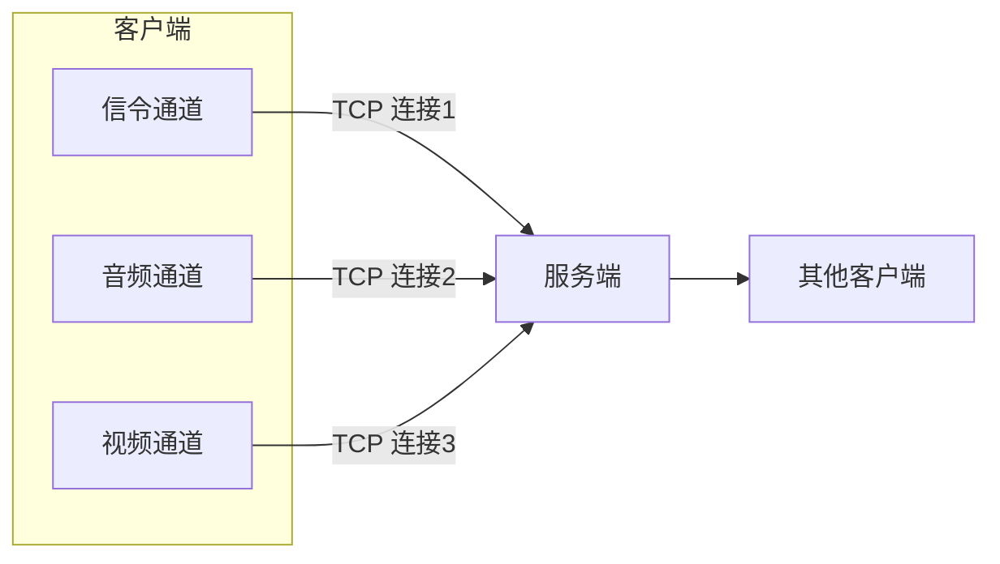
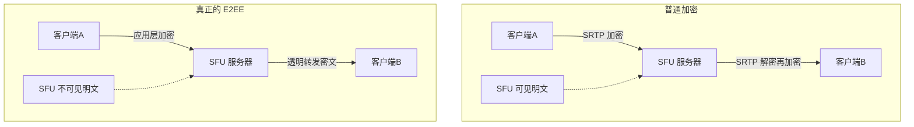
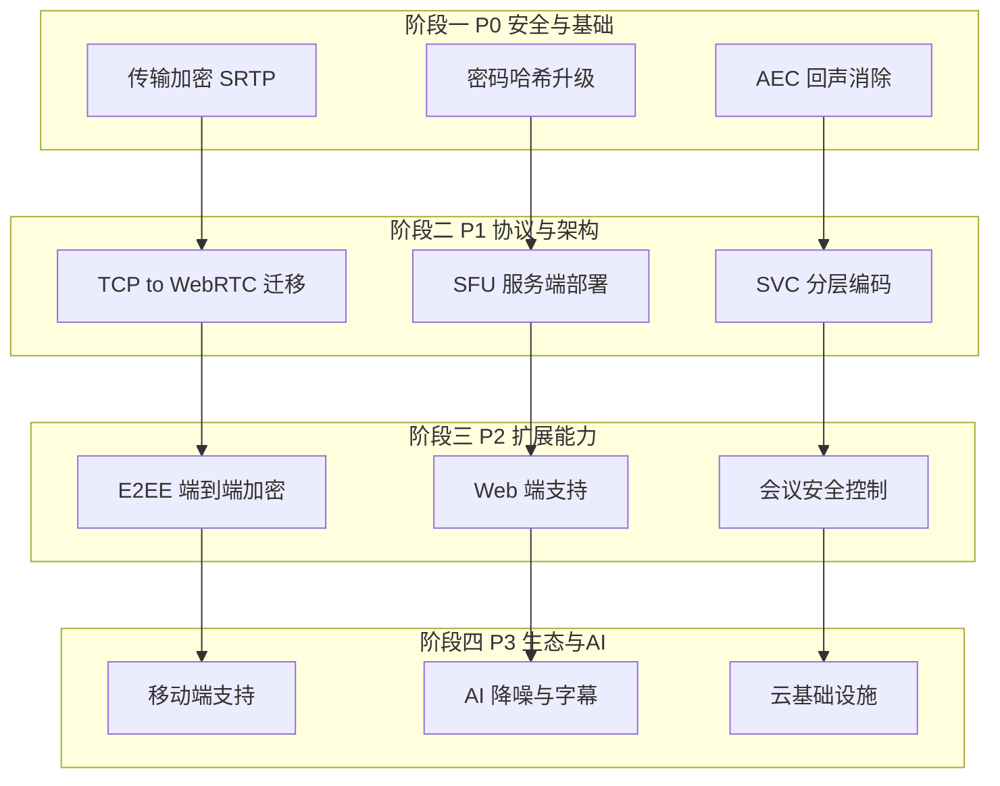
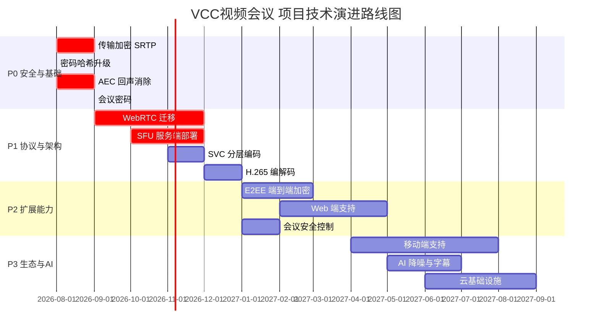

# VCC视频会议 音视频会议系统与主流视频会议软件技术对比分析

> **文档版本：** v1.0
> **最后更新：** 2026-07-30
> **文档类型：** 技术对比分析报告
> **分析对象：** VCC视频会议 音视频会议项目 vs 主流视频会议软件（腾讯会议/Zoom/Google Meet/Microsoft Teams/钉钉）
> **数据来源：** 项目源码与文档、厂商官方技术资料、公开工程博客、第三方技术分析（2026 年 7 月时点）

---

## 目录

- [一、文档概述](#一文档概述)
- [二、VCC视频会议 项目技术架构概述](#二VCC视频会议-项目技术架构概述)
- [三、主流视频会议软件技术栈调研](#三主流视频会议软件技术栈调研)
- [四、技术栈对比分析](#四技术栈对比分析)
- [五、VCC视频会议 项目局限性评估](#五VCC视频会议-项目局限性评估)
- [六、技术组件选型依据分析](#六技术组件选型依据分析)
- [七、VCC视频会议 项目采用主流技术的可行性评估](#七VCC视频会议-项目采用主流技术的可行性评估)
- [八、改进路线图建议](#八改进路线图建议)
- [九、结论](#九结论)

---

## 一、文档概述

### 1.1 分析背景

VCC视频会议 音视频会议系统是一个基于 C++/Qt 5 的桌面端多人音视频会议系统，采用 C/S 架构，使用三路 TCP 连接传输音视频数据。该系统已实现基础的音视频通信功能，但在功能完备性、用户体验、性能和安全性方面与市场上主流视频会议软件存在显著差距。

本文档旨在通过对 VCC视频会议 项目与主流视频会议软件（腾讯会议、Zoom、Google Meet、Microsoft Teams、钉钉视频会议）的全面对比分析，识别 VCC视频会议 项目的局限性及改进空间，调研主流软件的技术栈选择依据，并评估在 VCC视频会议 项目中采用这些技术的可行性与潜在挑战。

### 1.2 分析范围

| 维度 | VCC视频会议 项目 | 主流视频会议软件 |
|------|-------------|-----------------|
| 客户端形态 | 桌面端（Qt 5 原生） | 跨端（Web/桌面/移动/会议室） |
| 架构模式 | 单服务器 C/S | 云原生分布式 SFU |
| 传输协议 | 三路 TCP | WebRTC/QUIC（UDP 系） |
| 媒体架构 | 服务端透明转发 | SFU 选择性转发 |
| 部署方式 | 单机自部署 | 全球云基础设施 |

### 1.3 分析目标

1. 评估 VCC视频会议 项目在功能、用户体验、性能和安全性方面的局限性及改进空间
2. 调研主流视频会议软件的典型技术栈（前端、后端、协议、媒体处理、云基础设施）
3. 分析技术组件选择依据、优势、性能特点及适用性
4. 评估在 VCC视频会议 项目中采用这些技术的可行性与潜在实施挑战

---

## 二、VCC视频会议 项目技术架构概述

### 2.1 技术栈全景

| 技术层 | 选型 | 版本/参数 | 说明 |
|--------|------|-----------|------|
| **编程语言** | C++ | C++11/14 | 原生性能 |
| **应用框架** | Qt | 5.12 | 跨平台 GUI 框架 |
| **音频采集** | SDL2 | - | 回调驱动，48kHz/16bit/mono |
| **音频编解码** | Opus | 1.3+ | 32kbps VOIP 模式，DTX/FEC |
| **静音检测** | WebRTC VAD | - | 语音活动检测 |
| **视频采集** | OpenCV | VideoCapture | 摄像头 640×480@30fps |
| **屏幕共享** | Qt QScreen | grabWindow | 桌面 1024×768@25fps |
| **视频编解码** | FFmpeg | 4.x | H.264 编解码 |
| **编码器回退链** | NVENC→QSV→libx264 | - | 硬件优先，软件兜底 |
| **解码器回退链** | DXVA2→CUVID→QSV→软解 | - | 硬件优先 |
| **渲染引擎** | OpenGL | 3.x + GLSL 1.10 | YUV420P 三纹理渲染 |
| **色彩空间** | BT.601 | - | YUV↔RGB 转换标准 |
| **网络传输** | Winsock2 TCP | - | 三路 TCP 分离 |
| **传输协议** | 自研二进制协议 | - | 4 字节包头 + 载荷 |
| **音视频同步** | 音频主时钟 | - | 10ms 阈值，100ms 最大等待 |
| **多线程模型** | QThread + moveToThread | - | ThreadWorker 基类 |
| **密码存储** | MD5 + 盐 | - | 密码哈希 |
| **服务端** | C++ 单进程 | - | 透明转发 |

### 2.2 核心架构特点

#### 2.2.1 三路 TCP 分离架构

VCC视频会议 项目采用三路独立 TCP 连接的设计：

| 连接 | 用途 | 包大小 | 频率 | 特点 |
|------|------|--------|------|------|
| 连接 1（信令） | 登录/注册/房间管理 | 50-240 字节 | 低频 | 控制指令，要求即时响应 |
| 连接 2（音频） | 音频帧转发 | ~160 字节 | 50 帧/秒 | 小包高频，要求低延迟 |
| 连接 3（视频） | 视频帧转发 | ~4.1KB/分片 | 30 帧/秒 | 大包中频，要求高吞吐 |

#### 2.2.2 协议映射表机制

服务端使用 `PFUN m_netPackMap[100]` 协议映射表实现 O(1) 消息分发，采用策略模式将协议类型编号映射到对应的处理函数指针。

#### 2.2.3 音视频同步策略

采用音频主时钟方案：音频时钟为基准，视频帧根据音频时钟进行同步调整。

| 参数 | 值 | 说明 |
|------|-----|------|
| 同步阈值 | 10ms | 超过此值才等待 |
| 最大等待时间 | 100ms | 避免视频卡死 |
| 时钟超时 | 5 秒 | 超时标记时钟失效 |
| 每用户独立时钟 | 是 | `std::map<int, SyncContext*>` |

### 2.3 性能基准数据

| 指标 | 值 | 说明 |
|------|-----|------|
| 音频端到端延迟 | ~30ms | 采集+编码+网络+解码 |
| 视频编码延迟（NVENC） | ~2ms | 硬件编码 |
| 视频编码延迟（libx264） | ~10ms | 软件编码 |
| 音频带宽 | 32kbps | Opus VOIP |
| 视频带宽（640×480@30fps） | 1.2Mbps | H.264 |
| OpenGL 渲染 CPU 占用（4 路） | <5% | GPU 加速 |

---

## 三、主流视频会议软件技术栈调研

### 3.1 腾讯会议（Tencent Meeting / VooV Meeting）

#### 3.1.1 技术栈概览

| 技术层 | 选型 | 说明 |
|--------|------|------|
| **桌面客户端** | Electron + C++ 原生模块 | UI 层 Electron，媒体引擎 C++ 原生 |
| **移动客户端** | 原生（iOS Swift / Android Kotlin） | 性能与体验优先 |
| **Web 端** | WebRTC | 浏览器原生支持 |
| **后端** | C++ / Go 混合 | 媒体服务器 C++，业务服务 Go |
| **实时通信** | WebRTC + QUIC + 自研协议 | UDP 系传输，QUIC 优化登录 |
| **媒体架构** | SFU（选择性转发单元） | 自研 SFU 集群 |
| **编解码** | H.264 / H.265 / AV1（渐进） | 硬件加速优先 |
| **云基础设施** | 腾讯云全球节点 | 2800+ 节点，覆盖 100+ 国家 |
| **安全性** | SRTP + DTLS + 应用层加密 | 传输层 + 应用层双重加密 |

#### 3.1.2 关键技术特性

- **QUIC 优化**：登录耗时降低 48.6%，抗 80% 丢包
- **端到端延迟**：~80ms（同区域）
- **最大容量**：单会议 1000 人互动，万人观看
- **抗丢包策略**：FEC + ARC（自适应冗余）+ PLC
- **AI 增强功能**：AI 降噪、虚拟背景、实时字幕、会议纪要

### 3.2 Zoom

#### 3.2.1 技术栈概览

| 技术层 | 选型 | 说明 |
|--------|------|------|
| **桌面客户端** | C++ 原生（全平台） | 不使用 Electron，性能优先 |
| **Web 端** | WebAssembly 2.0 | 浏览器内原生级性能 |
| **移动客户端** | 原生 | iOS / Android |
| **后端** | C++ / Go | 多租户架构 |
| **实时通信** | UDP 为主 + TCP 回退 | 自研媒体协议 |
| **媒体架构** | 自研 SFU/MCU 混合 | 可扩展架构 |
| **编解码** | H.264 / H.265 / AV1 | 硬件加速，SVC 可分层编码 |
| **云基础设施** | 全球自建数据中心 | 18+ 区域 |
| **安全性** | E2EE（AES-256-GCM）+ 后量子加密 | 已部署后量子 E2EE |

#### 3.2.2 关键技术特性

- **视频质量**：4K@1.8Mbps（H.265 + SVC）
- **最大容量**：单会议 1000 人互动，10000 人观看
- **Web 端创新**：WebAssembly 2.0 实现浏览器内原生级性能
- **SVC 分层编码**：适应不同带宽和设备能力
- **E2EE**：已部署后量子加密，业界领先

### 3.3 Google Meet

#### 3.3.1 技术栈概览

| 技术层 | 选型 | 说明 |
|--------|------|------|
| **客户端** | Web（浏览器原生）+ 移动原生 | Web 优先策略 |
| **后端** | Go / C++ | Google 基础设施 |
| **实时通信** | WebRTC | 浏览器原生支持 |
| **媒体架构** | SFU（基于 Google 自研） | 与 WebRTC 深度集成 |
| **编解码** | VP9 / AV1 / H.264 | 优先 VP9/AV1，免版权费 |
| **云基础设施** | Google Cloud + 边缘节点 | 边缘节点 < 50km 覆盖 |
| **安全性** | E2EE（Insertable Streams） | 基于 WebRTC Insertable Streams |

#### 3.3.2 关键技术特性

- **VP9/AV1 优先**：避免 H.264/H.265 版权费，压缩效率更高
- **边缘计算**：边缘节点距离用户 < 50km，降低延迟
- **AI 功能**：实时字幕（30+ 语言）、降噪、低光增强
- **与 Google 生态集成**：Calendar、Gmail、Classroom

### 3.4 Microsoft Teams

#### 3.4.1 技术栈概览

| 技术层 | 选型 | 说明 |
|--------|------|------|
| **桌面客户端** | React Native + SlimCore（Teams 2.1） | 从 Electron 迁移 |
| **后端** | .NET / C++ / Azure 服务 | 微软生态 |
| **实时通信** | WebRTC + SIP（互操作） | 支持电话互操作 |
| **媒体架构** | Azure Communication Services SFU | 云原生 SFU |
| **编解码** | H.264 / H.265 / AV1 | 硬件加速 |
| **云基础设施** | Azure 全球区域 | 60+ 区域 |
| **安全性** | E2EE + 合规认证 | 企业级安全合规 |

#### 3.4.2 关键技术特性

- **Teams 2.1 架构升级**：从 Electron 迁移到 React Native + SlimCore 媒体引擎，性能提升 2 倍
- **SIP 互操作**：支持传统电话系统集成
- **企业合规**：SOC 2、HIPAA、GDPR 等认证
- **与 Microsoft 365 集成**：Office、SharePoint、OneDrive

### 3.5 钉钉视频会议

#### 3.5.1 技术栈概览

| 技术层 | 选型 | 说明 |
|--------|------|------|
| **桌面客户端** | Electron | 跨平台一致性 |
| **移动客户端** | 原生 | iOS / Android |
| **后端** | Java / Go | 阿里中间件生态 |
| **实时通信** | WebRTC + 自研协议 | UDP 系传输 |
| **媒体架构** | 自研 SFU | 阿里云 CDN 加速 |
| **编解码** | H.264 / H.265 | 硬件加速 |
| **云基础设施** | 阿里云全球节点 | 2800+ 节点 |
| **安全性** | SRTP + DTLS | 传输加密 |

### 3.6 SFU 服务器开源方案对比

主流视频会议软件背后通常采用 SFU（Selective Forwarding Unit）架构。以下是主流开源 SFU 方案对比：

| 方案 | 语言 | 架构特点 | 性能 | 易用性 | 适用场景 |
|------|------|----------|------|--------|----------|
| **mediasoup** | C++/Node.js | 纯 SFU，Node.js 控制层 + C++ 媒体层 | 极高（单机数千路） | 中（需自行构建信令） | 高性能定制化场景 |
| **Janus** | C | 模块化插件架构 | 高 | 中（配置复杂） | 电信级互操作、SIP 集成 |
| **LiveKit** | Go/Pion | 开箱即用，内置信令和客户端 SDK | 高 | 高（全栈方案） | 快速落地、初创项目 |
| **Jitsi** | Kotlin/Java | 完整 UX（含 Web 前端） | 中高 | 高（开箱即用） | 快速部署完整方案 |
| **Pion** | Go | 纯 WebRTC 库（非服务器） | 高 | 中（需自行组装） | 极致定制、研究项目 |

### 3.7 共性技术分析

#### 3.7.1 为什么主流方案选择 WebRTC 而非自建 TCP 传输

| 维度 | WebRTC（UDP 系） | 自建 TCP | 说明 |
|------|------------------|----------|------|
| **延迟** | 50-150ms | 200-500ms | TCP 重传导致队头阻塞 |
| **抗丢包** | FEC + NACK + PLC | 仅能重传 | UDP 允许丢包，TCP 必须重传 |
| **NAT 穿透** | ICE/STUN/TURN 内置 | 需自建 | WebRTC 原生支持 NAT 穿透 |
| **带宽自适应** | GCC 算法内置 | 需自研 | WebRTC 自带带宽估计 |
| **安全性** | DTLS-SRTP 强制 | 需自研 | WebRTC 强制加密 |
| **P2P 能力** | 支持 P2P | 不支持 | 小组会议可直连 |
| **标准化** | W3C/IETF 标准 | 私有协议 | 生态丰富 |
| **浏览器支持** | 原生支持 | 不支持 | Web 端必需 |

**核心结论**：TCP 的可靠重传机制在弱网环境下会导致队头阻塞（Head-of-Line Blocking），严重恶化实时音视频体验。WebRTC 基于 UDP 的设计允许按帧丢弃过期数据，是实时通信的正确选择。

#### 3.7.2 AV1/H.265 新一代编解码器采用情况

| 编解码器 | 压缩效率 | 硬件支持 | 浏览器支持 | 采用情况 |
|----------|----------|----------|------------|----------|
| **H.264** | 基线（1×） | 几乎 100% | 全部 | 最大兼容基线，所有产品支持 |
| **H.265 (HEVC)** | 比 H.264 节省 40% | Win 75% / Mac 90% | Chrome 136+ | 腾讯会议、Zoom 已采用 |
| **AV1** | 比 H.264 节省 30-50% | Win 8% / Mac 0% | Chrome/Firefox | Meta Messenger 已落地，未来趋势 |
| **VP9** | 比 H.264 节省 40% | 部分硬件 | Chrome/Edge | Google Meet 优先使用 |

**选型依据**：H.264 作为兼容性基线必须支持；H.265 在硬件支持充足时启用以节省带宽；AV1 是未来趋势但当前硬件支持不足；VP9 是 Google 生态的免版权费选择。

#### 3.7.3 端到端加密（E2EE）实现方式

| 加密层级 | 技术 | SFU 可见明文 | 说明 |
|----------|------|--------------|------|
| **传输加密** | DTLS-SRTP | 是 | WebRTC 强制，防止网络窃听 |
| **应用层 E2EE** | Insertable Streams + Double Ratchet | 否 | 真正端到端，SFU 无法解密 |
| **密钥管理** | Signal Protocol（Double Ratchet） | 否 | 前向保密，密钥定期更新 |

---

## 四、技术栈对比分析

### 4.1 客户端技术对比

| 维度 | VCC视频会议 项目 | 腾讯会议 | Zoom | Google Meet |
|------|-------------|----------|------|-------------|
| **桌面框架** | Qt 5（C++ 原生） | Electron + C++ | C++ 原生 | Web 浏览器 |
| **跨平台一致性** | 高（Qt 抽象） | 中（Electron） | 高（原生） | 极高（Web） |
| **性能** | 极高（原生 C++） | 中（Electron 开销） | 极高（原生） | 高（浏览器优化） |
| **Web 端** | 不支持 | WebRTC | WebAssembly 2.0 | 原生 WebRTC |
| **移动端** | 不支持 | 原生 | 原生 | 原生 |
| **包体积** | 小（~20MB） | 大（~150MB） | 中（~80MB） | 零（浏览器） |
| **开发效率** | 中（C++ 开发） | 高（JS/TS 生态） | 中（C++） | 高（Web 技术） |
| **热更新** | 不支持 | 支持 | 部分支持 | 完全支持 |

**分析**：VCC视频会议 项目采用 Qt 5 原生 C++ 开发，性能极高且包体积小，但跨端能力（Web/移动）缺失。主流方案普遍采用 Web 技术或跨平台框架以实现全端覆盖，性能通过原生模块或 WebAssembly 保障。

### 4.2 网络传输协议对比

| 维度 | VCC视频会议 项目 | 主流方案 |
|------|-------------|----------|
| **传输层** | TCP（Winsock2） | UDP（WebRTC/QUIC） |
| **连接数** | 3 路 TCP | 1 路 WebRTC（多路复用） |
| **NAT 穿透** | 不支持 | ICE/STUN/TURN |
| **P2P 能力** | 不支持 | 支持（小组会议） |
| **抗丢包** | 仅 TCP 重传（队头阻塞） | FEC + NACK + PLC |
| **带宽自适应** | 无 | GCC 算法（ABR） |
| **协议标准化** | 自研私有协议 | WebRTC/W3C 标准 |
| **加密传输** | 明文传输 | DTLS-SRTP 强制加密 |

**分析**：这是 VCC视频会议 项目与主流方案**最大的技术差距**。TCP 的可靠重传机制在弱网下会导致队头阻塞，严重恶化实时音视频体验。主流方案全部采用 UDP 系传输，配合 FEC/NACK/PLC 等抗丢包策略，能在 80% 丢包率下仍保持可用。

### 4.3 媒体处理方案对比

| 维度 | VCC视频会议 项目 | 主流方案 |
|------|-------------|----------|
| **媒体架构** | 服务端透明转发 | SFU 选择性转发 |
| **视频编码** | H.264（NVENC/QSV/libx264） | H.264/H.265/AV1/VP9 |
| **SVC 分层编码** | 不支持 | 支持（适应多端带宽） |
| **音频编码** | Opus（32kbps） | Opus/AAC |
| **AEC 回声消除** | 不支持 | 内置（WebRTC AEC3） |
| **ANS 降噪** | 仅 VAD 静音检测 | AI 降噪 |
| **视频后处理** | 无 | 虚拟背景、美颜、低光增强 |
| **硬件加速** | 编解码回退链 | 全链路硬件加速 |

**分析**：VCC视频会议 项目在编解码选型上与主流方案接近（Opus + H.264），但缺少 SVC 分层编码、AEC 回声消除、AI 降噪等关键媒体处理能力。服务端透明转发架构无法扩展到大房间场景。

### 4.4 云基础设施对比

| 维度 | VCC视频会议 项目 | 主流方案 |
|------|-------------|----------|
| **部署方式** | 单机自部署 | 全球云基础设施 |
| **可扩展性** | 单服务器瓶颈 | 弹性扩缩容 |
| **边缘节点** | 无 | 全球边缘节点（< 50km 覆盖） |
| **CDN 加速** | 无 | 全球 CDN |
| **多区域容灾** | 无 | 多区域容灾备份 |
| **监控运维** | 无 | 全链路监控 |

**分析**：VCC视频会议 项目采用单机部署，无法横向扩展。主流方案依托全球云基础设施，通过边缘节点降低延迟、CDN 加速内容分发、弹性扩缩容应对峰值流量。

### 4.5 安全性对比

| 维度 | VCC视频会议 项目 | 主流方案 |
|------|-------------|----------|
| **密码存储** | MD5 + 盐 | bcrypt/scrypt/Argon2 |
| **传输加密** | 明文传输 | DTLS-SRTP 强制加密 |
| **端到端加密** | 不支持 | E2EE（Double Ratchet） |
| **身份认证** | 自研（手机号+密码） | OAuth 2.0 / SSO / MFA |
| **会议安全** | 无密码、无等候室 | 会议密码、等候室、锁定 |
| **合规认证** | 无 | SOC 2、HIPAA、GDPR |

**分析**：安全性是 VCC视频会议 项目**最严重的短板**。明文传输、MD5 哈希、无 E2EE、无会议安全控制等问题使其无法用于敏感场景。

---

## 五、VCC视频会议 项目局限性评估

### 5.1 功能局限性

| 功能维度 | VCC视频会议 项目 | 主流方案 | 改进空间 |
|----------|-------------|----------|----------|
| **跨端支持** | 仅桌面端 | 全端（Web/桌面/移动/会议室） | 亟需 Web/移动端 |
| **会议容量** | 受限于单服务器 | 1000+ 人互动 | 需 SFU 架构 |
| **会议管理** | 基础创建/加入 | 等候室、锁定、静音控制、联席主持人 | 需丰富会议控制 |
| **内容共享** | 桌面共享 | 屏幕+应用+白板+协同文档 | 需协同功能 |
| **录制功能** | 不支持 | 云录制+本地录制 | 需录制能力 |
| **聊天功能** | 不支持 | 文字聊天+文件传输 | 需 IM 集成 |
| **虚拟背景** | 不支持 | AI 虚拟背景+美颜 | 需 AI 能力 |
| **实时字幕** | 不支持 | AI 实时字幕+翻译 | 需 ASR 能力 |

### 5.2 用户体验局限性

| 体验维度 | VCC视频会议 项目问题 | 主流方案做法 | 改进方向 |
|----------|-----------------|--------------|----------|
| **弱网体验** | TCP 队头阻塞导致卡顿 | UDP + 抗丢包，80% 丢包可用 | 迁移到 WebRTC |
| **回声问题** | 无 AEC，扬声器回声严重 | WebRTC AEC3 内置 | 集成 AEC |
| **画面质量** | 640×480，无 SVC 分层 | 1080p/4K + SVC 适应带宽 | 提升分辨率 + SVC |
| **多路渲染** | 4 路 GPU 渲染 | 数十路虚拟分屏 | 优化渲染管线 |
| **入会体验** | 需注册登录 | 会议号/链接一键入会 | 简化入会流程 |
| **设备兼容** | 仅 Windows | 全平台 | 跨端支持 |
| **UI 美观度** | 基础 Qt Widgets | 现代 UI 框架 | UI 升级 |

### 5.3 性能局限性

| 性能维度 | VCC视频会议 项目 | 主流方案 | 差距分析 |
|----------|-------------|----------|----------|
| **端到端延迟** | ~30ms（局域网）/ 不稳定（弱网） | 80-150ms（全球） | VCC视频会议 局域网优，弱网差 |
| **最大分辨率** | 640×480 | 1920×1080 / 4K | VCC视频会议 分辨率低 |
| **最大帧率** | 30fps | 30/60fps | 接近 |
| **并发用户数** | 受限于单服务器 | 1000+ 互动 | VCC视频会议 无法扩展 |
| **带宽自适应** | 无 | ABR（GCC 算法） | VCC视频会议 固定码率 |
| **CPU 占用** | 低（硬件加速） | 中（功能更多） | VCC视频会议 优 |

### 5.4 安全性局限性

| 安全维度 | VCC视频会议 项目 | 风险等级 | 改进优先级 |
|----------|-------------|----------|------------|
| **明文传输** | 音视频数据未加密 | 严重 | P0 |
| **MD5 密码哈希** | 易被彩虹表破解 | 高 | P0 |
| **无 E2EE** | 服务端可见明文 | 高 | P1 |
| **无会议密码** | 任何人可加入 | 中 | P1 |
| **无身份认证强化** | 无 MFA/SSO | 中 | P2 |
| **无审计日志** | 无操作记录 | 中 | P2 |

---

## 六、技术组件选型依据分析

### 6.1 实时通信协议选型

#### 6.1.1 WebRTC 选型依据

| 优势 | 说明 |
|------|------|
| **低延迟** | UDP 传输，避免 TCP 队头阻塞，50-150ms 端到端 |
| **抗丢包** | 内置 FEC/NACK/PLC，80% 丢包仍可用 |
| **NAT 穿透** | ICE/STUN/TURN 内置，支持复杂网络环境 |
| **P2P 能力** | 小组会议可直连，降低服务器负载 |
| **带宽自适应** | GCC 算法自动调整码率，适应网络变化 |
| **安全性** | DTLS-SRTP 强制加密，无需额外开发 |
| **标准化** | W3C/IETF 标准，浏览器原生支持 |
| **生态丰富** | 大量开源 SFU、客户端 SDK 可选 |

#### 6.1.2 QUIC 选型依据

| 优势 | 说明 |
|------|------|
| **连接迁移** | 网络切换不断连（WiFi↔4G） |
| **0-RTT** | 快速重连，登录耗时降低 48.6% |
| **多路复用** | 单连接多流，无队头阻塞 |
| **前向纠错** | 传输层抗丢包 |
| **加密内置** | TLS 1.3 强制加密 |

### 6.2 SFU 架构选型依据

| 优势 | 说明 |
|------|------|
| **可扩展性** | 横向扩展，支持大房间 |
| **带宽优化** | 选择性转发，仅发送订阅流 |
| **CPU 效率** | 不做编解码，纯转发 |
| **多端适配** | 可为不同终端发送不同质量流（SVC） |
| **延迟低** | 单跳转发，无需编解码延迟 |

### 6.3 编解码器选型依据

| 编解码器 | 选型依据 | 适用场景 |
|----------|----------|----------|
| **H.264** | 兼容性基线，100% 硬件支持 | 必须支持，兜底方案 |
| **H.265** | 节省 40% 带宽，硬件支持充足 | 高清会议，带宽受限 |
| **AV1** | 免版权费，压缩效率最高 | 未来趋势，移动端优先 |
| **VP9** | 免版权费，Google 生态 | Google Meet 优先 |
| **Opus** | 语音最优，低延迟，抗丢包 | 音频标准选择 |

### 6.4 客户端框架选型依据

| 框架 | 选型依据 | 适用场景 |
|------|----------|----------|
| **Electron** | 跨平台一致，Web 技术栈，开发效率高 | 桌面应用，快速迭代 |
| **React Native** | 跨平台，原生性能，Microsoft 推荐 | 移动+桌面统一 |
| **WebAssembly** | 浏览器内原生性能，零安装 | Web 端高性能场景 |
| **原生 C++** | 极致性能，资源占用低 | 嵌入式、会议室设备 |

### 6.5 云基础设施选型依据

| 组件 | 选型依据 | 说明 |
|------|----------|------|
| **边缘节点** | 降低延迟，< 50km 覆盖 | 用户就近接入 |
| **CDN** | 内容分发加速 | 录制视频回放 |
| **弹性扩缩容** | 应对峰值流量 | 按需分配资源 |
| **多区域容灾** | 高可用性 | 区域故障切换 |

---

## 七、VCC视频会议 项目采用主流技术的可行性评估

### 7.1 兼容性评估

| 引入技术 | 与现有架构兼容性 | 改造范围 | 风险 |
|----------|------------------|----------|------|
| **WebRTC** | 中（需替换 TCP 网络层） | 大（网络层重写） | 中 |
| **Opus（已采用）** | 高 | 无 | 无 |
| **H.265/AV1** | 中（FFmpeg 已支持） | 中（编解码扩展） | 低 |
| **SFU 架构** | 低（需替换服务端） | 极大（服务端重写） | 高 |
| **E2EE** | 中（需加密层） | 中（加密模块新增） | 中 |
| **AEC** | 中（需音频处理模块） | 中（音频管线改造） | 中 |
| **Electron** | 低（需重写 UI） | 极大（UI 重写） | 高 |
| **云基础设施** | 低（需重构部署） | 大（运维体系重建） | 高 |

### 7.2 资源需求评估

#### 7.2.1 开发资源

| 改造方向 | 预估工时（人月） | 优先级 | 说明 |
|----------|------------------|--------|------|
| **TCP→WebRTC 迁移** | 4-6 | P0 | 网络层重写，最大改造 |
| **AEC 回声消除集成** | 1-2 | P0 | 集成 WebRTC AEC3 |
| **传输加密（SRTP）** | 1-2 | P0 | DTLS-SRTP 集成 |
| **密码哈希升级** | 0.5 | P0 | bcrypt/Argon2 替换 MD5 |
| **SFU 服务端** | 6-8 | P1 | 采用 mediasoup/LiveKit |
| **H.265 编解码** | 1-2 | P1 | FFmpeg 扩展 |
| **SVC 分层编码** | 2-3 | P1 | 编码器配置扩展 |
| **会议安全控制** | 1-2 | P1 | 密码、等候室等 |
| **E2EE 端到端加密** | 3-4 | P2 | Double Ratchet 实现 |
| **Web 端支持** | 6-8 | P2 | WebRTC + Web 前端 |
| **移动端支持** | 8-12 | P2 | 原生开发或跨平台 |
| **AI 功能（降噪/字幕）** | 4-6 | P3 | AI 模型集成 |
| **云基础设施迁移** | 6-10 | P3 | 容器化 + K8s + CDN |

#### 7.2.2 基础设施资源

| 资源类型 | 当前需求 | 改造后需求 | 说明 |
|----------|----------|------------|------|
| **服务器** | 1 台 | 3-5 台（SFU 集群） | 按用户规模扩展 |
| **带宽** | 10Mbps | 100Mbps+ | SFU 转发带宽 |
| **存储** | 无 | 1TB+（录制） | 云存储 |
| **CDN** | 无 | 全球节点 | 边缘加速 |

### 7.3 集成策略

#### 7.3.1 分阶段渐进式集成

#### 7.3.2 具体集成方案

**方案 A：WebRTC 原生集成（推荐）**

| 步骤 | 内容 | 说明 |
|------|------|------|
| 1 | 引入 WebRTC Native 库 | 替换 Winsock2 TCP 层 |
| 2 | 保留 Qt 5 GUI 层 | 复用现有 UI |
| 3 | 保留 FFmpeg 编解码 | 复用 H.264 回退链 |
| 4 | 保留 OpenGL 渲染 | 复用 YUV 渲染管线 |
| 5 | 新增 SRTP 加密层 | WebRTC 内置 DTLS-SRTP |
| 6 | 新增 AEC3 回声消除 | WebRTC 音频处理模块 |

**方案 B：基于 LiveKit 的快速迁移**

| 步骤 | 内容 | 说明 |
|------|------|------|
| 1 | 部署 LiveKit SFU 服务器 | 替换自研服务端 |
| 2 | 集成 LiveKit C++ SDK | 替换客户端网络层 |
| 3 | 保留 Qt GUI + FFmpeg + OpenGL | 复用现有媒体管线 |
| 4 | 复用 LiveKit 信令与房间管理 | 替换自研协议 |

### 7.4 潜在实施挑战

#### 7.4.1 技术挑战

| 挑战 | 难度 | 应对策略 |
|------|------|----------|
| **TCP→WebRTC 迁移** | 高 | 分阶段迁移，先信令后媒体 |
| **Qt + WebRTC 集成** | 高 | 使用 WebRTC Native API，封装 Qt 适配层 |
| **SFU 部署运维** | 高 | 采用 LiveKit 开箱即用方案 |
| **AEC 算法调优** | 中 | 使用 WebRTC AEC3 默认参数 |
| **E2EE 密钥管理** | 高 | 采用成熟 Signal Protocol 库 |
| **跨端一致性** | 高 | 统一 SFU 协议，多端独立实现 |

#### 7.4.2 工程挑战

| 挑战 | 说明 | 应对策略 |
|------|------|----------|
| **开发资源不足** | 需多名资深 C++/WebRTC 工程师 | 优先 P0 项，逐步推进 |
| **测试覆盖** | 弱网/多端/大规模测试复杂 | 建立自动化测试矩阵 |
| **运维能力** | 云原生运维能力欠缺 | 采用托管服务（如 LiveKit Cloud） |
| **向后兼容** | 现有用户迁移 | 灰度发布，双协议过渡 |

#### 7.4.3 风险评估

| 风险 | 概率 | 影响 | 缓解措施 |
|------|------|------|----------|
| **WebRTC 集成失败** | 中 | 高 | 先做 PoC 验证 |
| **性能回退** | 低 | 高 | 基准测试对比 |
| **进度延期** | 高 | 中 | 分阶段交付 |
| **预算超支** | 中 | 中 | 优先 P0，按需推进 |

---

## 八、改进路线图建议

### 8.1 短期改进（1-3 个月，P0 优先级）

| 改进项 | 目标 | 预期收益 |
|--------|------|----------|
| **传输加密（SRTP）** | 音视频数据加密传输 | 消除明文传输风险 |
| **密码哈希升级** | MD5 → bcrypt/Argon2 | 提升密码安全性 |
| **AEC 回声消除** | 集成 WebRTC AEC3 | 消除扬声器回声 |
| **会议密码** | 加入会议需密码 | 防止未授权访问 |

### 8.2 中期改进（3-6 个月，P1 优先级）

| 改进项 | 目标 | 预期收益 |
|--------|------|----------|
| **TCP→WebRTC 迁移** | 替换网络传输层 | 弱网体验质变，抗 80% 丢包 |
| **SFU 服务端** | 部署 mediasoup/LiveKit | 支持大房间，可扩展 |
| **SVC 分层编码** | H.264 + SVC | 适应多端带宽 |
| **H.265 编解码** | 新增 H.265 支持 | 节省 40% 带宽 |
| **会议安全控制** | 等候室、锁定、静音控制 | 会议管理能力对齐 |

### 8.3 长期改进（6-12 个月，P2/P3 优先级）

| 改进项 | 目标 | 预期收益 |
|--------|------|----------|
| **E2EE 端到端加密** | Double Ratchet 实现 | 安全性对标 Zoom |
| **Web 端支持** | WebRTC Web 客户端 | 零安装入会 |
| **移动端支持** | iOS/Android 客户端 | 全端覆盖 |
| **AI 降噪与字幕** | 集成 AI 模型 | 体验提升 |
| **云基础设施** | 容器化 + K8s + CDN | 全球可用性 |

### 8.4 技术演进路线图

---

## 九、结论

### 9.1 核心差距总结

VCC视频会议 项目在**音视频编解码选型**（Opus + H.264 + FFmpeg 硬件回退链）和**渲染性能**（OpenGL YUV420P 三纹理）方面达到了主流水平，体现了扎实的工程功底。但在以下三个核心维度存在代际差距：

1. **网络传输层**：TCP vs WebRTC/UDP —— 这是最大的技术代差，直接导致弱网体验不可用
2. **服务端架构**：单服务器透明转发 vs 云原生 SFU —— 限制了可扩展性和大房间支持
3. **安全体系**：明文传输 + MD5 vs E2EE + 后量子加密 —— 无法用于敏感场景

### 9.2 关键改进建议

| 优先级 | 改进方向 | 预期收益 | 建议方案 |
|--------|----------|----------|----------|
| **P0** | 传输加密 + 密码升级 + AEC | 安全 baseline + 基础体验 | 集成 WebRTC 音频处理 + bcrypt |
| **P1** | TCP→WebRTC + SFU | 弱网体验质变 + 可扩展 | 采用 LiveKit 快速迁移 |
| **P2** | E2EE + Web 端 | 安全对标 + 全端覆盖 | Signal Protocol + WebRTC Web |
| **P3** | 移动端 + AI + 云 | 生态完整 + 体验领先 | 跨平台框架 + 云原生 |

### 9.3 总体评价

VCC视频会议 项目作为一个学习/原型项目，在有限资源下实现了完整的音视频通信链路，技术选型合理（C++/Qt/FFmpeg/SDL2/Opus/OpenGL），性能优化到位（硬件加速、YUV 渲染、音频主时钟同步）。但要达到商用视频会议软件的水平，需要在网络协议（WebRTC）、服务端架构（SFU）、安全体系（E2EE）三个核心维度进行系统性重构。建议采用**分阶段渐进式改进**策略，优先解决安全性和弱网体验问题，再逐步扩展功能和跨端能力。

---

> **文档版本：** v1.0
> **最后更新：** 2026-07-30
> **数据来源：** VCC视频会议 项目源码与文档、腾讯云开发者社区、Zoom Library、Microsoft Learn、Meta Engineering Blog、Google Cloud 文档、WebRTC 官方文档等公开技术资料（2026 年 7 月时点）
> **适用范围：** VCC视频会议 音视频会议系统项目团队技术决策参考
