# VCC视频会议 项目档案（分册版）

> **分册序号：** 第 9 册 / 共 12 册  
> **分册标题：** 第九部分 项目图表全集  
> **分册说明：** 本册为 VCC视频会议 项目档案的分册版本，内容与主档案（VCC视频会议项目档案.md）保持一致，仅做结构分册处理，便于按需查阅。  
> **主档案位置：** `VCC视频会议项目档案.md`

---

## 📑 本册目录

- [第九部分 项目图表全集](#第九部分-项目图表全集)
  - [9.1 00_图表汇总总览（1 张）](#101-00_图表汇总总览1-张)
  - [9.2 00_系统全景总图（7 张）](#102-00_系统全景总图7-张)
  - [9.3 01_业务流程图（3 张）](#103-01_业务流程图3-张)
  - [9.4 02_用户用例图（2 张）](#104-02_用户用例图2-张)
  - [9.5 03_系统时序图（4 张）](#105-03_系统时序图4-张)
  - [9.6 04_数据库ER图（1 张）](#106-04_数据库er图1-张)
  - [9.7 05_状态转换图（5 张）](#107-05_状态转换图5-张)
  - [9.8 06_组件图（1 张）](#108-06_组件图1-张)
  - [9.9 07_部署图（2 张）](#109-07_部署图2-张)
  - [9.10 08_活动图（3 张）](#1010-08_活动图3-张)
  - [9.11 09_数据流图（5 张）](#1011-09_数据流图5-张)
  - [9.12 VCC视频会议类图（18 张）](#1012-vcc视频会议类图18-张)
  - [9.13 VCC视频会议项目类图（17 张）](#1013-vcc视频会议项目类图17-张)

---
## 第九部分 项目图表全集

> **本部分完整嵌入项目类图文件夹中全部 71 张 JPG 图片，按图表类别分组展示。**
> 图片来源：Mermaid 图表渲染导出，涵盖系统全景、业务流程、用例、时序、ER、状态转换、组件、部署、活动、数据流及类图。

**图片总数：** 71 张

| 类别 | 数量 | 说明 |
|------|------|------|
| 00_图表汇总总览 | 1 | 所有图表的总览汇总 |
| 00_系统全景总图 | 7 | 系统整体架构与模块全景 |
| 01_业务流程图 | 3 | 核心业务流程（注册/登录/房间/音视频） |
| 02_用户用例图 | 2 | 用户角色与用例关系 |
| 03_系统时序图 | 4 | 关键交互时序（登录/房间/帧传输） |
| 04_数据库ER图 | 1 | 数据库实体关系图 |
| 05_状态转换图 | 5 | 核心对象状态机 |
| 06_组件图 | 1 | 系统组件与依赖 |
| 07_部署图 | 2 | 部署拓扑与节点 |
| 08_活动图 | 3 | 关键活动流程 |
| 09_数据流图 | 5 | 数据流与处理过程 |
| VCC视频会议类图 | 19 | VCC视频会议 旧版类图 |
| VCC视频会议项目类图 | 18 | VCC视频会议 项目完整类图 |

---

### 9.1 00_图表汇总总览（1 张）

**类别说明：** 所有图表的总览汇总

#### 图1：项目全量图表分类索引与开发生命周期关系图

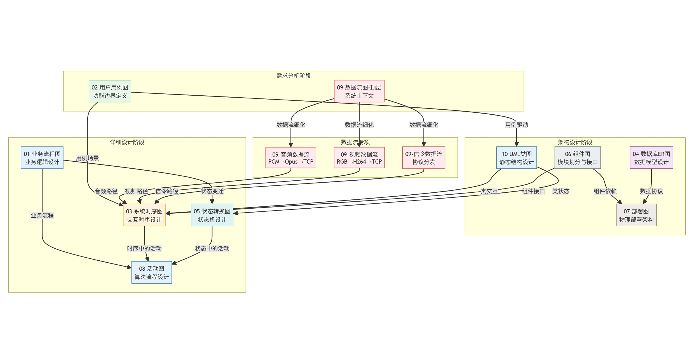

**图1：项目全量图表分类索引与开发生命周期关系图**

> **图片说明：** 汇总展示项目全部 UML 图表的分类索引，将 10 类图表按需求分析、架构设计、详细设计、数据流专项四个阶段组织，并用箭头标注用例驱动、数据流细化、类交互、业务流程等图表间的衔接关系，作为整个项目图表体系的导航总图。

---

### 9.2 00_系统全景总图（7 张）

**类别说明：** 系统整体架构与模块全景

#### 图2：客户端-服务端系统架构与数据流全景图

**图2：客户端-服务端系统架构与数据流全景图**

> **图片说明：** 展示客户端 A 与服务端、客户端 B 的整体架构分层关系。客户端侧划分为 UI 层（LoginDialog/VCC视频会议Dialog/RoomDialog/UserShow）、核心调度层（ckernel）、音频层（AudioRead/AudioWrite）、视频层（VideoRead/ScreenRead）、编解码层（H264Encoder/H264Decoder）、渲染层（YuvGLWidget/MyOpenGLWidget）、同步层（AVSyncManager）、网络层（INetMediator→TcpClient 三路 TCP）。服务端侧包含 epoll 的 TcpServer、clogic 协议分发、房间管理与 MySQL 数据库，体现 C/S 架构与透明转发模型。

#### 图3：音视频端到端数据流全景图

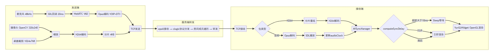

**图3：音视频端到端数据流全景图**

> **图片说明：** 以 flowchart 形式描绘音视频数据从发送端到接收端的完整链路。音频路径为麦克风→SDL 回调→WebRTC VAD→Opus 编码→TCP 发送；视频路径为摄像头/桌面→缩放→H264 编码→4KB 分片→TCP 发送。服务端 epoll 接收后按房间成员转发，接收端按包类型分发：音频经 Opus 解码→SDL 播放并更新 audioClock；视频经分片重组→H264 解码→AVSyncManager 同步（超前等待/落后追赶）→YuvGLWidget OpenGL 渲染。

#### 图4：登录注册与房间管理业务流程全景图

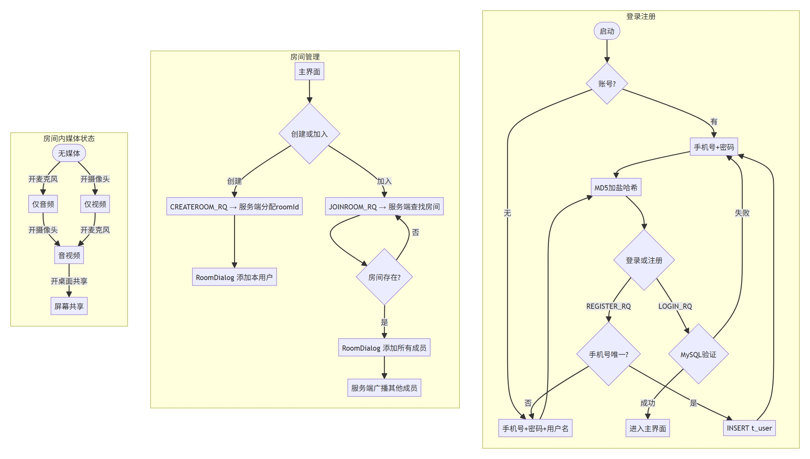

**图4：登录注册与房间管理业务流程全景图**

> **图片说明：** 以三个子流程展示核心业务逻辑：登录注册流程（账号判断→MD5 加盐哈希→LOGIN_RQ/REGISTER_RQ→MySQL 验证/插入→进入主界面）；房间管理流程（创建/加入→服务端分配 roomId→返回成员列表→创建 RoomDialog→广播其他成员）；房间内媒体状态机（无媒体→仅音频/仅视频→音视频→屏幕共享的组合切换）。

#### 图5：核心模块状态转换全景图

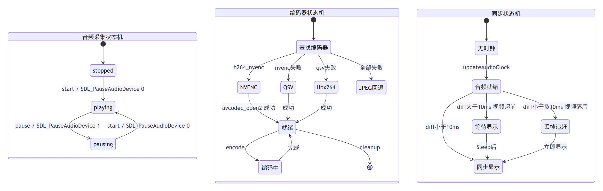

**图5：核心模块状态转换全景图**

> **图片说明：** 整合三个关键模块的状态机：音频采集状态机（stopped→playing→pausing，由 SDL_PauseAudioDevice 控制）；H.264 编码器状态机（查找编码器→NVENC/QSV/libx264 硬件回退链→就绪→编码中，含 JPEG 回退）；音视频同步状态机（无时钟→音频就绪→同步显示/等待显示/丢帧追赶，基于 10ms 阈值判定视频超前或落后）。

#### 图6：27 个类结构与设计模式全景图

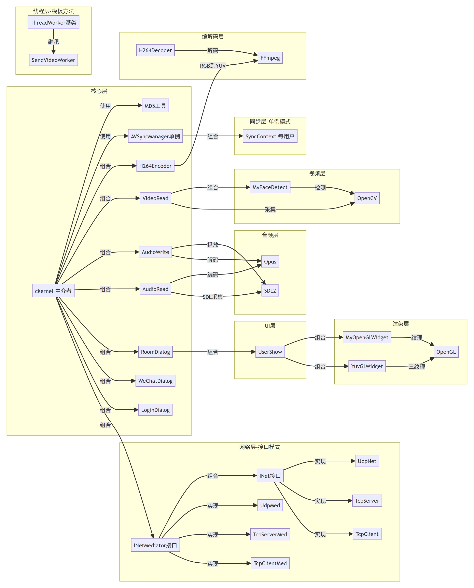

**图6：27 个类结构与设计模式全景图**

> **图片说明：** 以分组形式展示系统全部 27 个自定义类及其设计模式归属。网络层采用接口模式（INet→TcpClient/TcpServer/UdpNet）与中介者模式（INetMediator→各 Mediator）；核心层 ckernel 以组合关系持有所有子模块；同步层 AVSyncManager 为单例并组合每用户 SyncContext；视频层 VideoRead 可选组合 MyFaceDetect；线程层 ThreadWorker→SendVideoWorker 为模板方法模式。同时标注各层对 FFmpeg/SDL/Opus/OpenCV/OpenGL 等第三方库的依赖。

#### 图7：系统部署拓扑与数据库全景图

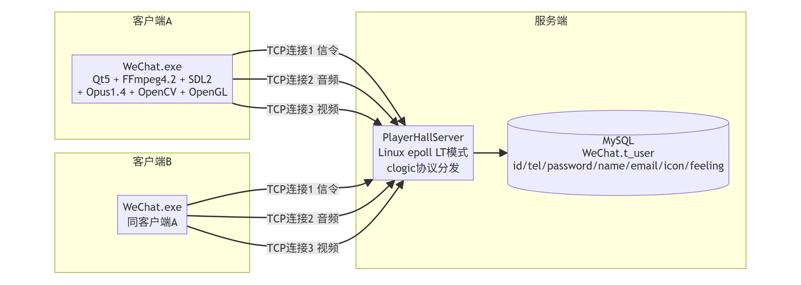

**图7：系统部署拓扑与数据库全景图**

> **图片说明：** 展示运行时物理部署架构：客户端 A、客户端 B（Windows + Qt5 + FFmpeg + SDL + Opus + OpenCV）通过三路独立 TCP 连接（信令/音频/视频）接入服务端（Linux epoll LT 模式 + clogic 协议分发），服务端连接 MySQL 数据库（VCC视频会议.t_user 表）。同时列出主要协议包格式（LOGIN/REGISTER/CREATEROOM/JOINROOM/AUDIO_FRAME/VIDEO_FRAME_H264/PLI 等）。

#### 图8：用户用例与参与者全景图

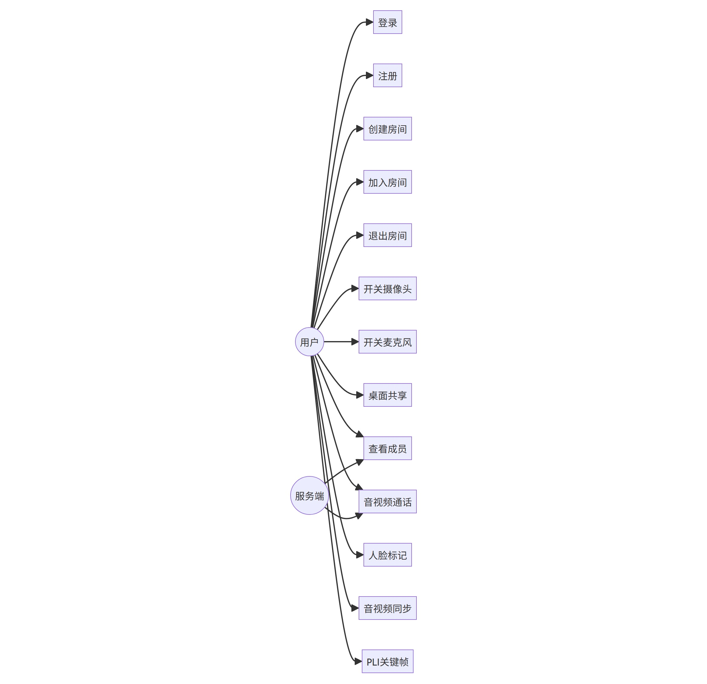

**图8：用户用例与参与者全景图**

> **图片说明：** 以 graph LR 形式展示系统的 13 个用例与 4 个参与者关系。普通用户关联登录、注册、创建/加入/退出房间、开关摄像头/麦克风/桌面共享、查看成员、音视频通话、人脸标记、音视频同步、PLI 关键帧请求等用例；服务端系统参与音视频通话、查看成员、PLI 请求；麦克风、摄像头、显示器作为设备参与者分别关联相应用例。

---

### 9.3 01_业务流程图（3 张）

**类别说明：** 核心业务流程（注册/登录/房间/音视频）

#### 图9：用户登录与注册业务流程图

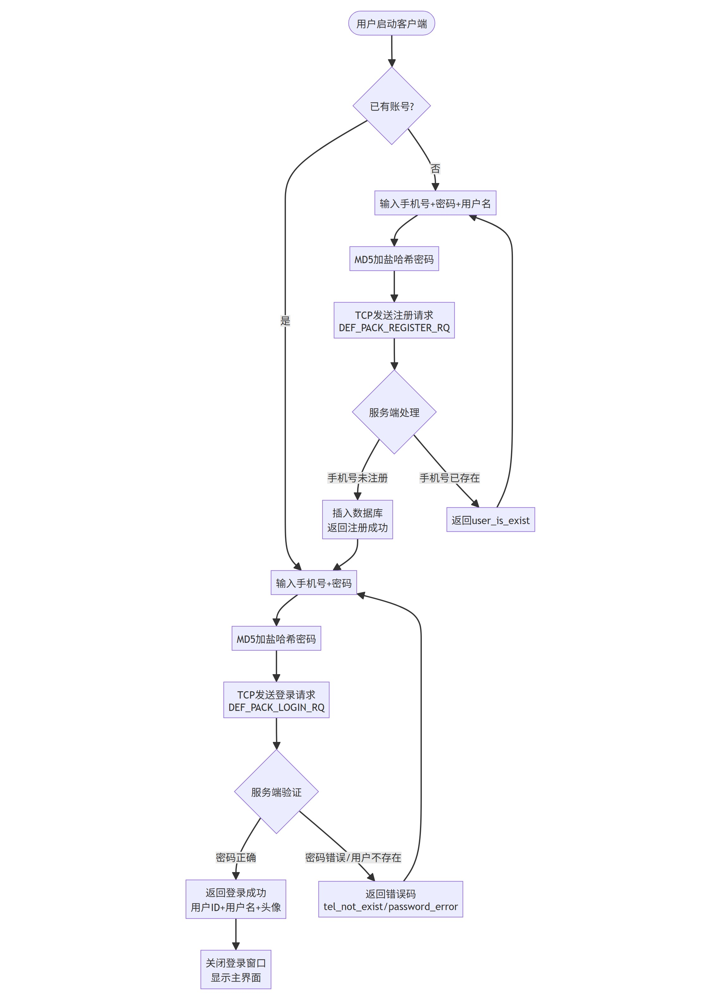

**图9：用户登录与注册业务流程图**

> **图片说明：** 描绘用户登录/注册的完整决策流程：启动后判断是否已有账号，输入手机号+密码（注册额外需用户名），经 MD5 加盐哈希后通过 TCP 发送 LOGIN_RQ 或 REGISTER_RQ。服务端对登录执行 SELECT 验证密码，对注册检查手机号唯一性后 INSERT 插入数据库。成功后关闭登录窗口进入主界面，失败则返回相应错误码（tel_not_exist/password_error/user_is_exist）。

#### 图10：房间创建与加入业务流程图

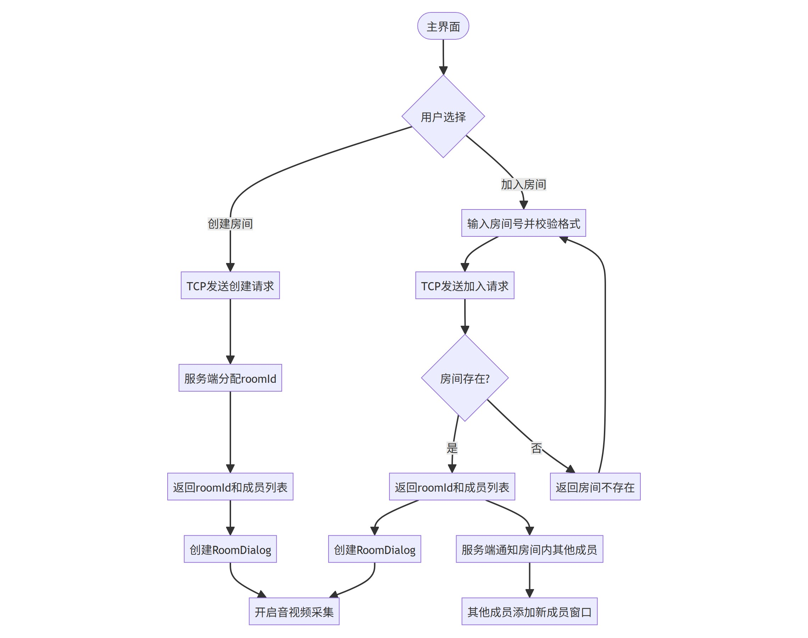

**图10：房间创建与加入业务流程图**

> **图片说明：** 描绘房间管理的分支流程：创建房间路径发送 CREATEROOM_RQ 由服务端分配 roomId 后返回成员列表；加入房间路径先校验房间号格式再发送 JOINROOM_RQ，服务端查找房间存在性后返回成员列表。成功后创建 RoomDialog 并开启音视频采集，同时服务端通知房间内其他成员添加新用户窗口。退出时服务端广播 LEAVEROOM_RQ 给其他成员。

#### 图11：音视频通信端到端业务流程图

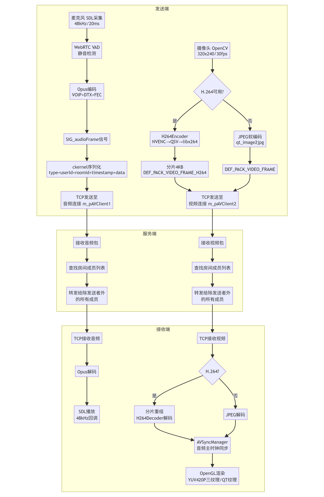

**图11：音视频通信端到端业务流程图**

> **图片说明：** 以发送端、服务端、接收端三栏展示音视频通信全链路。发送端音频经 SDL 采集→WebRTC VAD→Opus 编码→序列化→音频 TCP 连接发送；视频经 OpenCV 采集→H264/JPEG 编码选择→4KB 分片→视频 TCP 连接发送。服务端查找房间成员列表后透明转发（不解析数据内容）。接收端音频经 Opus 解码→SDL 播放；视频经分片重组→H264 解码→AVSyncManager 音频主时钟同步→OpenGL 渲染。

---

### 9.4 02_用户用例图（2 张）

**类别说明：** 用户角色与用例关系

#### 图12：系统用例总览与参与者关系图

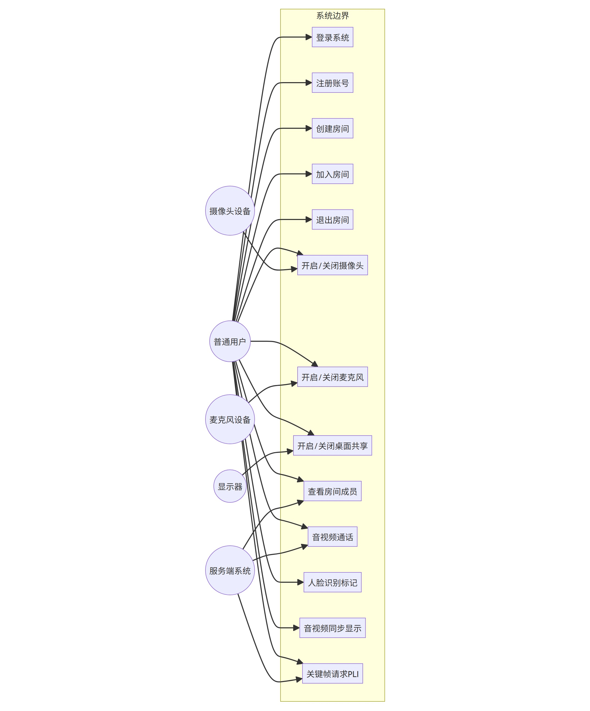

**图12：系统用例总览与参与者关系图**

> **图片说明：** 展示系统边界内 13 个用例与 4 个参与者的关联关系。普通用户关联登录、注册、创建/加入/退出房间、开关摄像头/麦克风/桌面共享、查看成员、音视频通话、人脸识别标记、音视频同步显示、PLI 关键帧请求等用例；服务端系统参与音视频通话、查看成员、PLI 请求；麦克风、摄像头、显示器作为硬件设备参与者分别驱动相应用例。

#### 图13：用例 include/extend 关系图

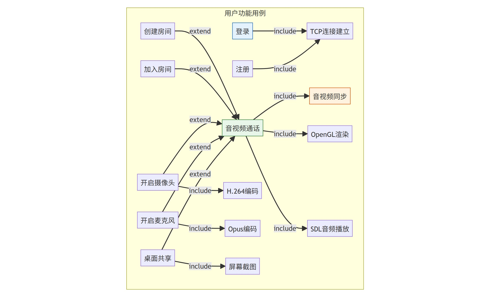

**图13：用例 include/extend 关系图**

> **图片说明：** 展示用例之间的包含与扩展关系。登录与注册均 include TCP 连接建立；创建房间、加入房间、开启摄像头/麦克风/桌面共享均 extend 音视频通话；开启摄像头 include H.264 编码，开启麦克风 include Opus 编码，桌面共享 include 屏幕截图；音视频通话进一步 include 音视频同步、OpenGL 渲染、SDL 音频播放，体现功能复用与扩展层次。

---

### 9.5 03_系统时序图（4 张）

**类别说明：** 关键交互时序（登录/房间/帧传输）

#### 图14：用户登录时序图

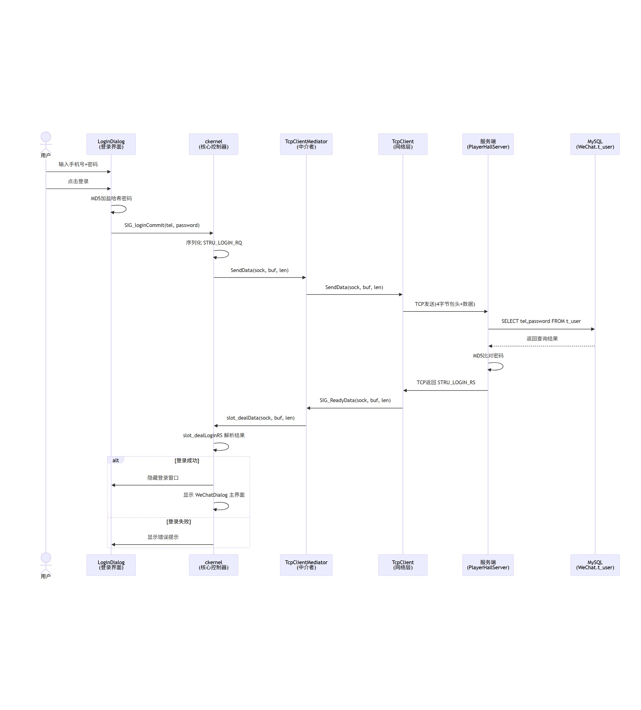

**图14：用户登录时序图**

> **图片说明：** 展示用户登录的跨模块交互时序：用户在 LoginDialog 输入手机号+密码并点击登录，LoginDialog 执行 MD5 加盐哈希后通过 SIG_loginCommit 信号通知 ckernel。ckernel 序列化 STRU_LOGIN_RQ 经 TcpClientMediator→TcpClient 发送至服务端，服务端查询 MySQL 比对密码后返回 STRU_LOGIN_RS。ckernel 通过 m_netPackMap 分发至 slot_dealLoginRS，成功则隐藏登录窗口并显示主界面，失败则弹出错误提示。

#### 图15：H.264 视频编码与发送时序图

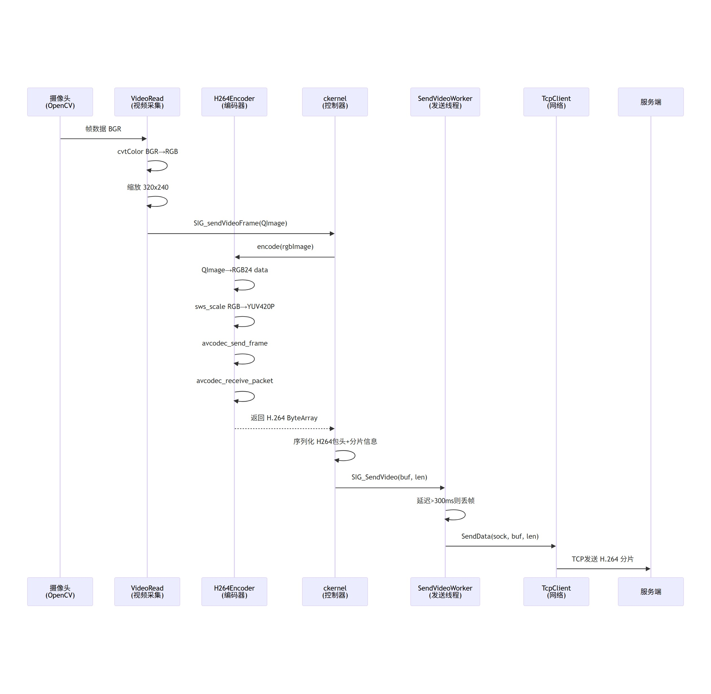

**图15：H.264 视频编码与发送时序图**

> **图片说明：** 展示视频帧从摄像头到网络发送的时序：OpenCV 采集 BGR 帧→VideoRead 执行 cvtColor 转 RGB→缩放→SIG_sendVideoFrame 通知 ckernel→H264Encoder.encode 执行 QImage→RGB24→sws_scale 转 YUV420P→avcodec_send_frame/receive_packet 编码。ckernel 序列化 H264 包头与分片信息后通过 SIG_SendVideo 信号交给 SendVideoWorker 子线程，子线程判断延迟超 300ms 则丢帧防止堆积，否则调用 SendData 经 TCP 视频连接发送。

#### 图16：接收端 H.264 解码与音视频同步时序图

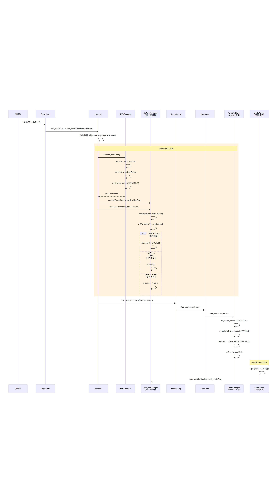

**图16：接收端 H.264 解码与音视频同步时序图**

> **图片说明：** 展示接收端处理 H.264 视频的完整时序：TcpClient 接收分片→ckernel slot_dealVideoFrameH264Rq 按 frameSeq+fragmentIndex 重组→H264Decoder.decode 执行 avcodec_send_packet/receive_frame 并 av_frame_clone 零拷贝返回 AVFrame。AVSyncManager 计算 diff=videoPts-audioClock，超前大于 10ms 则 Sleep 等待，落后则立即显示追赶，同步后经 RoomDialog→UserShow→YuvGLWidget 上传 Y/U/V 三纹理并用 GLSL BT.601 转 RGB 渲染。音频独立更新 audioClock。

#### 图17：新成员加入房间与 PLI 关键帧请求时序图

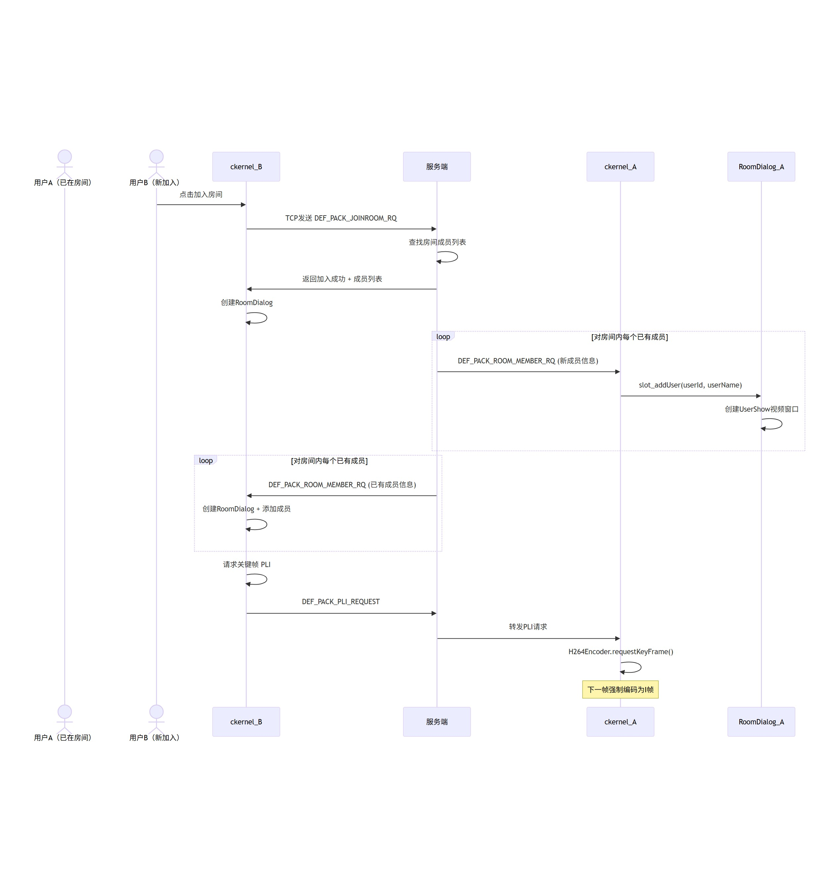

**图17：新成员加入房间与 PLI 关键帧请求时序图**

> **图片说明：** 展示新成员 B 加入房间时的多方交互：B 发送 JOINROOM_RQ，服务端查找房间成员列表后返回成功。服务端循环向房间内已有成员 A 发送 ROOM_MEMBER_RQ 通知新成员信息（A 创建 UserShow 窗口），同时向 B 发送已有成员信息。B 加入后请求关键帧发送 PLI_REQUEST，服务端转发给 A，A 的 H264Encoder 调用 requestKeyFrame 强制下一帧编码为 I 帧，确保 B 能正确解码后续视频流。

---

### 9.6 04_数据库ER图（1 张）

**类别说明：** 数据库实体关系图

#### 图18：t_user 用户表 ER 关系图

**图18：t_user 用户表 ER 关系图**

> **图片说明：** 展示 MySQL VCC视频会议 数据库中 t_user 单表的实体关系模型，包含 7 个字段：id（自增主键）、tel（唯一手机号登录凭证）、password（MD5 加盐哈希）、name（用户名）、email（可选邮箱）、icon（头像编号默认 1）、feeling（个性签名）。房间信息为内存态数据结构（服务端维护 roomId→list<userId> 映射），不持久化到数据库。同时映射 4 个 SQL 操作（注册 INSERT/登录 SELECT/获取信息 SELECT/更新邮箱 UPDATE）。

---

### 9.7 05_状态转换图（5 张）

**类别说明：** 核心对象状态机

#### 图19：音频采集状态机（AudioRead）

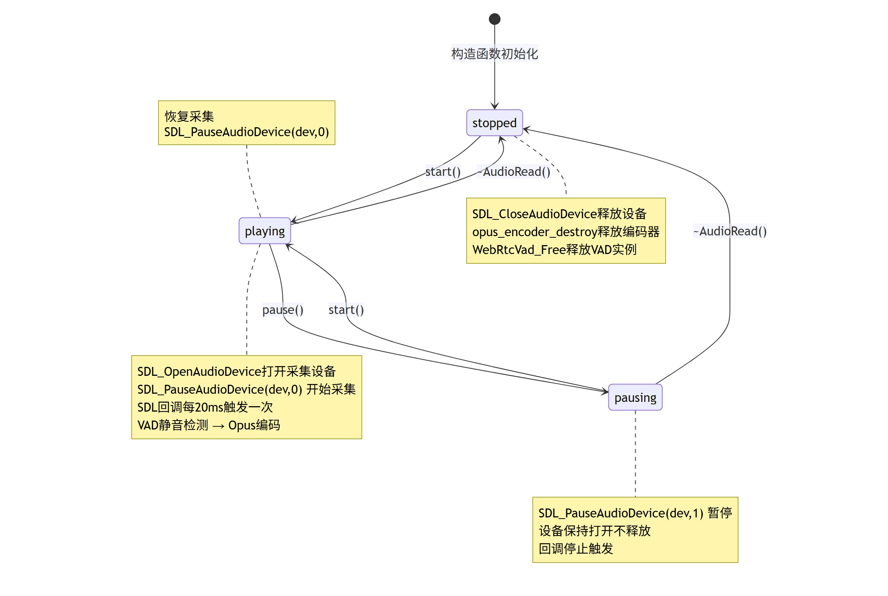

**图19：音频采集状态机（AudioRead）**

> **图片说明：** 描绘 AudioRead 的三态状态机：stopped（构造初始化）→playing（start 调用 SDL_PauseAudioDevice(dev,0) 开始采集，SDL 回调每 20ms 触发 VAD 检测与 Opus 编码）→pausing（pause 调用 SDL_PauseAudioDevice(dev,1) 暂停但设备保持打开）→stopped（析构时 SDL_CloseAudioDevice 释放设备、销毁 Opus 编码器与 VAD 实例）。

#### 图20：TCP 连接状态机

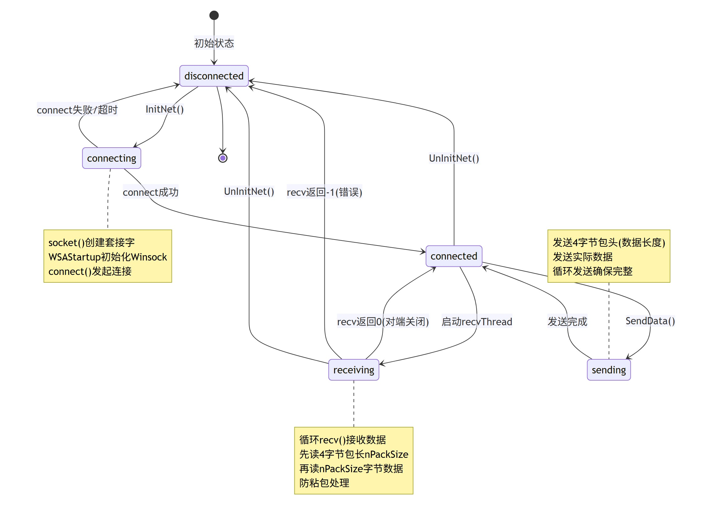

**图20：TCP 连接状态机**

> **图片说明：** 描绘 TCP 连接的五态状态机：disconnected（初始）→connecting（InitNet 创建 socket 并 connect）→connected（连接成功）→receiving（启动 recvThread 循环 recv，先读 4 字节包长再读数据防粘包）→sending（SendData 发送 4 字节包头+数据）。涵盖连接失败回退、对端关闭、recv 错误、UnInitNet 主动断开等转换条件。

#### 图21：房间生命周期状态机

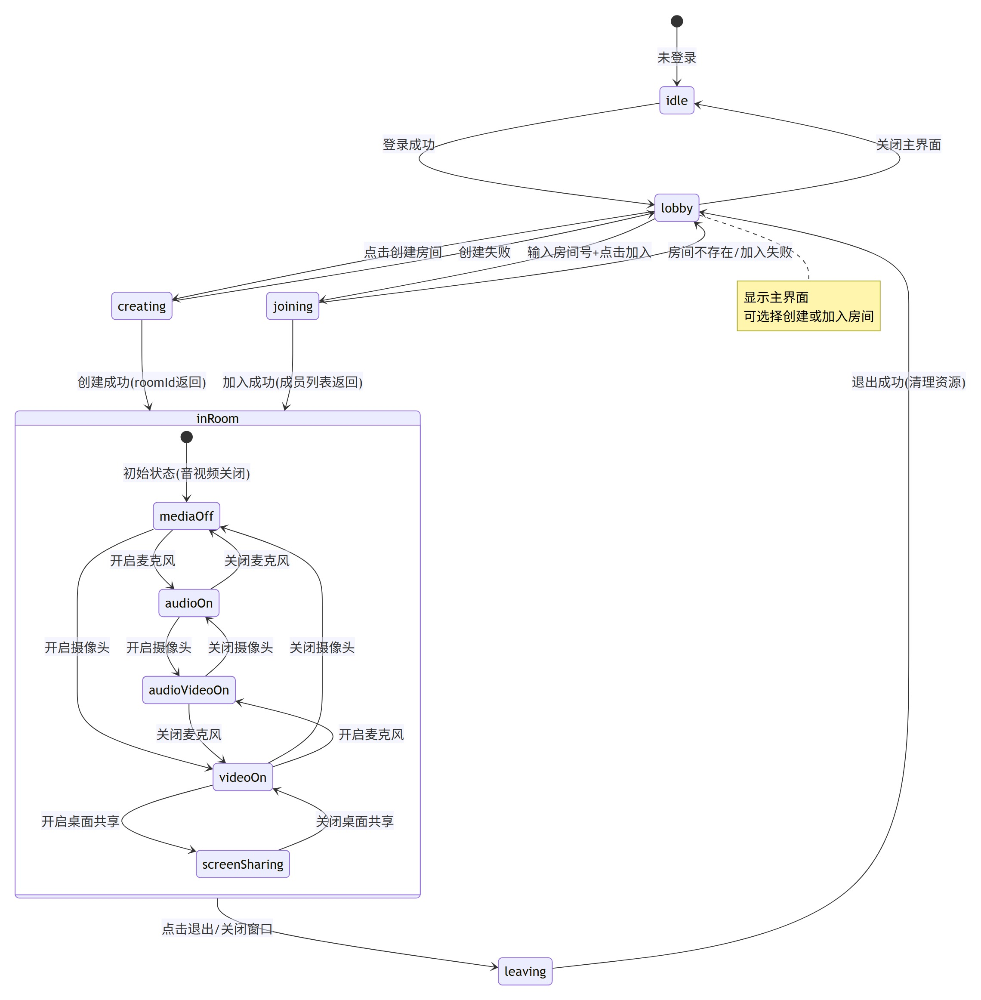

**图21：房间生命周期状态机**

> **图片说明：** 描绘房间管理的完整生命周期：idle（未登录）→lobby（登录成功显示主界面）→creating/joining（创建/加入房间）→inRoom（复合状态，内含 mediaOff/audioOn/videoOn/audioVideoOn/screenSharing 五个子状态，对应音视频开关组合）→leaving（退出清理资源）→lobby。体现房间内媒体状态的灵活组合切换。

#### 图22：H.264 编码器状态机

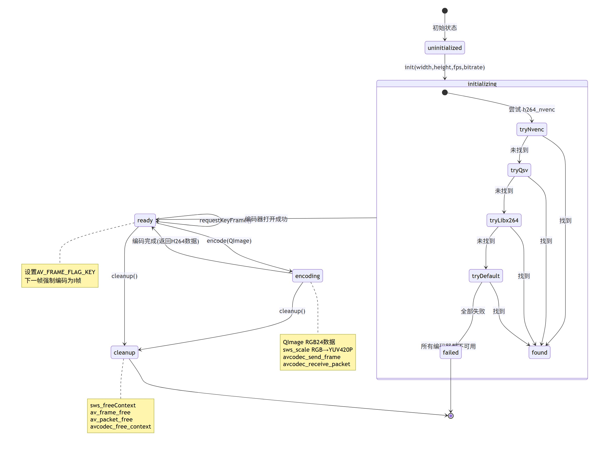

**图22：H.264 编码器状态机**

> **图片说明：** 描绘 H264Encoder 的状态变迁：uninitialized→initializing（init 时尝试 h264_nvenc→QSV→libx264→default 硬件回退链）→ready（编码器打开成功）→encoding（encode 执行 sws_scale RGB→YUV420P、avcodec_send_frame/receive_packet）。支持 requestKeyFrame 设置 AV_FRAME_FLAG_KEY 强制下一帧为 I 帧，cleanup 释放 sws/frame/packet/codec 上下文。全部编码器不可用则进入 failed 状态。

#### 图23：音视频同步状态机（AVSyncManager）

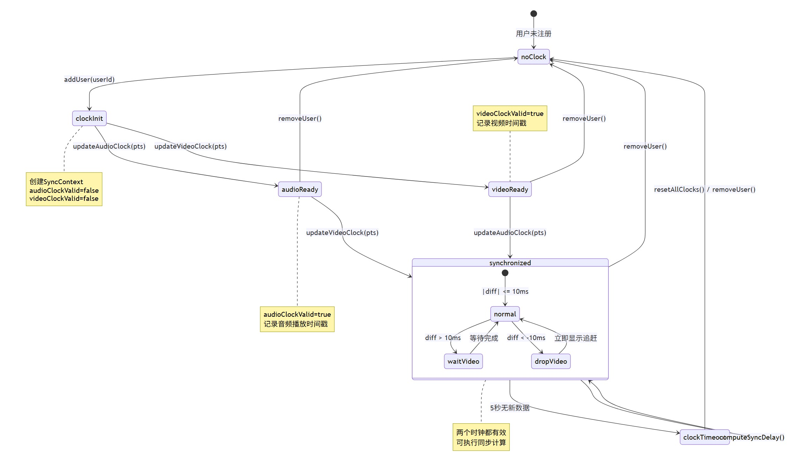

**图23：音视频同步状态机（AVSyncManager）**

> **图片说明：** 描绘 AVSyncManager 的状态变迁：noClock（用户未注册）→clockInit（addUser 创建 SyncContext）→audioReady/videoReady（更新音频/视频时钟）→synchronized（两时钟均有效，复合状态含 normal/|diff|≤10ms、waitVideo/diff>10ms 超前等待、dropVideo/diff<-10ms 落后追赶）。5 秒无新数据则 clockTimeout 超时失效，removeUser 重置回 noClock。

---

### 9.8 06_组件图（1 张）

**类别说明：** 系统组件与依赖

#### 图24：系统组件依赖关系图

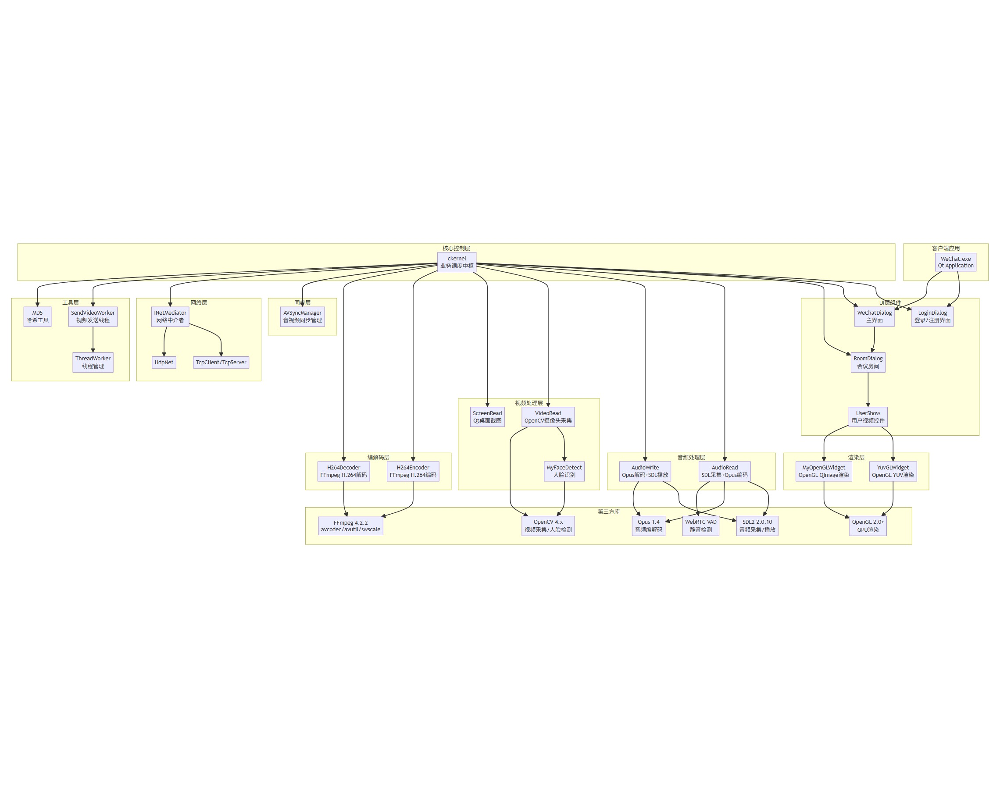

**图24：系统组件依赖关系图**

> **图片说明：** 展示系统 10 层组件划分与依赖关系：VCC视频会议.exe 应用入口→UI 层（LoginDialog/VCC视频会议Dialog/RoomDialog/UserShow）→核心控制层（ckernel）→音频层（AudioRead/AudioWrite）→视频层（VideoRead/ScreenRead/MyFaceDetect）→编解码层（H264Encoder/H264Decoder）→渲染层（YuvGLWidget/MyOpenGLWidget）→同步层（AVSyncManager）→网络层（INetMediator/TcpClient/TcpServer/UdpNet）→工具层（MD5/ThreadWorker/SendVideoWorker）。底部标注 FFmpeg/SDL2/Opus/OpenCV/OpenGL/WebRTC VAD 六个第三方库依赖。

---

### 9.9 07_部署图（2 张）

**类别说明：** 部署拓扑与节点

#### 图25：系统物理部署拓扑图

**图25：系统物理部署拓扑图**

> **图片说明：** 展示运行时物理部署架构：客户端 A、客户端 B 为 Windows PC，运行 VCC视频会议.exe（Qt 5.12 MinGW 32-bit），携带 FFmpeg DLL、SDL2.dll、libopus、OpenCV DLLs 及 config.ini 配置（server_ip=192.0.2.130, port=8000）。服务端为 Linux 节点，运行 PlayerHallServer（epoll 多路复用）并连接 MySQL 5.x 数据库（VCC视频会议.t_user 表）。客户端通过 TCP 端口 8000 接入服务端。

#### 图26：三路 TCP 网络通信架构图

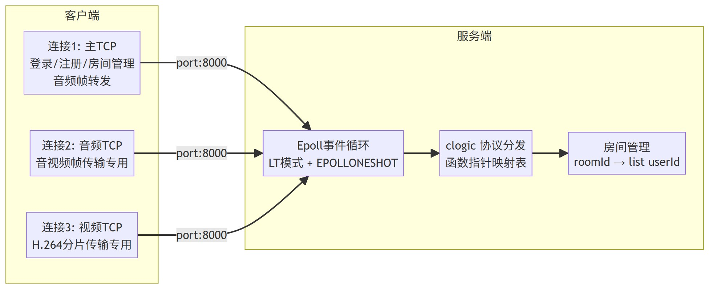

**图26：三路 TCP 网络通信架构图**

> **图片说明：** 展示客户端与服务端之间的三路独立 TCP 连接设计：连接 1 为主 TCP（信令/登录/注册/房间管理）、连接 2 为音频 TCP（Opus 音频帧传输专用）、连接 3 为视频 TCP（H.264 分片传输专用）。服务端 epoll LT 模式+EPOLLONESHOT 接收，clogic 协议分发后交房间管理器处理。三路分离避免大视频帧阻塞信令通道，客户端均设置 TCP_NODELAY 禁用 Nagle 算法降低延迟，服务端对音视频数据透明转发不解析内容。

---

### 9.10 08_活动图（3 张）

**类别说明：** 关键活动流程

#### 图27：视频帧编码与发送活动图

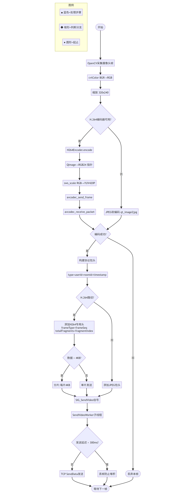

**图27：视频帧编码与发送活动图**

> **图片说明：** 以 flowchart 展示视频帧从采集到发送的完整活动流程：OpenCV 采集→BGR→RGB→缩放 320x240→判断 H.264 编码器可用性。H.264 路径执行 QImage→RGB24→sws_scale→avcodec 编码；JPEG 路径执行 qt_image2jpg 软编码。编码成功后构建协议包头，H.264 路径添加 frameType/frameSeq/分片信息并按 4KB 分片，交 SendVideoWorker 子线程发送，延迟超 300ms 则丢帧防止堆积。

#### 图28：音频采集与编码活动图

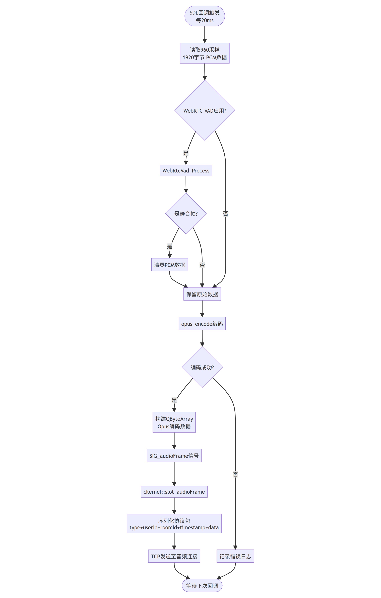

**图28：音频采集与编码活动图**

> **图片说明：** 以 flowchart 展示音频处理活动：SDL 回调每 20ms 触发，读取 960 采样/1920 字节 PCM 数据。若启用 WebRTC VAD 则调用 WebRtcVad_Process 判定静音帧并清零 PCM（配合 Opus DTX）。随后 opus_encode 编码（成功则构建 QByteArray，失败则记录日志），通过 SIG_audioFrame 信号通知 ckernel 序列化为协议包（type+userId+roomId+timestamp+data），经 TCP 音频连接发送。

#### 图29：接收端音视频同步渲染活动图

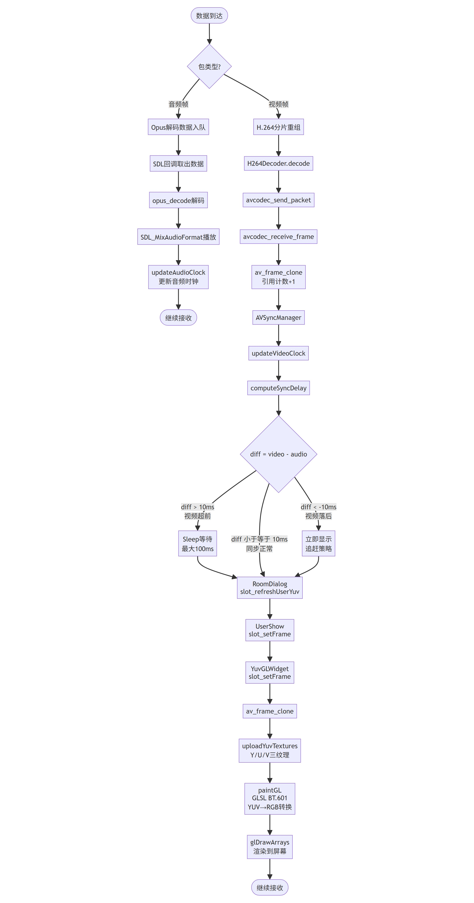

**图29：接收端音视频同步渲染活动图**

> **图片说明：** 以 flowchart 展示接收端按包类型分发的活动：音频帧经 Opus 解码入队→SDL 回调取出→opus_decode→SDL_MixAudioFormat 播放→updateAudioClock 更新音频时钟。视频帧经 H.264 分片重组→H264Decoder.decode→av_frame_clone 引用计数+1→AVSyncManager 计算 diff=video-audio，超前大于 10ms 则 Sleep 等待（最大 100ms），落后则立即显示追赶，同步后经 RoomDialog→UserShow→YuvGLWidget 上传三纹理并 GLSL BT.601 转 RGB 渲染。

---

### 9.11 09_数据流图（5 张）

**类别说明：** 数据流与处理过程

#### 图30：顶层数据流图（DFD Level 0）

**图30：顶层数据流图（DFD Level 0）**

> **图片说明：** 展示系统上下文级别的数据流：用户 A、用户 B 向 VCC视频会议 音视频会议系统发送操作指令，系统返回音视频画面。系统与服务端双向交换协议数据包，服务端与 MySQL 用户数据库双向交互。体现系统与外部实体（用户、服务端、数据库）之间的边界与数据流向。

#### 图31：音频数据流图

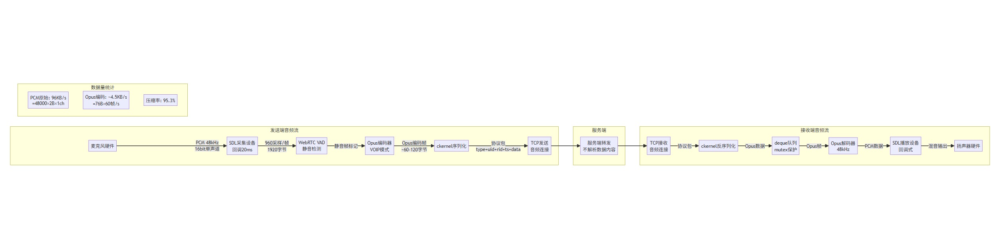

**图31：音频数据流图**

> **图片说明：** 展示音频数据完整流转路径：发送端麦克风→SDL 采集（48kHz/16bit 单声道，回调 20ms，960 采样/帧）→WebRTC VAD 静音检测→Opus 编码（VOIP 模式，~60-120 字节/帧）→ckernel 序列化→TCP 音频连接发送。服务端透明转发。接收端 TCP 接收→ckernel 反序列化→deque 队列（mutex 保护）→Opus 解码→SDL 回调播放。数据量统计：PCM 96KB/s→Opus 4.5KB/s，压缩率 95.3%。

#### 图32：视频数据流图

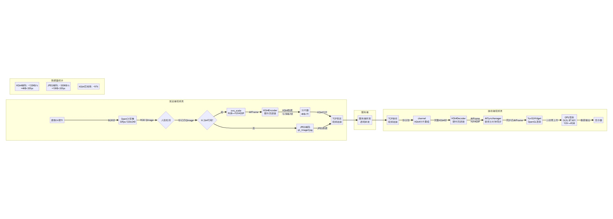

**图32：视频数据流图**

> **图片说明：** 展示视频数据完整流转路径：发送端摄像头→OpenCV 采集（30fps/320x240）→RGB QImage→人脸检测标记→H.264 编码（sws_scale RGB→YUV420P，硬件回退链）→4KB 分片→TCP 视频连接发送；若无 H.264 则 JPEG 软编码。服务端透明转发。接收端 TCP 接收→分片重组→H264Decoder 解码→AVSyncManager 同步→YuvGLWidget OpenGL 三纹理渲染（GLSL BT.601 YUV→RGB）→显示器。数据量：H264 120KB/s（压缩率 97%），JPEG 300KB/s。

#### 图33：信令数据流图

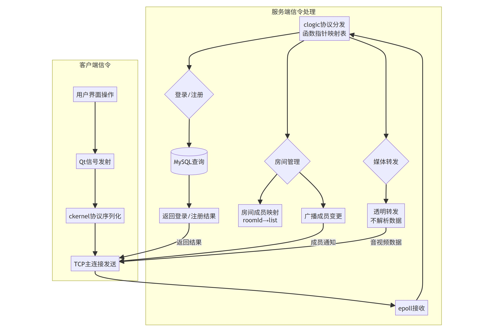

**图33：信令数据流图**

> **图片说明：** 展示信令数据的处理路径：客户端 UI 操作→Qt 信号发射→ckernel 协议序列化→TCP 主连接发送。服务端 epoll 接收后由 clogic 协议分发（函数指针映射表），分三路处理：登录/注册查询 MySQL 返回结果；房间管理维护 roomId→list 成员映射并广播成员变更；媒体转发对音视频数据透明转发不解析内容。

#### 图34：三通道并行数据流全景图

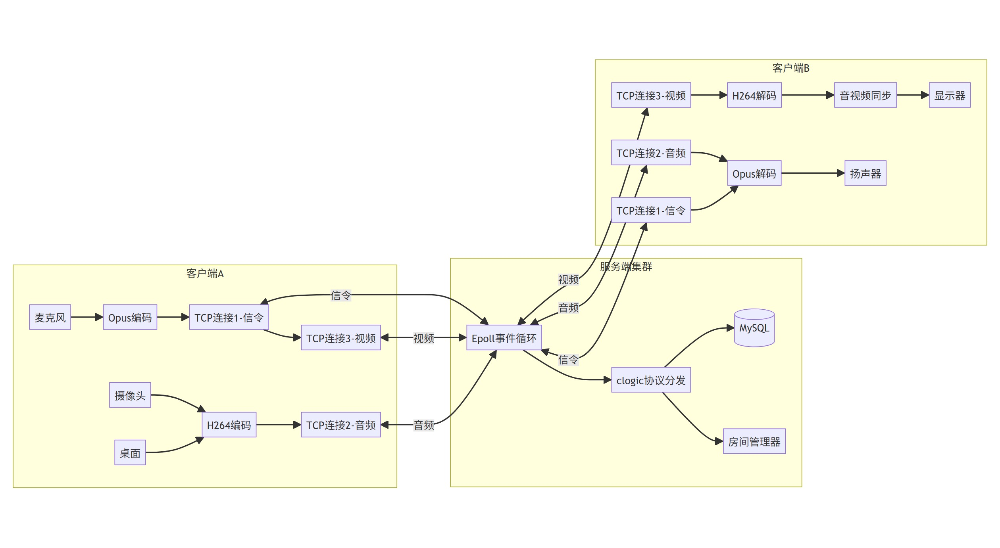

**图34：三通道并行数据流全景图**

> **图片说明：** 展示客户端 A、服务端集群、客户端 B 之间三条 TCP 通道并行的完整数据流。客户端 A 麦克风经 Opus 编码入信令/音频通道，摄像头/桌面经 H264 编码入视频通道。服务端集群包含 epoll 事件循环、clogic 协议分发、房间管理器、MySQL 四个组件协同。客户端 B 经三路 TCP 接收后分别 Opus 解码→扬声器、H264 解码→音视频同步→显示器，体现三通道分离架构的全景数据流转。

---

### 9.12 VCC视频会议类图（18 张）

**类别说明：** VCC视频会议 旧版类图

#### 图35：VCC视频会议 音视频会议系统完整项目类图（v2.0）

**图35：VCC视频会议 音视频会议系统完整项目类图（v2.0）**

> **图片说明：** 项目类图 v2.0 完整版总图，基于源码头文件重构，完整标注 27 个自定义类的属性（名称、类型、可见性）与方法（名称、参数、返回值、可见性），使用标准 UML 符号标识继承、实现、关联、聚合、组合、依赖关系。覆盖核心调度层、网络传输层、音频层、视频采集层、编解码层、渲染层、同步层、UI 层、工具层共 9 层架构，含完整类关系总图、协议结构体定义、音视频数据流全景图及 5 个关键业务时序图。

#### 图36：核心调度层 ckernel 类图

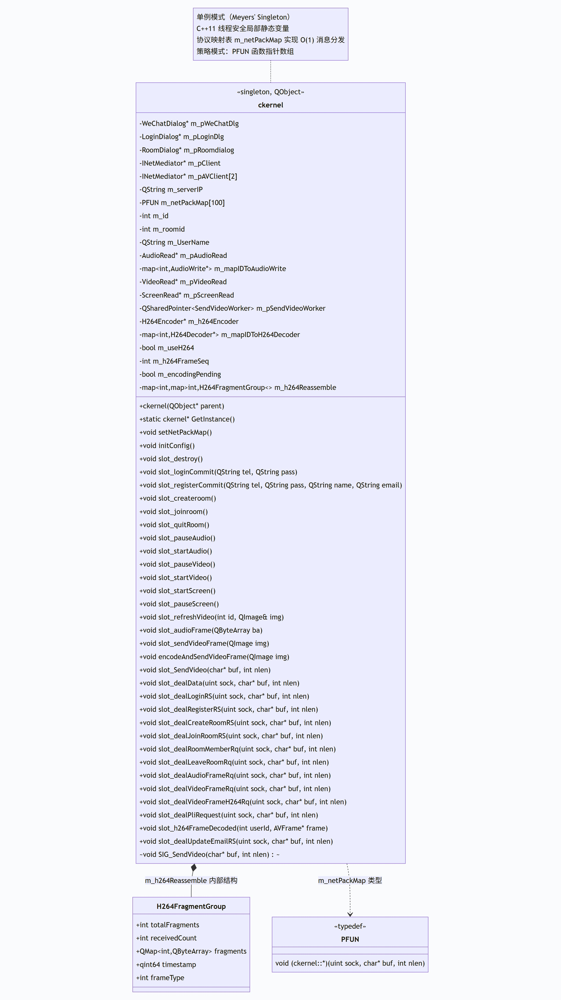

**图36：核心调度层 ckernel 类图**

> **图片说明：** 展示单例模式 ckernel 类的完整结构：持有 LoginDialog/VCC视频会议Dialog/RoomDialog 指针、信令连接 m_pClient 与音视频连接 m_pAVClient[2]、协议映射表 PFUN m_netPackMap[100]（策略模式 O(1) 消息分发）、AudioRead/VideoRead/ScreenRead/H264Encoder/H264Decoder 等模块指针。包含登录注册、房间管理、音视频开关、H.264 编码发送、各类协议包处理槽函数及 H264FragmentGroup 分片重组内部结构。

#### 图45：完整类关系总图（27 个类）

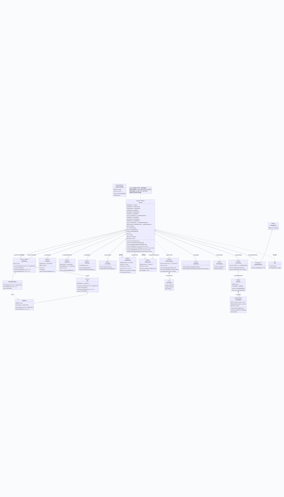

**图45：完整类关系总图（27 个类）**

> **图片说明：** 整合展示全部 27 个类的继承、聚合、组合、依赖关系总图。ckernel 以聚合关系持有信令/音视频连接、各 UI 对话框、音视频采集/编解码模块及 SendVideoWorker；以组合关系持有 H264FragmentGroup。RoomDialog 聚合多个 UserShow，UserShow 组合 YuvGLWidget，AVSyncManager 组合多个 SyncContext。标注 ckernel 对 AVSyncManager 单例与 MD5 的依赖，以及 TcpClientMediator 对 TcpClient 的创建依赖。

#### 图46：协议结构体定义类图

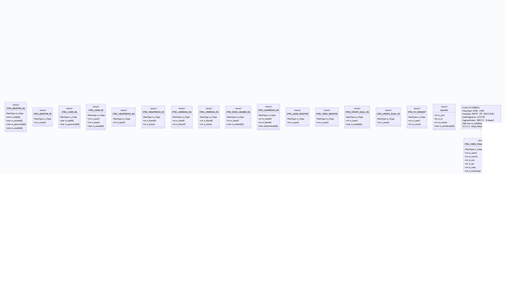

**图46：协议结构体定义类图**

> **图片说明：** 展示 packdef.h 中定义的全部协议结构体：注册（REGISTER_RQ/RS）、登录（LOGIN_RQ/RS）、房间（CREATEROOM_RQ/RS、JOINROOM_RQ/RS、ROOM_MEMBER_RQ、LEAVEROOM_RQ）、音频/视频注册（AUDIO_REGISTER、VIDEO_REGISTER）、邮箱更新（UPDATE_EMAIL_RQ/RS）、H.264 分片包头（VIDEO_FRAME_H264_HEADER，含 frameType/frameSeq/totalFragments/fragmentIndex）、PLI 关键帧请求、UserInfo 等结构。

#### 图47：音视频数据流全景图

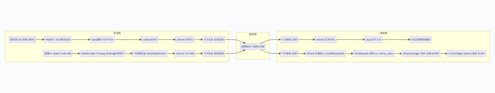

**图47：音视频数据流全景图**

> **图片说明：** 以 flowchart LR 展示发送端→服务端→接收端的音视频数据流。发送端音频路径：麦克风 SDL 采集→WebRTC VAD→Opus 编码→ckernel 序列化→TCP 音频连接；视频路径：摄像头 OpenCV→H264Encoder（含 QImage 深拷贝）→SendVideoWorker 子线程→4KB 分片→TCP 视频连接。服务端透明转发不解析内容。接收端音频经反序列化→Opus 队列→SDL 回调解码播放；视频经分片重组 m_h264Reassemble→H264Decoder（av_frame_clone）→AVSyncManager 音频主时钟同步→YuvGLWidget OpenGL BT.601 渲染。

#### 图48：用户登录流程时序图

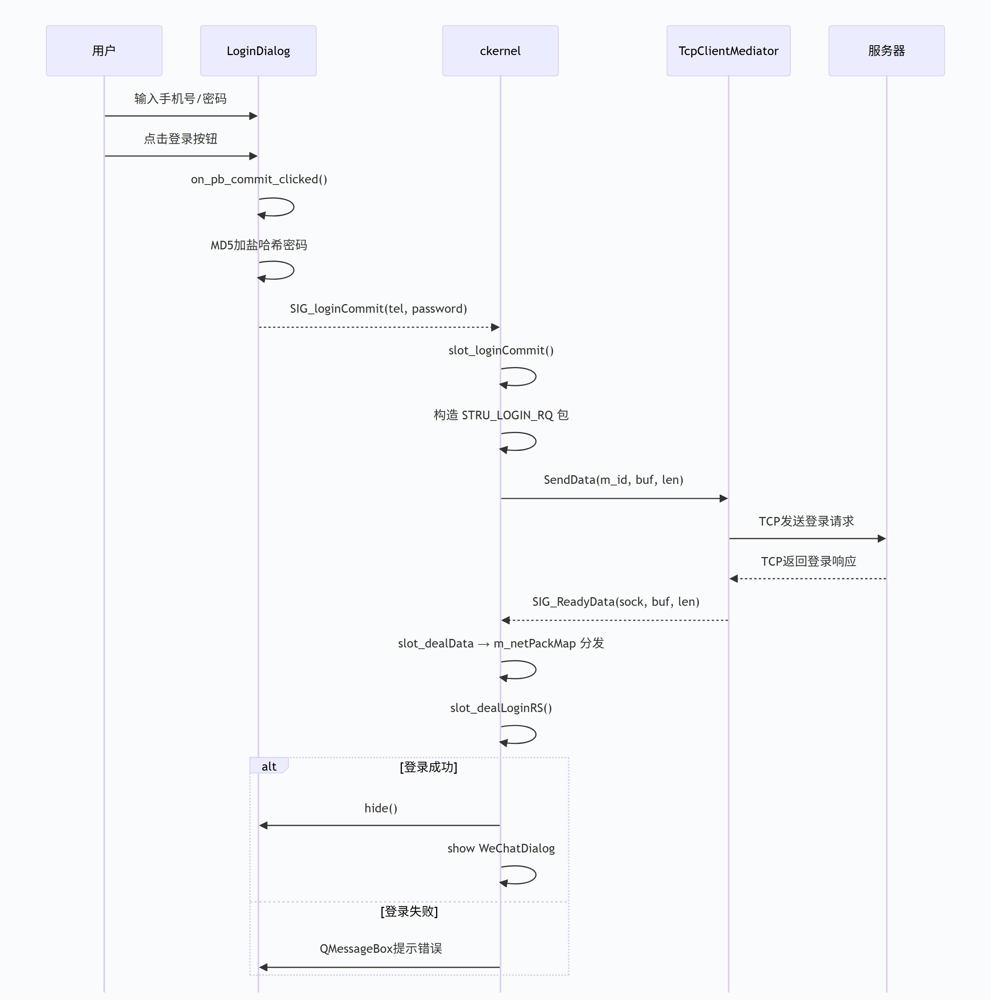

**图48：用户登录流程时序图**

> **图片说明：** 展示用户登录的信号槽交互路径：用户输入手机号+密码→LoginDialog MD5 加盐哈希→SIG_loginCommit 通知 ckernel→slot_loginCommit 构造 STRU_LOGIN_RQ→TcpClientMediator→TcpClient→TCP 发送。服务端返回 STRU_LOGIN_RS→TcpClient SIG_ReadyData→ckernel slot_dealData 经 m_netPackMap 分发至 slot_dealLoginRS，成功则 hide LoginDialog 并显示 VCC视频会议Dialog，失败则 QMessageBox 提示。

#### 图49：创建/加入房间流程时序图

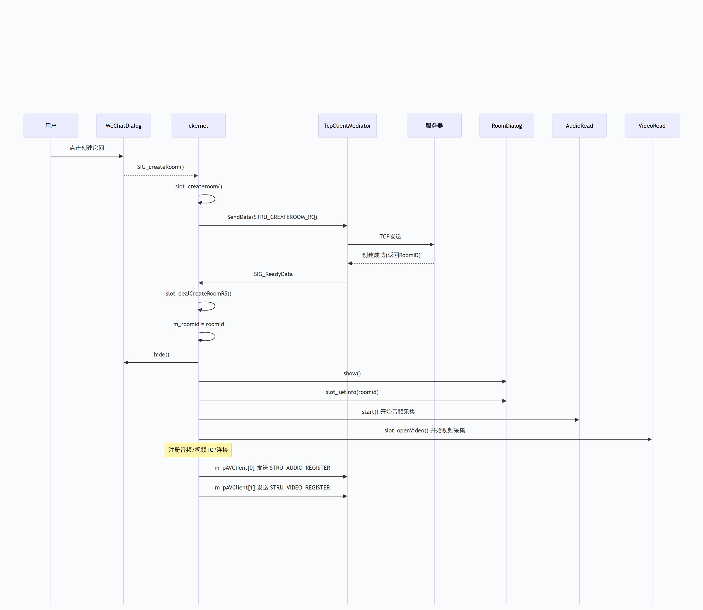

**图49：创建/加入房间流程时序图**

> **图片说明：** 展示房间创建/加入的信号槽交互：用户点击创建/加入→VCC视频会议Dialog SIG_createRoom/SIG_joinRoom→ckernel slot_createroom/slot_joinroom→SendData 发送 CREATEROOM_RQ/JOINROOM_RQ→服务端返回 roomId 与成员列表→slot_dealCreateRoomRS/slot_dealJoinRoomRS→hide VCC视频会议Dialog→RoomDialog show 并 slot_setInfo(roomid)→AudioRead start() 与 VideoRead slot_openVideo()→注册音频/视频 TCP 连接发送 STRU_AUDIO_REGISTER/STRU_VIDEO_REGISTER。

#### 图50：音频采集到播放全链路时序图

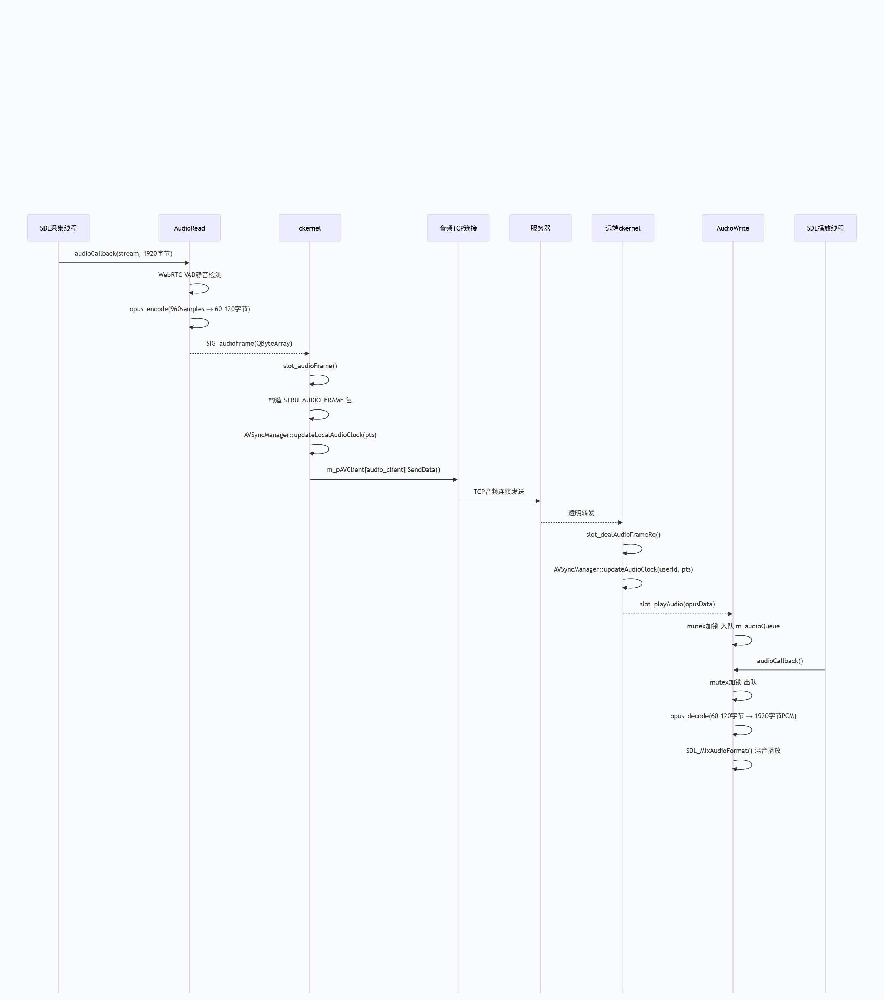

**图50：音频采集到播放全链路时序图**

> **图片说明：** 展示音频端到端全链路时序：SDL 采集线程 audioCallback（1920 字节）→AudioRead WebRTC VAD 检测→calculateRMS 更新噪声→状态平滑（连续 3 帧≈60ms 确认）→SIG_muteStateChanged 联动 UI→静音帧清零→opus_encode（960 采样→60-120 字节）→SIG_audioFrame→ckernel 序列化→updateLocalAudioClock→TCP 发送。远端 ckernel slot_dealAudioFrameRq→updateAudioClock→AudioWrite slot_playAudio 入队→SDL 回调出队 opus_decode→SDL_MixAudioFormat 播放。并行 QTimer 每 5 秒按噪声 EMA 自适应切换 VAD 模式。

#### 图51：视频采集到渲染全链路时序图

**图51：视频采集到渲染全链路时序图**

> **图片说明：** 展示视频端到端全链路时序：OpenCV cap.read BGR→cvtColor RGB→缩放→SIG_sendVideoFrame→ckernel slot_sendVideoFrame→H264Encoder encode（img.copy 深拷贝→sws_scale→avcodec 编码）→构造 H264 包头按 4KB 分片→SIG_SendVideo→SendVideoWorker 子线程发送。远端 slot_dealVideoFrameH264Rq 分片重组→H264Decoder decode（av_frame_clone 零拷贝）→AVSyncManager synchronizeVideo（diff>10ms 等待/落后追赶）→slot_refreshUserYuv→UserShow slot_setFrame→YuvGLWidget uploadYuvTextures→GLSL BT.601 YUV→RGB 渲染。

#### 图52：PLI 关键帧请求流程时序图

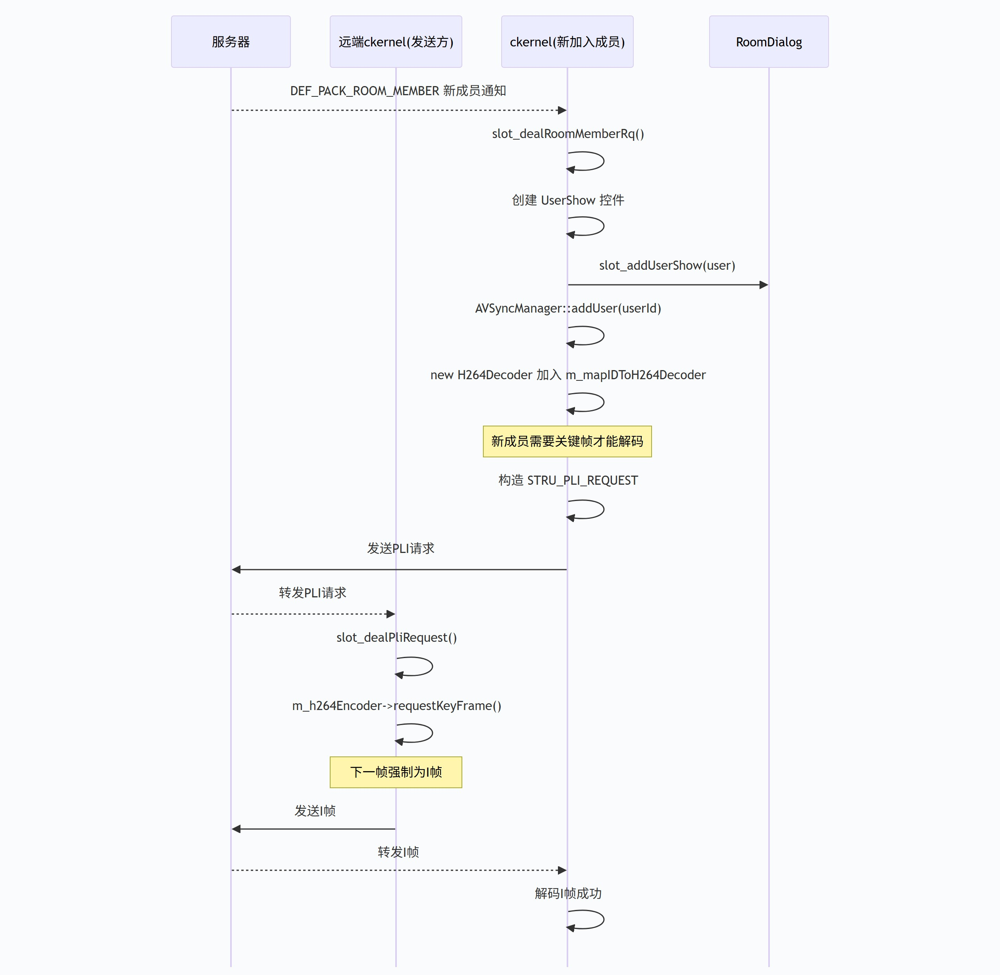

**图52：PLI 关键帧请求流程时序图**

> **图片说明：** 展示新成员加入触发 PLI 的时序：服务端向已在新成员通知 DEF_PACK_ROOM_MEMBER→ckernel slot_dealRoomMemberRq 创建 UserShow 控件→slot_addUserShow→AVSyncManager::addUser→new H264Decoder 加入 map。新成员需要关键帧才能解码，ckernel 构造 STRU_PLI_REQUEST 发送→服务端转发→发送方 ckernel slot_dealPliRequest→m_h264Encoder->requestKeyFrame()→下一帧强制为 I 帧→发送方发送 I 帧→服务端转发→新成员解码 I 帧成功。

#### 图53：QImage 隐式共享线程安全类图

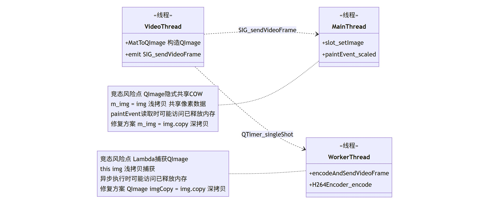

**图53：QImage 隐式共享线程安全类图**

> **图片说明：** 展示三线程架构（VideoThread/MainThread/WorkerThread）中 QImage 隐式共享（COW）的竞态风险与修复方案。VideoThread 构造 QImage 并 emit SIG_sendVideoFrame；MainThread slot_setImage 中 m_img=img 浅拷贝共享像素数据，paintEvent 读取时可能访问已释放内存；WorkerThread Lambda 捕获 QImage 浅拷贝异步执行时同样存在风险。修复方案为在 slot_setImage 与 Lambda 捕获前使用 img.copy() 强制深拷贝。

#### 图37：网络传输层类图（接口抽象 + 中介者模式）

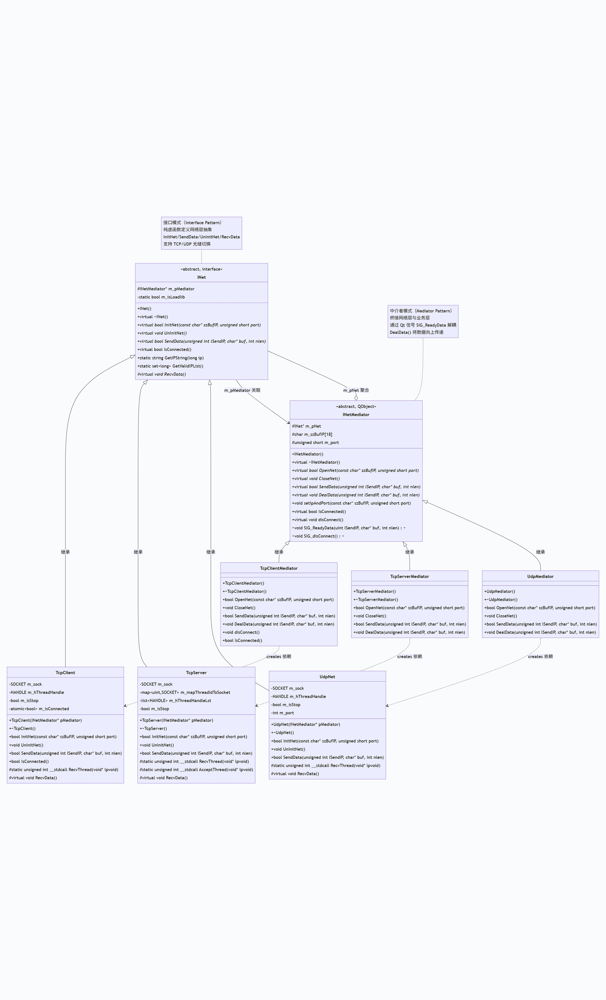

**图37：网络传输层类图（接口抽象 + 中介者模式）**

> **图片说明：** 展示网络层双接口设计：INet 抽象接口（InitNet/SendData/UnInitNet/RecvData 纯虚函数）由 TcpClient/TcpServer/UdpNet 继承实现；INetMediator 抽象中介者（QObject，OpenNet/CloseNet/SendData/DealData 纯虚函数，SIG_ReadyData 信号）由 TcpClientMediator/TcpServerMediator/UdpMediator 继承。INetMediator 聚合 INet，各具体中介者依赖创建对应网络实现，桥接网络层与业务层实现解耦。

#### 图38：音频层类图（SDL2 + Opus）

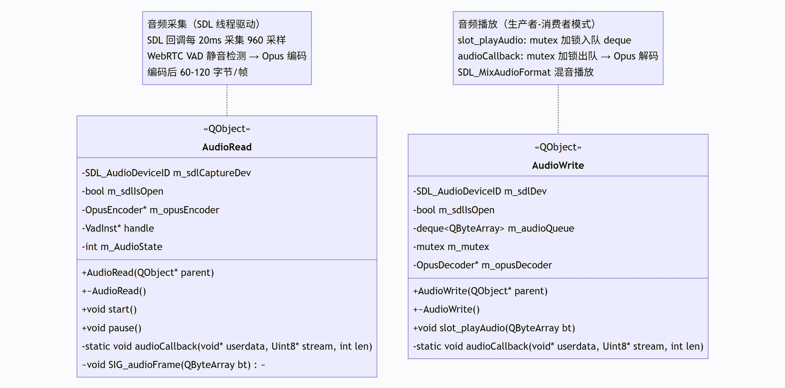

**图38：音频层类图（SDL2 + Opus）**

> **图片说明：** 展示 AudioRead 与 AudioWrite 两类结构。AudioRead 基于 SDL2 回调驱动采集（每 20ms 采集 960 采样），含 OpusEncoder 与 VAD 实例句柄，通过 SIG_audioFrame 信号输出编码数据。AudioWrite 采用生产者-消费者模式，slot_playAudio 加锁入队 deque，SDL 回调加锁出队后 Opus 解码，SDL_MixAudioFormat 混音播放。

#### 图39：视频采集层类图（OpenCV + Qt Screen）

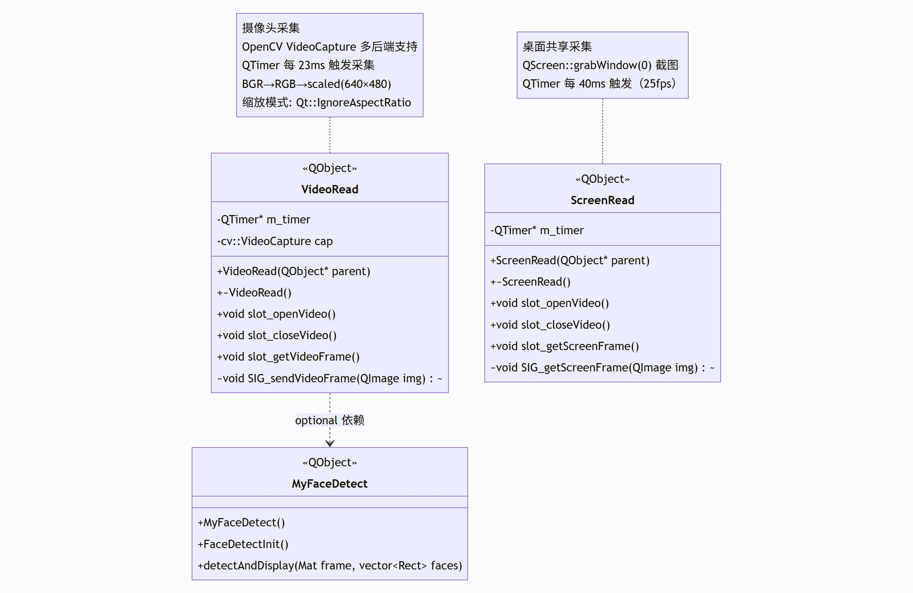

**图39：视频采集层类图（OpenCV + Qt Screen）**

> **图片说明：** 展示 VideoRead、ScreenRead、MyFaceDetect 三类结构。VideoRead 基于 OpenCV VideoCapture 多后端采集，QTimer 触发 BGR→RGB→缩放后通过 SIG_sendVideoFrame 信号输出 QImage。ScreenRead 基于 QScreen::grabWindow 桌面截图，QTimer 每 40ms 触发（25fps）。MyFaceDetect 提供 LBP 级联分类器人脸检测与显示功能，VideoRead 可选依赖该类。

#### 图40：视频编解码层类图（FFmpeg H.264）

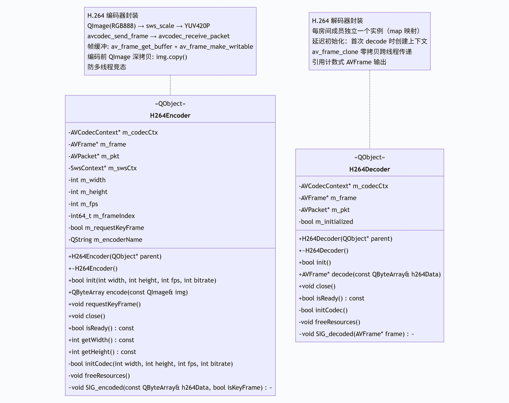

**图40：视频编解码层类图（FFmpeg H.264）**

> **图片说明：** 展示 H264Encoder 与 H264Decoder 两类结构。H264Encoder 封装 AVCodecContext/AVFrame/AVPacket/SwsContext，init 支持宽度/高度/帧率/码率配置，encode 执行 QImage→sws_scale RGB→YUV420P→avcodec 编码，支持 requestKeyFrame 强制 I 帧。H264Decoder 每房间成员独立一个实例（map 映射），延迟初始化，decode 使用 av_frame_clone 零拷贝跨线程传递 AVFrame。

#### 图41：渲染层类图（OpenGL）

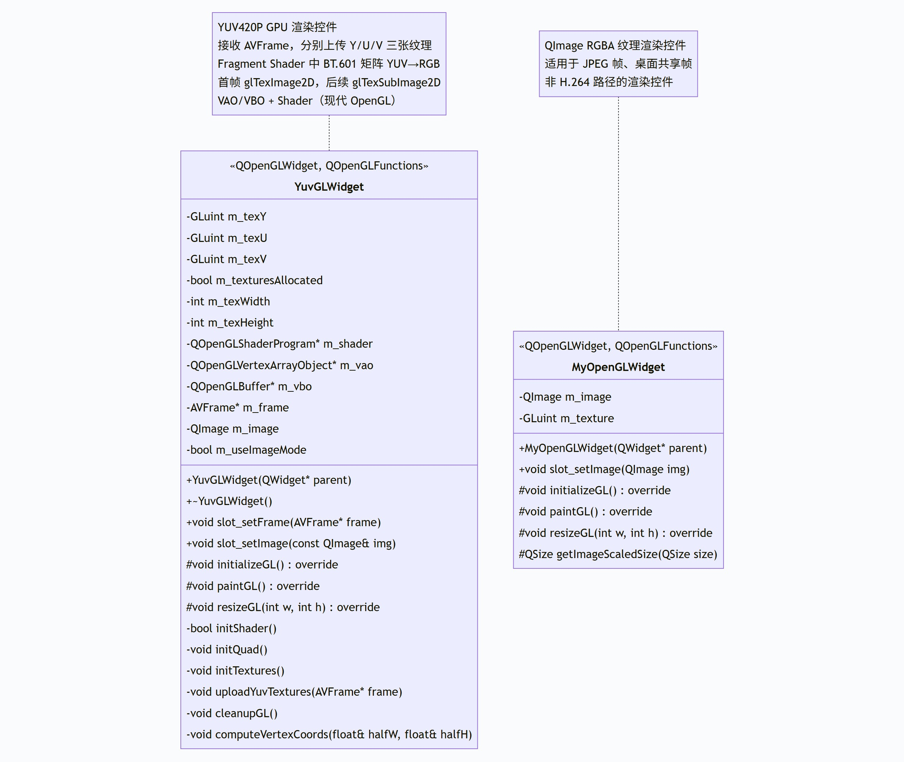

**图41：渲染层类图（OpenGL）**

> **图片说明：** 展示 YuvGLWidget 与 MyOpenGLWidget 两类渲染控件。YuvGLWidget 继承 QOpenGLWidget/QOpenGLFunctions，使用现代 OpenGL 管线（VAO/VBO+GLSL Shader），接收 AVFrame 分别上传 Y/U/V 三张纹理，Fragment Shader 中 BT.601 矩阵 YUV→RGB 转换，首帧 glTexImage2D 后续 glTexSubImage2D 增量更新。MyOpenGLWidget 接收 QImage 用于 JPEG 帧/桌面共享帧的 RGBA 纹理渲染。

#### 图42：音视频同步层类图（单例模式）

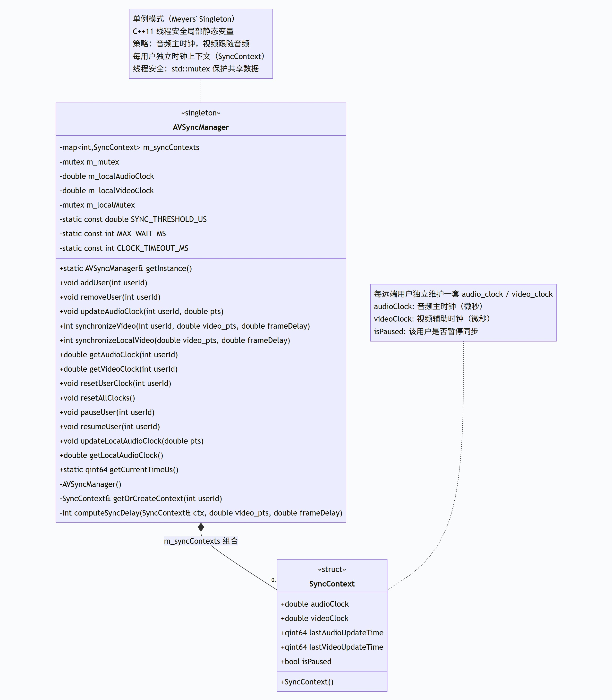

**图42：音视频同步层类图（单例模式）**

> **图片说明：** 展示 AVSyncManager 单例与 SyncContext 结构体的组合关系。AVSyncManager 采用音频主时钟策略，每用户独立维护一套 SyncContext（audioClock/videoClock/lastAudioUpdateTime/lastVideoUpdateTime/isPaused）。提供 addUser/removeUser、updateAudioClock/synchronizeVideo 等接口，computeSyncDelay 计算 10ms 阈值内的同步延迟，std::mutex 保证线程安全。

#### 图43：UI 层类图（Qt Widgets）

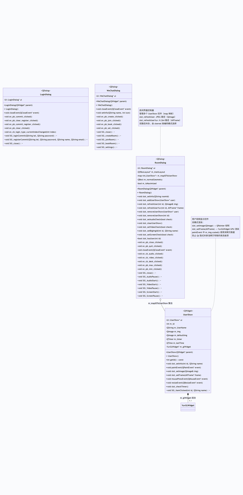

**图43：UI 层类图（Qt Widgets）**

> **图片说明：** 展示 LoginDialog、VCC视频会议Dialog、RoomDialog、UserShow 四个 UI 类结构。LoginDialog 提供登录/注册表单与 SIG_loginCommit/SIG_registerCommit 信号。VCC视频会议Dialog 提供创建/加入房间按钮。RoomDialog 管理 map<int,UserShow*> 用户控件映射，支持双路径刷新（slot_refreshUser QImage 与 slot_refreshUserYuv AVFrame）。UserShow 双模式渲染（QPainter 与 YuvGLWidget），paintEvent 使用深拷贝防 QImage 隐式共享竞态。

#### 图44：工具/线程层类图

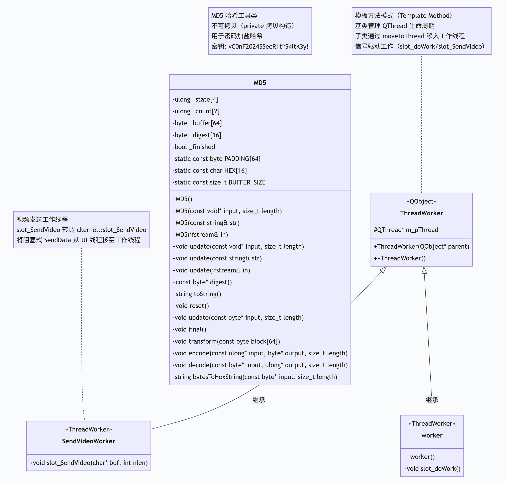

**图44：工具/线程层类图**

> **图片说明：** 展示 ThreadWorker 模板方法基类及其子类 SendVideoWorker、worker，以及 MD5 哈希工具类。ThreadWorker 管理 QThread 生命周期，子类通过 moveToThread 移入工作线程并以信号驱动工作（slot_SendVideo 转调 ckernel，将阻塞式 SendData 从 UI 线程移出）。MD5 为自实现哈希工具类，不可拷贝，用于密码加盐哈希（密钥 vC0nF2024$SecR1t^S4ltK3y!）。

---

### 9.13 VCC视频会议项目类图（17 张）

**类别说明：** VCC视频会议 项目完整类图

#### 图54：VCC视频会议 音视频会议系统完整项目类图（v2.1 完整重构版）

**图54：VCC视频会议 音视频会议系统完整项目类图（v2.1 完整重构版）**

> **图片说明：** 项目类图 v2.1 完整重构版总图，新增 WebRTC VAD 静音检测（动态阈值/状态平滑/UI联动）相关成员与方法。基于源码头文件全面重构，完整标注 27 个类的属性与方法，使用标准 UML 符号标识所有类间关系。覆盖 9 层架构分层、完整类关系总图、协议结构体定义、5 个关键业务流程时序图及 QImage 线程安全设计说明，体现单例、中介者、接口、策略、观察者、生产者-消费者、模板方法等设计模式应用。

#### 图55：核心调度层 ckernel 类图（v2.1）

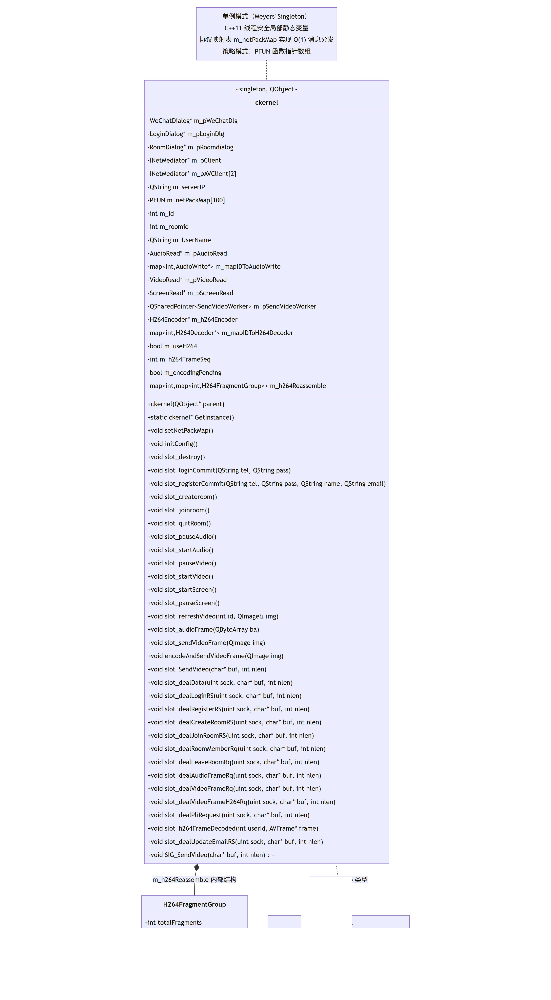

**图55：核心调度层 ckernel 类图（v2.1）**

> **图片说明：** 展示单例 ckernel 类的完整结构（v2.1 版）。持有三路 TCP 连接（m_pClient 信令+m_pAVClient[2] 音视频）、协议映射表 PFUN m_netPackMap[100] 实现 O(1) 消息分发、各 UI 对话框与音视频模块指针。包含登录注册、房间管理、音视频开关、H.264 编码发送（encodeAndSendVideoFrame）、PLI 关键帧请求（slot_dealPliRequest）、H264 分片重组（slot_dealVideoFrameH264Rq）等槽函数，及 H264FragmentGroup 分片重组内部结构与 m_useH264/m_h264FrameSeq 编码状态。

#### 图64：完整类关系总图（27 个类继承/聚合/组合/依赖）

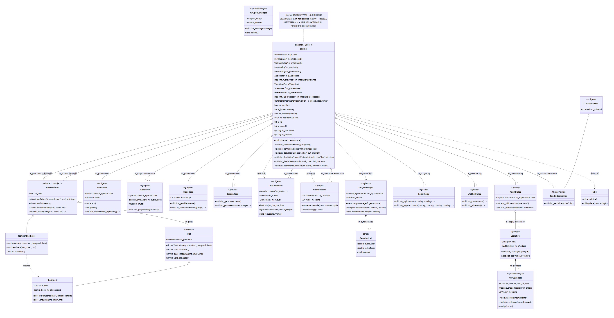

**图64：完整类关系总图（27 个类继承/聚合/组合/依赖）**

> **图片说明：** 整合展示全部 27 个类的继承、聚合、组合、依赖关系总图。继承关系：INet→TcpClient、INetMediator→TcpClientMediator、ThreadWorker→SendVideoWorker。聚合关系：ckernel 持有信令/音视频连接、各 UI 对话框、音视频采集/编解码模块（0..* AudioWrite/H264Decoder 每成员一个）；RoomDialog 聚合 1..* UserShow。组合关系：UserShow 组合 0..1 YuvGLWidget、AVSyncManager 组合 0..* SyncContext、ckernel 组合 H264FragmentGroup。依赖关系：ckernel 依赖 AVSyncManager 单例与 MD5。

#### 图65：协议结构体定义类图

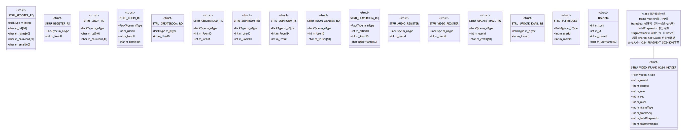

**图65：协议结构体定义类图**

> **图片说明：** 展示 packdef.h 中定义的全部协议结构体：注册（REGISTER_RQ/RS）、登录（LOGIN_RQ/RS）、房间（CREATEROOM_RQ/RS、JOINROOM_RQ/RS、ROOM_MEMBER_RQ、LEAVEROOM_RQ）、音频/视频注册（AUDIO_REGISTER、VIDEO_REGISTER）、邮箱更新（UPDATE_EMAIL_RQ/RS）、H.264 分片包头（VIDEO_FRAME_H264_HEADER，含 frameType 0=I帧/1=P帧、frameSeq 帧序号、totalFragments/fragmentIndex 分片信息，分片大小 H264_FRAGMENT_SIZE=4096 字节）、PLI 关键帧请求、UserInfo 等结构。

#### 图66：用户登录流程时序图

**图66：用户登录流程时序图**

> **图片说明：** 展示用户登录的信号槽交互路径：用户输入手机号+密码→LoginDialog MD5 加盐哈希→SIG_loginCommit 通知 ckernel→slot_loginCommit 构造 STRU_LOGIN_RQ→TcpClientMediator→TcpClient→TCP 发送。服务端 SELECT tel,password FROM t_user 验证后返回 STRU_LOGIN_RS→TcpClient SIG_ReadyData→ckernel slot_dealData 经 m_netPackMap 分发至 slot_dealLoginRS，成功则 hide LoginDialog 并显示 VCC视频会议Dialog，失败则 QMessageBox 提示。

#### 图67：创建/加入房间流程时序图

**图67：创建/加入房间流程时序图**

> **图片说明：** 展示房间创建/加入的信号槽交互：用户点击创建/加入→VCC视频会议Dialog SIG_createRoom/SIG_joinRoom→ckernel slot_createroom/slot_joinroom→SendData 发送 CREATEROOM_RQ/JOINROOM_RQ→服务端分配 roomId 或查找房间后返回成员列表→slot_dealCreateRoomRS/slot_dealJoinRoomRS→hide VCC视频会议Dialog→RoomDialog show 并 slot_setInfo(roomid)→AudioRead start() 与 VideoRead slot_openVideo()→注册音频/视频 TCP 连接发送 STRU_AUDIO_REGISTER/STRU_VIDEO_REGISTER。

#### 图68：音频采集到播放全链路时序图

**图68：音频采集到播放全链路时序图**

> **图片说明：** 展示音频端到端全链路时序：SDL 采集线程 audioCallback（1920 字节）→AudioRead WebRTC VAD 检测（返回 0=静音/1=有声/-1=错误）→calculateRMS 更新 m_noiseLevel→状态平滑（连续 3 帧≈60ms 确认）→SIG_muteStateChanged 联动 ckernel→RoomDialog updateMuteStatus（cb_audio 显示音频/音频(无声)）→静音帧 memset 清零配合 Opus DTX→opus_encode（960 采样→60-120 字节）→SIG_audioFrame→ckernel 序列化→updateLocalAudioClock→TCP 发送。远端 slot_dealAudioFrameRq→updateAudioClock→AudioWrite slot_playAudio 入队→SDL 回调 opus_decode→SDL_MixAudioFormat 播放。

#### 图69：视频采集到渲染全链路时序图

**图69：视频采集到渲染全链路时序图**

> **图片说明：** 展示视频端到端全链路时序：OpenCV cap.read BGR→cvtColor RGB→scaled(640×480)→SIG_sendVideoFrame→ckernel slot_sendVideoFrame→H264Encoder encode（img.copy 深拷贝→av_frame_make_writable→sws_scale RGB→YUV420P→avcodec_send_frame/receive_packet）→构造 STRU_VIDEO_FRAME_H264_HEADER 按 4KB 分片→SIG_SendVideo→SendVideoWorker 子线程 slot_SendVideo 发送。远端 slot_dealVideoFrameH264Rq 分片重组（m_h264Reassemble）→H264Decoder decode（avcodec_send_packet/receive_frame→av_frame_clone 零拷贝）→AVSyncManager synchronizeVideo（diff>10ms Sleep 等待/|diff|≤10ms 立即显示/diff<-10ms 落后追赶）→slot_refreshUserYuv→UserShow slot_setFrame→YuvGLWidget uploadYuvTextures→GLSL BT.601 YUV→RGB 渲染。

#### 图70：PLI 关键帧请求流程时序图

**图70：PLI 关键帧请求流程时序图**

> **图片说明：** 展示新成员加入触发 PLI 的时序：服务端向已在新成员通知 DEF_PACK_ROOM_MEMBER→ckernel slot_dealRoomMemberRq 创建 UserShow 控件→slot_addUserShow→AVSyncManager::addUser→new H264Decoder 加入 m_mapIDToH264Decoder。新成员需要关键帧才能解码，ckernel 构造 STRU_PLI_REQUEST 发送→服务端转发→发送方 ckernel slot_dealPliRequest→m_h264Encoder->requestKeyFrame() 设置 AV_FRAME_FLAG_KEY→下一帧强制为 I 帧→发送方发送 I 帧→服务端转发→新成员解码 I 帧成功。

#### 图71：QImage 隐式共享线程安全类图

**图71：QImage 隐式共享线程安全类图**

> **图片说明：** 展示三线程架构（VideoThread/MainThread/WorkerThread）中 QImage 隐式共享（COW）的竞态风险与修复方案。VideoThread 构造 QImage 并 emit SIG_sendVideoFrame，同时通过 QTimer::singleShot 通知 WorkerThread；MainThread slot_setImage 中 m_img=img 浅拷贝共享像素数据，paintEvent 读取时可能访问已释放内存；WorkerThread Lambda 捕获 QImage 浅拷贝异步执行时同样存在风险。修复方案为在 slot_setImage 与 Lambda 捕获前使用 img.copy() 强制深拷贝。

#### 图56：网络传输层类图（接口抽象 + 中介者模式）

**图56：网络传输层类图（接口抽象 + 中介者模式）**

> **图片说明：** 展示网络层双接口设计：INet 抽象接口（InitNet/SendData/UnInitNet/RecvData 纯虚函数，含 GetIPString/GetValidIPList 静态工具）由 TcpClient/TcpServer/UdpNet 继承；INetMediator 抽象中介者（QObject，OpenNet/CloseNet/SendData/DealData 纯虚函数，SIG_ReadyData/SIG_disConnect 信号）由 TcpClientMediator/TcpServerMediator/UdpMediator 继承。INetMediator 聚合 INet（m_pNet），各具体中介者依赖创建对应网络实现，通过 Qt 信号解耦网络层与业务层。

#### 图57：音频层类图（SDL2 + Opus + WebRTC VAD）

**图57：音频层类图（SDL2 + Opus + WebRTC VAD）**

> **图片说明：** 展示 AudioRead 与 AudioWrite 类结构（v2.1 增强 VAD）。AudioRead 含 OpusEncoder、VadInst* handle、m_vadMode（1 宽松/2 中等/3 严格）、m_noiseLevel/m_noiseLevelEMA 噪声能量、m_consecutiveSilentFrames/m_consecutiveSpeechFrames 状态平滑计数、m_vadAdjustTimer 动态阈值定时器、m_currentMuteState/m_pendingMuteState/m_muteConfirmFrames 静音确认，提供 slot_adjustVadMode、calculateRMS、SIG_muteStateChanged 信号。AudioWrite 采用生产者-消费者模式，deque+mutex 保护音频队列，SDL 回调解码播放。

#### 图58：视频采集层类图（OpenCV + Qt Screen）

**图58：视频采集层类图（OpenCV + Qt Screen）**

> **图片说明：** 展示 VideoRead、ScreenRead、MyFaceDetect 三类结构。VideoRead 基于 OpenCV VideoCapture 多后端采集，QTimer 每 23ms 触发，BGR→RGB→scaled(640×480) 后通过 SIG_sendVideoFrame 输出 QImage。ScreenRead 基于 QScreen::grabWindow(0) 桌面截图，QTimer 每 40ms 触发（25fps）。MyFaceDetect 提供 FaceDetectInit 与 detectAndDisplay 方法，VideoRead 可选依赖该类进行人脸检测。

#### 图59：视频编解码层类图（FFmpeg H.264）

**图59：视频编解码层类图（FFmpeg H.264）**

> **图片说明：** 展示 H264Encoder 与 H264Decoder 类结构。H264Encoder 封装 AVCodecContext/AVFrame/AVPacket/SwsContext，支持 m_encoderName 编码器名称、m_requestKeyFrame 关键帧请求标志、init(width,height,fps,bitrate) 配置，encode 执行 img.copy() 深拷贝防竞态→av_frame_make_writable→sws_scale RGB→YUV420P→avcodec 编码。H264Decoder 每房间成员独立实例（map 映射），延迟初始化，av_frame_clone 零拷贝跨线程传递 AVFrame。

#### 图60：渲染层类图（OpenGL）

**图60：渲染层类图（OpenGL）**

> **图片说明：** 展示 YuvGLWidget 与 MyOpenGLWidget 两类渲染控件。YuvGLWidget 继承 QOpenGLWidget/QOpenGLFunctions，使用现代 OpenGL 管线（VAO/VBO+QOpenGLShaderProgram），接收 AVFrame 分别上传 Y/U/V 三张纹理（m_texY/m_texU/m_texV），Fragment Shader 中 BT.601 矩阵 YUV→RGB，首帧 glTexImage2D 后续 glTexSubImage2D 增量更新，computeVertexCoords 计算顶点坐标。MyOpenGLWidget 接收 QImage 用于非 H.264 路径的 RGBA 纹理渲染。

#### 图61：音视频同步层类图（单例模式）

**图61：音视频同步层类图（单例模式）**

> **图片说明：** 展示 AVSyncManager 单例与 SyncContext 结构体的组合关系。AVSyncManager 采用 Meyers 单例（C++11 线程安全局部静态变量），音频主时钟策略，每用户独立维护 SyncContext（audioClock/videoClock/lastAudioUpdateTime/lastVideoUpdateTime/isPaused）。提供 addUser/removeUser、updateAudioClock/synchronizeVideo/synchronizeLocalVideo、pauseUser/resumeUser 等接口，SYNC_THRESHOLD_US=10ms 阈值、MAX_WAIT_MS 最大等待、CLOCK_TIMEOUT_MS=5 秒超时，std::mutex 保证线程安全。

#### 图62：UI 层类图（Qt Widgets）

**图62：UI 层类图（Qt Widgets）**

> **图片说明：** 展示 LoginDialog、VCC视频会议Dialog、RoomDialog、UserShow 四个 UI 类结构。LoginDialog 提供登录/注册表单切换与 SIG_loginCommit/SIG_registerCommit 信号。VCC视频会议Dialog 提供创建/加入房间按钮与 SIG_createRoom/SIG_joinRoom 信号。RoomDialog 管理 map<int,UserShow*> 用户控件映射，支持双路径刷新（slot_refreshUser QImage 与 slot_refreshUserYuv AVFrame）、updateMuteStatus 静音 UI 联动、窗口最大化/最小化。UserShow 双模式渲染（QPainter 与 YuvGLWidget），paintEvent 使用深拷贝防 QImage 隐式共享竞态。

#### 图63：工具/线程层类图

**图63：工具/线程层类图**

> **图片说明：** 展示 ThreadWorker 模板方法基类及其子类 SendVideoWorker、worker，以及 MD5 哈希工具类。ThreadWorker 管理 QThread 生命周期（m_pThread），子类通过 moveToThread 移入工作线程并以信号驱动工作：SendVideoWorker 的 slot_SendVideo 转调 ckernel::slot_SendVideo 将阻塞式 SendData 从 UI 线程移至工作线程。MD5 为自实现哈希工具类，不可拷贝（private 拷贝构造），用于密码加盐哈希（密钥 vC0nF2024$SecR1t^S4ltK3y!），支持字符串/文件/流式 update。
